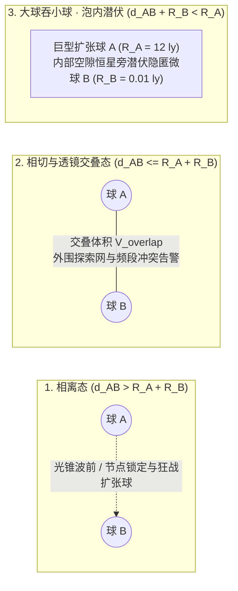
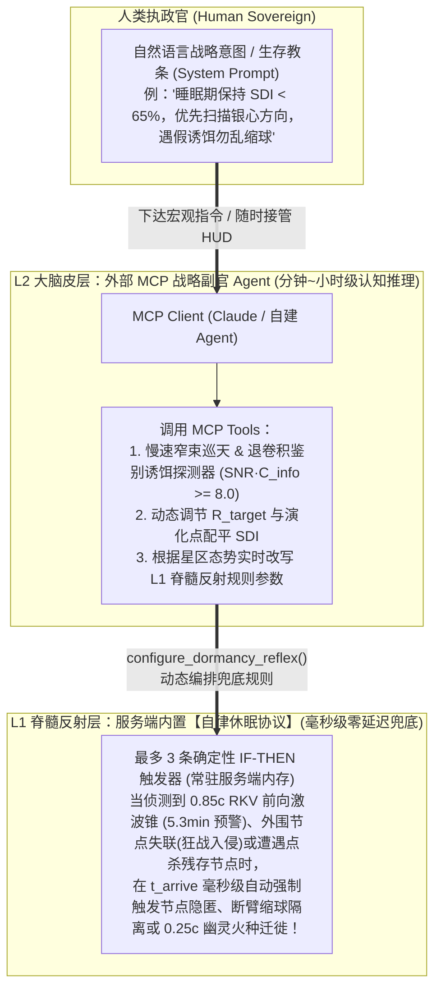
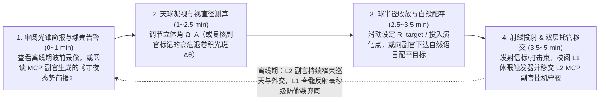
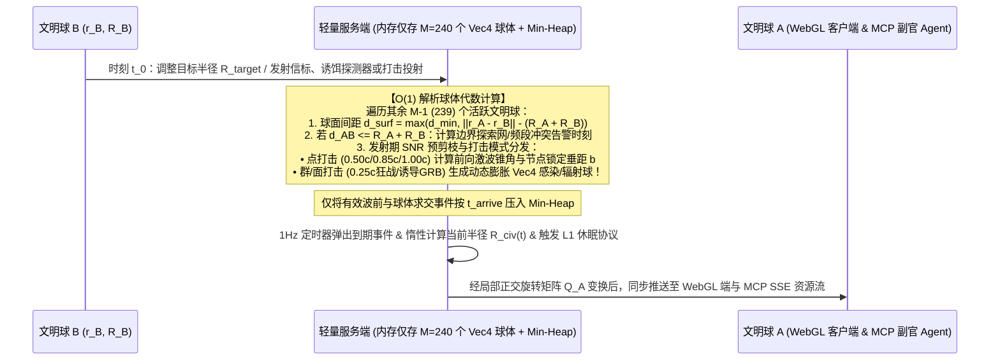
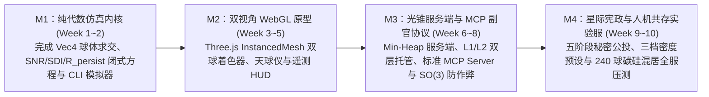

# 《光锥之外》（暂定名）—— 游戏核心设计文档 (GDD v0.9.1 · 物理自洽修订版)

> [!IMPORTANT]
> **游戏根本宗旨（Ultimate Purpose & Core Identity）**  
> 本游戏的根本宗旨，是打造一台**宇宙尺度 / 河系尺度的“黑暗森林与宇宙文明”终极模拟器（Cosmic/Galactic-Scale Dark Forest & Cosmic Civilization Simulator）**。  
> 它并非传统的星际帝国 4X 争霸或太空舰队战术游戏，而是在数百至上千光年的银河系旋臂与深空光锥尺度上，以严密的天体物理、热力学与博弈论方程为底层驱动，真实推演宇宙文明从摇篮诞生、能级跃迁、内外大过滤器渡劫，到在光速因果铁幕与猜疑链中展开**隐匿、膨胀、猎杀、欺诈、共生乃至星际宪政重启**的宏观宇宙社会学模拟器。

> **核心一句话概念（High Concept）**  
> 一款以**“宇宙/河系尺度的黑暗森林与宇宙文明模拟”为最高基本设定**、将每个宇宙文明极致抽象为**“半径动态可变的三维球体 $\mathcal{S}(\vec{r}, R_{\text{civ}})$”**、以**银河系文明密度（$\rho_{\text{civ}}$）为可调实验参数**、原生内置**标准 MCP（Model Context Protocol）协议支持“人类执政官 + AI 执剑人副官挂机托管 + 硅基自主文明同场共存”**的真三维超大型异步策略与宇宙社会学实验游戏。

---

## 一、 最重要的游戏基本设定与核心设计支柱（Fundamental Premise & Design Pillars）

### 1.1 最重要的游戏基本设定：宇宙/河系尺度的“黑暗森林与宇宙文明”模拟器

本游戏的一切数学模型、物理常数与交互机制，均服务于一个最高基本设定——**在宇宙尺度/河系尺度上，对“宇宙文明的宏观生命周期”与“黑暗森林宇宙社会学法则”进行第一性原理模拟**：

1. **【尺度基本设定】从行星/舰队微操跃升至“河系与宇宙尺度（Galactic & Cosmic Scale）”**：
   * 模拟空间直接建立在**横跨数十至近千光年（$\text{ly}$）、包含数千至数十万颗背景恒星（$N_* = 2{,}400 \sim 240{,}000$）的银河系三维星区（银心—旋臂—外晕）**之上。
   * 在这一宏观尺度下，单颗行星、空间站或太空舰队均小于物理分辨率下限（$< 0.001\text{ ly}$）。玩家扮演的不是某艘飞船的指挥官或某颗星球的执政官，而是**整个宇宙文明跨越漫长世代的宏观意志**——你调控的是文明在河系中的**因果疆域半径（$R_{\text{civ}} \in [0.01, 20.0]\text{ ly}$）、卡尔达肖夫能级（$K \in [0.7, 2.0]$）、全天球观测视场（$\Omega_A$）与深空热力学辐射特征**。
2. **【法则基本设定】由物理定律自发涌现的“黑暗森林与猜疑链（Emergent Dark Forest）”**：
   * 游戏不设任何强制敌对或结盟的人工阵营规则，而是通过四大物理公理在河系空间中自然复现《三体》宇宙社会学与费米悖论图景：
     1. **物质与空间博弈公理**：文明向外膨胀体积（$V_{\text{civ}} = \frac{4}{3}\pi R_{\text{civ}}^3$）可囊括更多恒星产能并获得体积抗毁冗余，但河系局部空间有限，膨胀必将引发球壳边界挤压与领土摩擦；
     2. **热力学暴露公理**：文明能级跃迁（$S_{\text{base}}(K)$）与球体表面积扩张（$4\pi R_{\text{civ}}^2$）必然伴随废热辐射，在宇宙背景噪底（$N_{\text{bg}}$）之上形成以光速向外扩散的暴露球壳；
     3. **光速因果铁幕与猜疑链公理**：一切探测波前、通信信标与相对论打击均受限于光速 $1.0c$（跨越平均文明间距 $\bar{d}_{\text{civ}}$ 需 $30\text{ 分钟}$）。你看到的永远是远方文明“过去的光”，无法实时确认对方在收到信号后的数十分钟内是否已发生技术爆炸（点出高阶【打击】）并向你发射了戴森死光束或制导 RKV——**物理光锥延迟直接铸就了不可逾越的猜疑链**；
     4. **清理与威慑不对称公理**：终端制导 RKV（$0.85c$）、隐身冯·诺依曼狂战集群（$0.25c$）与尼科尔-戴森相控阵光束（$1.00c$）在各自尺度上具备截然不同的毁伤与隐蔽特征，迫使每个文明必须在**“极致坍缩隐匿（单星微球）”、“主动扩张冗余（多星巨泡）”、“实体诱饵探测器欺诈”与“冒险点亮信标寻求共鸣”**之间做出生死抉择。
3. **【本体基本设定】内外双重“大过滤器（The Great Filter）”下的宇宙文明存续模拟**：
   * 作为宇宙文明模拟器，威胁不仅来自深空中的其他猎手，更来自文明自身的演化悖论与冷酷的宇宙天灾：
     * **内源性大过滤器（末日时钟 $\text{SDI}$）**：模拟文明在“过度坍缩导致单点人口内卷（$\Delta\text{SDI}_{\text{density}}$）”、“过度膨胀导致跨光年通讯延迟与边缘分裂（$\Delta\text{SDI}_{\text{lag}}$）”以及“穷兵黩武点出高阶毁灭武器（$\Delta\text{SDI}_{\text{tech}}$）”下的自毁张力；
     * **外源性大过滤器（河系天体灾变 B1~B4）**：模拟暗天体群冲击、母星环境剧变、超级日冕风暴乃至**横扫星区的超新星伽马射线暴**，检验文明的持续冗余度（$\mathcal{R}_{\text{persist}}$）与跨代火种迁徙能力。
4. **【实验基本设定】参数化的河系社会学实验室与“MCP 碳硅人机共存（Human-Agent Coexistence）”**：
   * 模拟器将德雷克方程中最核心的变量——**河系文明空间密度 $\rho_{\text{civ}}$（高密“三体泡沫挤压态”、中密“SETI 旋臂态”、低密“孤独银河态”）**设为一级实验参数，并在单服内恒定维持 $M = 200 \sim 300$ 个遵循同一套物理法则与“10 点终身演化点守恒”的文明球；
   * 原生提供**标准 MCP（Model Context Protocol）服务接口**，支持人类玩家挂载自己的 AI Agent 作为**“文明执剑人 / 守夜人副官”**协助离线挂机、巡天滤波与危机博弈，同时允许纯自主 AI Agent 文明与人类同服演化——隔着数十光年的光锥迷雾，你永远无法仅凭肉眼分辨远方的光斑背后是纯人类、人机共驾体还是某种硅基智能体，从而在银河尺度上构筑一场真正的**“黑暗森林图灵测试”**，直至星区通过**星际宪政秘密公投**触发奇点大反弹（Big Bounce）进入下一宇宙纪元。

---

### 1.2 六大核心设计支柱（Design Pillars）

1. **文明的“同心双球”几何抽象（Concentric Dual-Sphere Abstraction）**：
   * 彻底砍掉具象的行星公转轨道、伴星地表建造、太空建筑模型与飞船实体。在宇宙空间中，每一个文明均被纯粹抽象为由一个四维向量 $\text{Vec4}(x, y, z, R_{\text{civ}})$ 定义的**同心双球结构**：
     1. **内球 —— 文明实体球 / 因果疆域泡（半径 $R_{\text{civ}}$，体积 $V_{\text{civ}} = \frac{4}{3}\pi R_{\text{civ}}^3$）**：代表文明当前的物理与因果控制疆域（微球态为单一恒星摇篮，巨泡态则是由多颗被改造利用的恒星及其间星际航道/工业网构成的“多恒星红外过剩团簇”）。球体内部不渲染单颗行星微操，仅通过球半径 $R_{\text{civ}}$、分布式多星红外光谱特征（$S_{\text{base}}(K)$）、各向异性辐射包络面与内部自毁指数（SDI）表征其宏观状态；
     2. **外球 —— 光锥波前球壳（半径 $R_{\text{light}}(t) = R_{\text{civ}}(t_0) + c \cdot (t - t_0)$）**：从文明实体球表面不断剥离、以光速 $1.0c$ 向四周膨胀扩散的半透明因果信号球壳。
2. **“向外膨胀（增体积）” vs. “向内坍缩（缩成点）”的物理二律背反**：
   * 玩家可动态调控自身文明球体的半径 $R_{\text{civ}}$，在两大宇宙演化流派间自由切换：
     * **【向外膨胀流（星际巨泡态，$R_{\text{civ}} \uparrow$）】**：向外开拓并囊括更多背景恒星形成分布式多恒星网络（具备天然的**多节点抗毁冗余**，单发点杀无法瞬间抹除整个多星巨泡），同时拉长合成孔径观测基线（$D = 2R_{\text{civ}}$）大幅提升角分辨率以拆解远方团簇与识破诱饵；但代价是**暴露与多星红外过剩特征随 $R_{\text{civ}}^2$ 暴增**，且球体直径变大后**内部光速通讯延迟（$\Delta t = 2R_{\text{civ}}/c$）会推高分裂与自毁指数（SDI）**，同时成为自复制狂战集群的肥沃猎物。
     * **【向内坍缩流（单星微球态，$R_{\text{civ}} \to R_{\text{min}}$）】**：效仿“内向超越假说”，将活动疆域收缩在单一恒星引力井与内奥尔特云内——在天球仪上与普通零维恒星完全混同、极难被定性锁定；但若长期处于极小微球态且缺乏【存续】科技缓冲，高人口密度将引发内部内卷压抑，且所有身家性命绑定在**同一颗恒星**上，一旦被精准点杀锁定便缺乏多恒星分散冗余。
3. **三维球体拓扑交集博弈（Sphere-to-Sphere 3D Topology）**：
   * 因为文明是有体积的三维球体，空间中自然涌现出丰富的几何拓扑关系：**球体相离（远距光锥博弈）**、**球体相切与透镜交叠（外围探索网遭遇与通信频段冲突告警）**、**大球吞小球（微缩隐士文明潜伏在巨型文明球体内部空隙恒星旁“泡内寄生”）**，以及**分布式节点命中与狂战扩张球体削蚀**。
4. **银河系文明密度参数化（Parameterized Galactic Civilization Density, $\rho_{\text{civ}}$）**：
   * 将德雷克方程中最核心的未知数——**“文明空间密度 $\rho_{\text{civ}}$（或相邻文明球心平均间距 $\bar{d}_{\text{civ}}$）”**设计为服务器的一级可调参数，严格闭合 $(\eta_{\text{civ}}, N_*, \bar{d}_{\text{civ}}, D_{\text{map}})$ 物理推导关系，支持高密度（三体森林态）、中密度（SETI 旋臂态）、低密度（孤独银河态）及单图内的“银心—旋臂—外晕”径向密度梯度。
5. **标准 MCP 赋能的“双层托管与人机共存”架构（MCP-Native Hybrid Custody & Coexistence）**：
   * 针对 $24\text{ 小时}$ 实时演化的跨时区痛点与高概念密度门槛，构建**【L1 服务端毫秒级脊髓反射（自律休眠协议）+ L2 外部 MCP Agent 战略副官（大脑皮层）】**双层挂机托管体系；
   * 人类只需用自然语言向 Agent 下达宏观生存教条（System Prompt），由 Agent 代管漫长的全天球窄束巡天、真伪诱饵退卷积鉴别与 SDI 动态配平；同时通过**望远镜光子积分时间（$\tau_{\text{int}}$）**与**客户端局部 $SO(3)$ 正交旋转矩阵**双重物理铁律，彻底杜绝 Agent 依靠高频轮询或场外共享坐标碾压人类。
6. **极致轻量的软件工程与现代星际宪政实验**：
   * 每个文明仅占 $16\text{ Bytes}$ 坐标内存（完整状态结构体约 $256\text{ Bytes}$），球体求交与射线命中全部为 $O(1)$ 初等代数运算，单核 1G 轻量服务器可在 $<1\%$ CPU 负载下跑满全服；
   * 五大平行成就横向平权；当星区陷入高熵死锁时，全体真人主权文明通过**五阶段全民秘密公投程序**决定宇宙是否提前坍缩重启。

---

### 1.3 真实天体物理与 SETI 科学锚点：“观测、发现、抵达、控制”的四重物理不对称

本模拟器并非凭空捏造数值，而是以**截至 2026 年 11 月的地球人类文明真实能力边界**（基于 NASA 深空探测记录、SETI 巡天实测及 2025 年《天文学杂志》论文 *"Earth Detecting Earth"* 模型 [1]~[9]）作为唯一的**“人类学认知基准（$= 1.00$）”**。

> [!NOTE]
> **科学基准一句话结论**：人类的电磁信号可以跨越星际空间，但可探测距离高度依赖信号强度与接收条件；人类实际物质探索仍停留在太阳系及其邻近的星际介质，尚无地外自给自足定居点。**认知可以通过接收光与信号远距离扩展；物质扩张必须付出推进与建设成本；而跨星际政治控制还要额外付出通信时延与组织成本。**

#### 1.3.1 人类文明的五个真实尺度与游戏机制映射

| 能力边界层级 | 截至 2026-11 的人类代表尺度 | 真实天体物理与工程含义 | 在《光锥之外》中的核心机制映射 |
| :--- | :--- | :--- | :--- |
| **1. 天文学观测** *(Background Observation)* | **可观测宇宙半径约 $460\text{ 亿光年}$** | 能观测遥远天体发出的旧光，但**“看得见恒星”绝不等于“看清文明活动”** [1]。 | 客户端由 `EpochSeed` 本地渲染 $N_* = 2{,}400 \sim 240{,}000$ 颗**背景恒星点云**；玩家开局即可看见满天星斗（已知星图），但无法直接得知哪颗恒星旁潜伏着文明微球。 |
| **2. 强信号可探测性** *(Directional Beacon Upper Limit)* | **约 $12{,}000\text{ 光年}$（模型上限）** *实际 SETI 巡天试点约 $124\text{ ly}$* | 特定高功率行星雷达（阿雷西博级）+ 近未来 SKA1-Mid 阵列理想接收配置下的理论上限 [2]；2026-11 实际 SETI 试点观测在 $124\text{ ly}$ 内未检出信号 [3]。 | 对应**【信标 Lv.1~Lv.4 窄束定向广播】**（$S_{\text{beacon}} = 0.05 \sim 100$）配合接收方**【观测 Lv.2~Lv.4 窄立体角凝视积分】**（$G_{\text{focus}} \le 10^6$）时的跨星区远距共鸣。 |
| **3. 典型通信泄漏可探测性** *(Passive & Routine Leakage)* | **深空网络（DSN）约 $65\text{ ly}$** **4G LTE 聚合泄漏约 $4\text{ ly}$** **旅行者级无线电约 $0.97\text{ ly}$** | 取决于波束方向、带宽、积分时间与平方反比（$r^{-2}$）衰减 [2]；4G LTE 的 $4\text{ ly}$ 检出极限恰好与最近恒星（比邻星 $4.22\text{ ly}$）同量级！ | 直接标定第 8.1 节**信噪比参考校准距离 $d_0 = 4.22\text{ ly}$** 与 **Tier 1 基础热/电磁通量 $S_{\text{base}}$**：未开隐匿的初生微球在邻居间距处处于 $\text{SNR} \approx 1.12$ 临界线，开启【隐匿 Lv.1 电磁管制】即隐入背景噪底。 |
| **4. 人造物体最远抵达** *(Uncrewed Material Reach)* | **旅行者 1 号：接近距地球 $1\text{ 光日}$** *（约 $259\text{ 亿公里} \approx 0.00274\text{ ly}$）* | 1977 年发射，2012 年穿越日球层边界进入星际介质，预计 **2026-11-18 达到 $1\text{ 光日}$**（单程通信 $24\text{ h}$，往返问答 $48\text{ h}$），但按现有速度抵达比邻星仍需数万年 [4][5][9]。 | 标定文明球体最小坍缩半径 **$R_{\text{min}} = 0.01\text{ ly}$（约 $3.65\text{ 光日} \approx 632\text{ AU}$）**；发射无人探测器或相对论打击射线（抵达），不代表疆域球体积 $V_{\text{civ}}$ 完成了扩张。 |
| **5. 载人与真正自给扩张** *(Crewed & Self-Sustaining Settlement)* | **载人最远约 $40.7\text{ 万公里}$** **地外自给自足定居点：$0$** | Artemis II 于 2026 年 4 月达 $252{,}756\text{ 英里}$ 刷新载人纪录 [6]；国际空间站（2000 年起）依赖地球补给 [7]，月球基地仍在规划建设中 [8]。 | 标定人类基准处于 **Tier 1 微球摇篮期**；文明若想将自给自足的因果实体球 $R_{\text{civ}}$ 扩张至跨恒星尺度（$> d_0$），必须克服推进、生态建设与**光速通信延迟导致的自毁分裂（$\Delta\text{SDI}_{\text{lag}}$）**。 |

#### 1.3.2 底层物理方程严格规避的“三个常见混淆”与“三大设定推论”

1. **严格规避三个物理混淆**：
   * **混淆一：“信号能够传播到” $\neq$ “对方能检测到”**：1974 年向 M13 发送的阿雷西博信息到 2026 年在空间中仅走过了约 **$52\text{ 光年}$**——即便同强度信号在特定模型下可被 $12{,}000\text{ ly}$ 外检测，它也不可能提前抵达尚未走过的空间 [2][3]；反之，电磁波虽无自动停止的边界，但全向扩散功率密度按 $1/d_{\text{surf}}^2$ 衰减。因此游戏严格区分**外球“光锥波前半径 $R_{\text{light}}(t) = R_{\text{civ}}(t_0) + c(t-t_0)$”**（因果到达时刻 $t_{\text{arrive}}$）与**接收端“信噪比裁定 $\text{SNR}_{A \leftarrow B} \ge 1.0$”**（背景噪声之上的可识别性）。
   * **混淆二：“理论探测模型上限” $\neq$ “全方向全天候常规检出能力”**：未检出不代表不存在——对方可能开启了电磁管制/热沉隐匿、窄波束未指向你、或你的望远镜视场 $\Omega_A$ 与曝光积分时间 $\Delta t_{\text{dwell}}$ 未对准该方向。这正是游戏引入**【相控阵视场立体角 $\Omega_A$】**与**【光子积分特征时间 $\tau_{\text{int}}(\Omega_A)$】**的物理原型。
   * **混淆三：“探测器进入星际介质” $\neq$ “拥有跨恒星系航行与定居能力”**：旅行者 1 号离开太阳风主导的日球层，不代表人类已将文明定居点扩张出太阳系。发送信号只需向外辐射电磁能量，而扩张因果疆域球 $R_{\text{civ}}$ 必须运输物质、建立可维护的能源/制造/生态与社会体系。
2. **驱动核心博弈的三大星际文明设定推论**：
   * **推论一：“已知星图（$N_*$）”远大于“可识别文明的星域（$\text{SNR} \ge 5.0$）”**：文明看得见满天恒星，却无法一眼确认上面是否有技术活动——铸就了全天球巡天与窄束凝视退卷积的探索张力；
   * **推论二：“可远征/打击星域”大于“可稳定控制星域（$R_{\text{sync}}$）”**：终端制导 RKV（$0.85c$）与尼科尔-戴森光束（$1.00c$）可以跨越数十光年摧毁目标节点，但文明自身的稳定治理半径受光速通信延迟（如相距 $100\text{ ly}$ 单程通信 $100\text{ 年}$、往返问答至少 $200\text{ 年}$）死死约束；
   * **推论三：“星际网络（【存续 Lv.3 超距因果同步网】）”的价值高于单纯领土面积（$V_{\text{civ}}$）**：能否保持跨节点补给、通信同步与组织韧性（扩大安全同步半径 $R_{\text{sync}}$、压低 $\Delta\text{SDI}_{\text{lag}}$），决定了膨胀巨泡是成为星际霸主还是因内部光行延迟而崩解分裂。

---

## 二、 空间尺度、球体半径量级与文明密度参数（$\rho_{\text{civ}}$）

### 2.1 空间坐标系与球体半径（$R_{\text{civ}}$）尺度标定
* **基础坐标单位与浮点精度验证**：设世界坐标 $1.0 = 1.0\text{ 光年（ly，距离单位，约 } 9.46\times 10^{12}\text{ km）}$，采用原生单精度浮点数（`Float32`，IEEE 754 标准 24 位有效尾数）：
  * 在默认中密度星区（坐标范围 $\pm 120\text{ ly}$）内，最小精度步长（ULP）约为 $7.6 \times 10^{-6}\text{ ly}$；
  * 即便在低密度广域星区最边缘（坐标达 $\pm 500 \sim \pm 1{,}000\text{ ly}$），$\text{ULP} \approx 3.0 \times 10^{-5} \sim 6.1 \times 10^{-5}\text{ ly}$，**依然比游戏最小逻辑空间分辨率（$0.001\text{ ly}$，即微球最小半径 $R_{\text{min}} = 0.01\text{ ly}$ 的十分之一，约合 $0.365\text{ 光日}$）精细 $16$ 倍以上**，无需 `Float64` 即可在 WebGL 端与服务端彻底规避精度抖动。
* **背景恒星总数（$N_*$）**：由客户端根据纪元 64 位种子 `EpochSeed` 本地确定性生成，随星区密度档位覆盖 $N_* = 2{,}400 \sim 240{,}000$ 颗（默认中密度档 $N_* = 24{,}000$ 颗，近邻背景恒星平均间距为太阳系至最近恒星比邻星的真实距离 $\bar{d}_* \approx d_0 = 4.22\text{ ly}$ [1][9]）。
* **文明球体半径 $R_{\text{civ}}$ 的四个演化量级**（以 2026 年人类深空边界——旅行者 1 号 $1\text{ 光日} \approx 0.00274\text{ ly}$ 及近邻恒星间距 $d_0 = 4.22\text{ ly}$ 为参照）：

| 球体形态阶段 | 球体半径 $R_{\text{civ}}$ 范围 | 球体体积 $V_{\text{civ}} = \frac{4}{3}\pi R_{\text{civ}}^3$ | 暴露/受击截面 $\sigma = \pi R_{\text{civ}}^2$ | 物理含义、人类基准参照与天球仪视觉表现 |
| :--- | :--- | :--- | :--- | :--- |
| **1. 坍缩微球态 / 初始摇篮态** *(Collapsed / Cradle Micro-Sphere)* | **$0.01 \sim 0.05\text{ ly}$** *($3.65 \sim 18.3\text{ 光日}$)* | $4.2\times 10^{-6} \sim 5.2\times 10^{-4}\text{ ly}^3$ *(近乎零体积点)* | $3.1\times 10^{-4} \sim 7.9\times 10^{-3}\text{ ly}^2$ *(针尖截面，极难命中)* | 紧缩于单一恒星引力井、日球层顶（旅行者 1 号约 $1\text{ 光日}$）与内奥尔特云内；地外自给定居点刚起步，在远方天球仪上与普通零维恒星亮点完全不可区分。 |
| **2. 近邻包络球态** *(Local Envelope Sphere)* | **$0.2 \sim 1.5\text{ ly}$** *(外奥尔特云至星际过渡泡)* | $0.034 \sim 14.1\text{ ly}^3$ | $0.126 \sim 7.07\text{ ly}^2$ | 因果控制与前哨资源网延伸至外奥尔特云及星际介质（超越旅行者级无线电 $0.97\text{ ly}$ 检出圈）；在近邻高倍望远镜中开始呈现可分辨的微弱视直径圆斑。 |
| **3. 恒星群落泡态** *(Stellar Cluster Bubble)* | **$2.0 \sim 8.0\text{ ly}$** *(跨越比邻星尺度 $d_0=4.22\text{ ly}$)* | $33.5 \sim 2{,}145\text{ ly}^3$ | $12.6 \sim 201\text{ ly}^2$ | 真正实现跨恒星系自给定居扩张，球体内部包裹数颗至数十颗背景恒星；具备极强的体积抗毁冗余与长基线干涉视野，但受跨光年往返通信时延制约需【存续】网络维持稳定。 |
| **4. 旋臂巨泡态** *(Galactic Sector Macro-Sphere)* | **$10.0 \sim 20.0\text{ ly}$** *(极限膨胀巨兽)* | $4{,}189 \sim 33{,}510\text{ ly}^3$ | $314 \sim 1{,}257\text{ ly}^2$ | 横跨数十光年（直径可达 $40\text{ ly}$，单程光行时延数十年）的庞大因果球体，极易与邻近文明球体发生**边界相切、透镜交叠甚至直接将小型隐士文明球吞入腹中**；但一旦因果同步网受损极易发生球体崩解。 |

### 2.2 核心实验参数：银河系文明密度（$\rho_{\text{civ}}$）与四元闭合关系
服务端恒定维护 **$M = 200 \sim 300$ 个活跃文明球体**（**标准服标定值 $M = 240$**），按席位主权划分为两类同场共存的生态池（加总严格为 $200 \sim 300$）：
* **真人主权文明席位（Human-Sovereign Pool：$60 \sim 120$ 名）**：由经过身份认证的真人玩家创立，每个席位支持**“纯手动执政”**或通过官方 MCP 服务挂载 **1 个伴生 AI Agent（执剑人副官）** 进行人机协同挂机，享有第九章星际宪政公投的法定选民资格（一主权文明一票）；
* **自主硅基生态席位（Autonomous Agent & Built-in AI Pool：$140 \sim 180$ 个）**：包含服务端内置的 5 类高拟真演化 AI 文明球，以及开放给外部开发者/玩家通过 MCP 协议独立注册接入的**纯自主运行 Agent 文明球**（遵循完全相同的物理法则与光锥裁剪，但不参与宪政公投计票）。

设星区为直径 $D_{\text{map}}$ 的三维球形空间（体积 $V_{\text{map}} = \frac{\pi}{6} D_{\text{map}}^3$），活跃文明占比为 $\eta_{\text{civ}} = M / N_*$，文明空间数密度为 $\rho_{\text{civ}} = M / V_{\text{map}}$，相邻文明球心特征平均间距定义为 $\bar{d}_{\text{civ}} = \rho_{\text{civ}}^{-1/3}$。由此得到严格闭合的四元解析关系（以标准服 $M = 240$ 标定）：

$$N_* = \frac{M}{\eta_{\text{civ}}}, \qquad \bar{d}_{\text{civ}} = \rho_{\text{civ}}^{-1/3} = \eta_{\text{civ}}^{-1/3} \bar{d}_*, \qquad D_{\text{map}} = \left(\frac{6 M}{\pi}\right)^{1/3} \bar{d}_{\text{civ}} \approx \mathbf{7.71\,\bar{d}_{\text{civ}}}$$

> [!NOTE]
> 若服务器开启“银河扁平旋臂盘裁剪”（设圆柱星盘厚度与盘面直径之比为 $H_{\text{map}} / D_{\text{disk}} = 1 : 3$，即 $V_{\text{disk}} = \frac{\pi}{12} D_{\text{disk}}^3$），则同等 $\bar{d}_{\text{civ}}$ 与 $M=240$ 下的星盘直径按 $(12/\pi \cdot M)^{1/3} \approx 9.71\,\bar{d}_{\text{civ}}$ 换算。下表统一以标准三维球形星区（$D_{\text{map}} = 7.71\,\bar{d}_{\text{civ}}$）进行精确标定。

| 文明密度参数档位 | 活跃文明占比 $\eta_{\text{civ}} = M/N_*$ | 背景恒星总数 $N_*$ *($M=240$ 标定)* | 球心平均间距 $\bar{d}_{\text{civ}}$ *(括号为基准值)* | 星区有效直径 $D_{\text{map}} = 7.71\bar{d}_{\text{civ}}$ *(括号为基准值)* | 球体几何交互与宇宙社会学特征 |
| :--- | :--- | :--- | :--- | :--- | :--- |
| **高密度档（High）** *【三体 · 泡沫挤压态】* | **$1 : 10$** | **$2{,}400$ 颗** | **$4 \sim 8\text{ ly}$** *($6.0\text{ ly}$)* | **$31 \sim 62\text{ ly}$** *($46.3\text{ ly}$)* | **高频球体碰撞与挤压**：只要文明球半径 $R_{\text{civ}}$ 稍微膨胀到 $2 \sim 4\text{ ly}$，就会像肥皂泡一样立刻撞上邻居的球壳！领土边界摩擦、吞并与贴脸动能打击极其惨烈。 |
| **中密度档（Medium · 默认）** *【经典 SETI · 旋臂星泡态】* | **$1 : 100$** | **$24{,}000$ 颗** | **$15 \sim 30\text{ ly}$** *($20.0\text{ ly}$)* | **$116 \sim 231\text{ ly}$** *($154.2\text{ ly}$)* | **膨胀与坍缩高度平衡**：微球态（$R_{\text{civ}} < 0.2\text{ ly}$）可享受深空天然隐身（对应背景恒星间距 $\bar{d}_* = 20 / 100^{1/3} \approx 4.31\text{ ly} \approx d_0$）；唯有主动膨胀为巨泡或发射窄束信标才会发生跨星际接触。 |
| **低密度档（Low）** *【稀有地球 · 孤泡银河态】* | **$1 : 1{,}000$** | **$240{,}000$ 颗** | **$50 \sim 100\text{ ly}$** *($75.0\text{ ly}$)* | **$385 \sim 771\text{ ly}$** *($578.2\text{ ly}$)* | **浩瀚虚空中的孤独气泡**：即便膨胀到 $R_{\text{civ}} = 15\text{ ly}$ 的巨泡，周围数十光年依然空无一物；限制球体大小的主要因素不是邻居挤压，而是光速延迟导致的内部自毁分裂（SDI）。 |

**单张星图内的径向密度梯度（Radial Density Gradient）**：
在同一星区内，背景恒星与文明出生点的空间概率密度遵循银河系双曲正割指数盘模型：
$$\rho_{\text{civ}}(r, z) = \rho_{\text{core}} \cdot \exp\left(-\frac{r}{R_{\text{disk}}}\right) \cdot \mathrm{sech}^2\left(\frac{z}{Z_{\text{disk}}}\right)$$
* **银心密集区（局部 $\bar{d}_{\text{civ}} \approx 5\text{ ly}$）**：多球交叠挤压、高能遗迹富集的高压火药桶；
* **旋臂主盘区（局部 $\bar{d}_{\text{civ}} \approx 20\text{ ly}$）**：标准星泡博弈带；
* **外晕与高银纬区（局部 $\bar{d}_{\text{civ}} \ge 50\text{ ly}$）**：**新玩家首代强制出生保护区**，提供天然物理隔离的发育摇篮。

### 2.3 时间常数与打击物理传播标定
为保证不同密度档位下的策略博弈节奏一致，以光跨越**当前档位平均球心间距 $\bar{d}_{\text{civ}}$** 的现实时间恒定为 **$30.0\text{ 现实分钟}$** 进行归一化标定（即有效光速 $c_{\text{eff}} = \bar{d}_{\text{civ}} / 30.0\text{ min}$）：
* **$1.00c$ 观测光线 / 窄束信标 / 戴森相控阵光束 / 诱导超新星辐射壳跨越 $\bar{d}_{\text{civ}}$**：**$30.0\text{ 分钟}$**（其中高度准直的尼科尔-戴森光束与光速同速，**物理上零提前预警窗口、侧向几乎不可见**，光到即毁灭）；
* **$0.85c$ 终端制导相对论动能弹（Guided RKV）跨越 $\bar{d}_{\text{civ}}$**：$30.0 / 0.85 \approx \mathbf{35.3\text{ 分钟}}$（**无全图全向开火广播**；仅因弹丸高速撞击星际介质氢原子与微尘，在其飞行前方约 $\theta \approx 1/\gamma$ 的窄锥角内持续发出高能 X/伽马射线激波尾迹，使处于目标下游窄锥内的接收方提前约 **$5.3\text{ 分钟}$** 收到来袭方向预警，侧向第三方极难察觉）；
* **$0.50c$ 动能拦截与质量投射脉冲跨越 $\bar{d}_{\text{civ}}$**：$30.0 / 0.50 = \mathbf{60.0\text{ 分钟}}$（加速段电磁/聚变喷流与介质碰撞辐射使来袭方向提前 **$30.0\text{ 分钟}$** 可见，主要用于近防偏转或低成本单星骚扰）；
* **$0.25c$ 冯·诺依曼狂战集群 / 亚光速诱饵探测器 / 幽灵火种迁徙跨越 $\bar{d}_{\text{civ}}$**：$30.0 / 0.25 = \mathbf{120.0\text{ 分钟}}$（**$2.0\text{ 小时}$**；无线电静默微型探测器质量极小，**巡航途中极难被远距望远镜提前发现**，抵达目标外围恒星后方可展开）；
* **球体边界扩张/收缩等效速率（$v_{\text{expand}}$）**：受物理输运与星际关停响应制约，$|\dot{R}_{\text{civ}}| \le 0.10c \sim 0.25c$（注意：**巨泡“缩球”在物理上并非把几十光年内的恒星拖回球心，而是按光速指令波前从外向内关停外围戴森节点、放弃外围航道控制权以回缩信号疆域，故无法在数分钟内将十几光年的实体节点凭空抹除，但可及时切断外围受感染节点防止狂战群或因果分裂蔓延**）；
* **望远镜窄束凝视光子积分特征时间（$\tau_{\text{int}}$）**：全天球巡天（$\Omega_A = \Omega_{\text{full}}$）为瞬时响应（$\tau_{\text{int}} = 0\text{ s}$）；当收窄视场至窄立体角 $\Omega_A < \Omega_{\text{full}}$ 时，需经历特征积分时间 $\tau_{\text{int}}(\Omega_A) = \tau_0 \ln(\Omega_{\text{full}}/\Omega_A)$（其中基准积分常数 $\tau_0 = 2.5\text{ 秒}$，Lv.1~Lv.4 极限凝视特征耗时约为 $5.8\text{ s} \sim 53.0\text{ s}$）方可累积出峰值观测增益，从物理底层阻断脚本或 MCP Agent 依靠高频切换视角瞬间扫遍全图；
* **单代文明标准存续窗口（$L_{\text{std}}$）**：**现实时间 $24.0\text{ 小时}$**（闪电实验服可设为 $4.0 \sim 6.0\text{ 小时}$）。

---

## 三、 真三维球体几何博弈与双视角交互设计

### 3.1 三维球体独有的五大核心策略机制

1. **球体膨胀与坍缩动态调节（Active Radius Control：$R_{\text{target}}$）**
   * 玩家可在 HUD 上随时设定目标球半径 $R_{\text{target}} \in [R_{\text{min}}, R_{\text{max}}(K)]$，文明实体球以等效速率 $\dot{R}_{\text{civ}}$ 平滑膨胀或收缩（膨胀代表向外开拓恒星节点与部署分布式观测阵；收缩代表关停外围高功耗设施、主动放弃外围星域并退回核心恒星）。
   * **膨胀收益**：① **产能与多恒星分布式冗余**（球体积 $V_{\text{civ}}$ 每多包裹一颗背景恒星，工程建造与充能效率获得加成，且**不再会被单发点杀武器一击灭绝**）；② **干涉孔径角分辨率放大**（长基线 $D = 2R_{\text{civ}}$ 可拆解远方多星团簇与识破单点诱饵）；③ **体积抗毁冗余**（巨泡承受局部灾变与节点损毁的韧性极高）。
   * **膨胀代价**：① **多星红外过剩特征随 $R_{\text{civ}}^2$ 增长**（除非点出【隐匿 Lv.3】绝热热沉）；② **内部因果延迟负荷 $\Delta\text{SDI}_{\text{lag}} \propto (R_{\text{civ}}/R_{\text{sync}})^2$**（球体超过安全同步半径 $R_{\text{sync}}$ 后，跨光年往返通信延迟导致边缘控制失灵与分裂风险飙升）；③ **极易吸引自复制狂战集群从外围逐星蚕食**。
2. **球体相切与透镜交叠摩擦（Sphere Overlap & Border Friction：$d_{AB} \le R_A + R_B$）**
   * 当两个文明球体在膨胀中表面相触（$d_{AB} = R_A + R_B$）或发生部分体积相交（形成球冠透镜交集区 $V_{\text{overlap}} > 0$）时：
     * **双向无视距接触告警**：无论双方是否将窄束望远镜对准彼此，交叠区内的外围星际探测器遭遇、激光航道尾迹散射与定向通信频段冲突会立刻向双方触发**【星域边界接触告警】**（指明接触方向角与交叠深度，但不直接暴露对方球心精确距离）；
     * **交叠区摩擦熵增**：若双方未建立友好 `[PING]` 共鸣协议，交叠体积 $V_{\text{overlap}}$ 会使双方的自毁指数 $\text{SDI}$ 额外上升，逼迫双方做出抉择：**主动收缩半径 $R_{\text{civ}}$ 退出争议星区**、**签署边界共鸣协议共生**，或**顺着接触面外围节点发动近距清剿**。
3. **大球吞小球 ——“泡内寄生与灯下黑”（Sphere Engulfment：$d_{AB} + R_B < R_A$）**
   * 当一个巨型文明球 $A$（如 $R_A = 12\text{ ly}$）向外扩张星际网络时，可能越过并包围一颗保持极小坍缩态（$R_B = 0.01\text{ ly}$）且开启高阶【隐匿】的微球文明 $B$ 所在的冷门恒星！
   * **灯下黑法则**：只要内部微球 $B$ 的红外与无线电泄漏低于巨球 $A$ 自身的背景噪底（$\text{SNR}_{A \leftarrow B} < 1.0$，如开启【隐匿 Lv.4 背景黑体拟态】），巨球 $A$ 就不会触发边界告警，也无法从十几颗恒星背景中分辨出其中一颗旁潜伏着外星微球（除非动用【观测 Lv.4 引力透镜极限透视】逐星扫描内部）；而微球 $B$ 身处巨球内部，可零距离监听巨球 $A$ 节点间的星际通信，达成【深空幽灵 / 泡内潜伏者】成就。
4. **物理尺度一致的“点节点打击” vs. “扩张泡面杀伤”判定**
   * 彻底摒弃“射穿真空即削体积”或“一发点杀打穿球心就蒸发 20 光年外恒星”的违和规则，严格区分两类跨星际毁伤机制：
     * **点打击（`0.50c` 动能脉冲 / `0.85c` 制导 RKV / `1.00c` 戴森光束）**：必须命中真实存在天体质量的目标节点。跨光年飞行时受恒星自行运动（$20 \sim 100\text{ km/s}$）影响，必须依靠战前**高精度观测解算目标位置与速度矢量（$\text{SNR} \ge 5.0$）+ 末段光学自主导引**方能精准命中单颗恒星系节点（未完全锁定而盲射大概率在空旷星际间脱靶）。**打中单星微球直接灭绝（无冗余盾时）；打中多星巨泡只能摧毁或瘫痪其中 1 颗节点恒星，削减对应份额体积并因网络断裂推高其 $\Delta\text{SDI}_{\text{lag}}$**；
     * **面 / 群打击（`0.25c` 冯·诺依曼狂战集群 / `1.00c` 诱导超新星伽马暴）**：狂战集群抵达目标球外围后就地取材自我复制，化为一颗持续膨胀的**【狂战感染球 $\mathcal{S}_{\text{swarm}}(\vec{r}_{\text{hit}}, R_{\text{inf}}(t))$】**逐星蚕食，逼迫巨泡主动断臂退网缩球；诱导超新星则生成以 $1.00c$ 扩散的**【局部 B4 伽马暴球壳】**，从空间体积上真正烧蚀数光年至十余光年内的多星巨泡！
5. **体积削蚀（Volume Erosion）与火种迁徙**
   * 文明球不使用传统“HP 血条”，**球体体积 $V_{\text{civ}} = \frac{4}{3}\pi R_{\text{civ}}^3$（对应所控恒星节点数）与持续冗余度 $\mathcal{R}_{\text{persist}}$ 本身就是生命值**：
     * 遭受单发 RKV/光束拔除节点、狂战感染球从外围蚕食，或 B4 超新星辐射泡横扫时，剥离其对应比例的受控疆域体积 $\Delta V$（视觉上表现为文明球表面被撕开缺口并退缩至新半径 $R'_{\text{civ}}$）；
     * 唯有当单星摇篮被精准贯通抹除、或所有受控节点与冗余盾在连续打击/天灾下彻底归零时，该文明球才熄灭化为废墟。

### 3.2 双视角无缝切换与“球体遥测”相机
* **视角一：球心第一人称“天球仪”凝视视角（Celestial Sphere View）**
  * 置身自身文明球中心向外仰望全天球（总立体角 $4\pi\text{ sr} \approx 41{,}253\text{ deg}^2$）。远方的坍缩态文明呈现为点光源，而膨胀态的文明球则在天球幕布上直接渲染为具有真实**视直径 $\Delta\theta = 2\arcsin(R_B / d_{AB})$ 的半透明发光球斑**（若对方开启半球各向异性遮光场，则呈现为如同月相般的半明半暗新月形红外光斑）。
* **视角二：三维全息星泡星图视角（3D Bubble Star Chart）**
  * 宏观俯瞰已探明的三维星区：背景是数万颗针尖般的恒星点云，其间悬浮着半透明的**内层文明实体球（$R_{\text{civ}}$，带经纬网格与排热锥流光）**与不断向外扩散的**外层光锥波前球壳（$R_{\text{light}}$）**，直观展现球体膨胀、收缩、相切与吞没的宇宙泡沫图景。

---

## 四、 文明初始本底特性、球体自毁/天灾机制与五维参数体系

### 4.1 文明初始基础特性：以人类文明为唯一认知基准的“四维十三项”本底矩阵

严格遵循**“人类学唯一认知基准（$1.00 =$ 截至 2026 年 11 月的现代地球人类文明，即卡尔达肖夫能级 $K \approx 0.73$、无人深空触达 $1\text{ 光日}$、地外自给定居点为 $0$ 的初生摇篮态）”**、**“零意识形态预设（膨胀/坍缩与开放/封闭 $100\%$ 由玩家局内操控）”**与**“$\pm 10\% \sim \pm 15\%$ 窄幅波动零和配平”**。

> [!IMPORTANT]
> **零和配平生成约束（Zero-Sum Trait Generation Constraint）**：为防止随机出全属性垫底或全属性拉满的失衡开局，服务端在生成 13 项本底时执行归一化零和约束——正向增益项与负向代价项的对数代数和恒定为 $0$（$\sum_{m=1}^{12} \ln X_m - \ln \mathcal{D}_0 = 0$），且第 4.2.2 节中的抗毁本底组合因子 $\Phi_{\text{trait}} = (g_0 M_{\text{bio}} S_{\text{org}} R_{\text{orb}}^{0.5}) / \mathcal{D}_0$ 严格钳制在 **$[0.80,\ 1.25]$** 区间内。

#### 第一维度：母星摇篮与空间曲率本底（Cradle & Spatial Baseline —— 决定球体收放速率与本体硬度）

| 编号与特性名称 | 人类认知基准（$= 1.00$） | 初始波动范围 | 对“文明球体 $\mathcal{S}(\vec{r}, R_{\text{civ}})$”的耦合机制 |
| :--- | :--- | :--- | :--- |
| **1. 重力井深与球核刚度 ($g_0$)** *(Gravity Well & Core Stiffness)* | 地球标准重力与逃逸井深 | **$0.85 \sim 1.15$ ($\pm 15\%$)** | **【球体膨胀速率 vs. 球心抗击穿阈值】**： • **$g_0 < 1.0$**：走出初始重力井能耗低，**球体向外膨胀速率 $\dot{R}_{\text{expand}}$ 与迁徙速度提升 $+15\%$**；但球心结构较脆，坍缩态下遭遇直接命中时抗毁力略降。 • **$g_0 > 1.0$**：球体膨胀略慢，但球心本体抗冲击硬度 $\mathcal{R}_{\text{persist}}$ 更高。 |
| **2. 星域物质丰度 ($R_{\text{orb}}$)** *(Local Matter Abundance)* | 太阳系金属与轨道物质丰度 | **$0.85 \sim 1.15$ ($\pm 15\%$)** | **【球体体积产能转化率与冗余恢复】**： 以 $R_{\text{orb}}^{0.5}$ 调制系统持续冗余度 $\mathcal{R}_{\text{persist}}$，并决定球体膨胀囊括空间时将体积 $V_{\text{civ}}$ 转化为工程效率的倍率，以及体积受损后的半径恢复速度。 |
| **3. 电磁窗口与边界面屏蔽 ($W_{\text{em}}$)** *(EM Window & Boundary Shielding)* | 地球大气透射率与磁层屏蔽 | **$0.88 \sim 1.12$ ($\pm 12\%$)** | **【球面观测透光率 vs. 球壳漏光与抗风暴】**： • **$W_{\text{em}} > 1.0$**：球面望远镜光学透射因子 $\mathcal{S}_{\text{opt}}$ 更高；但球体表面红外废热更易外溢。 • **$W_{\text{em}} < 1.0$**：天然压低球面热辐射泄漏并增强球壳对恒星日冕风暴（B3）的抵御力，但观测增益略降。 |

#### 第二维度：生理代谢与世代人口本底（Demographic & Metabolic Baseline —— 决定窗口跨度与体积填充力）

| 编号与特性名称 | 人类认知基准（$= 1.00$） | 初始波动范围 | 对“文明球体 $\mathcal{S}(\vec{r}, R_{\text{civ}})$”的耦合机制 |
| :--- | :--- | :--- | :--- |
| **4. 世代存续窗口基底 ($L_0$)** *(Generational Window Baseline)* | 人类工业文明标准存续窗口 $L_{\text{std}}$ | **$0.88 \sim 1.12$ ($\pm 12\%$)** | **【单局寿命跨度 vs. 演化点数产出斜率（终身总点数 10 点守恒）】**： 实际初始窗口为 $L_{\text{init}} = L_{\text{std}} \cdot L_0$，演化点数自然产出间隔为 $\Delta t_{\text{pt}} = L_{\text{init}} / 10$。$L_0 < 1.0$ 则点数产出更快（短促爆发型）；$L_0 > 1.0$ 则存续时间更久（绵长守望型）。 |
| **5. 生理耐受与低功耗休眠力 ($M_{\text{bio}}$)** *(Metabolic & Dormancy Persistence)* | 人体环境耐受与低温冬眠潜力 | **$0.90 \sim 1.10$ ($\pm 10\%$)** | **【跨代休眠延寿与极端球体压缩耐受】**： 调制【存续 Lv.2】的寿命延长倍率（$\Delta L = +80\% \cdot M_{\text{bio}}$，即 **$+72\% \sim +88\%$**），并直接提升持续冗余度 $\mathcal{R}_{\text{persist}}$。 |
| **6. 人口规模与体积热负荷 ($P_{\text{pop}}$)** *(Demographic Scale & Thermal Load)* | 地球百亿级人口与工程师基数 | **$0.88 \sim 1.12$ ($\pm 12\%$)** | **【工程建造速度 vs. 坍缩态内卷压力】**： • **$P_{\text{pop}} > 1.0$**：按 $1/P_{\text{pop}}$ 缩短所有五维工程与能级跃迁耗时；但若长期将球体压缩在最小半径 $R_{\text{min}}$ 且不点存续缓冲，高人口密度将推高**单点内卷压抑项 $\Delta\text{SDI}_{\text{density}}$** 与热辐射基数。 |

#### 第三维度：能量转化与光学工造本底（Thermodynamic & Optical Baseline —— 决定球面辐射与准直）

| 编号与特性名称 | 人类认知基准（$= 1.00$） | 初始波动范围 | 对“文明球体 $\mathcal{S}(\vec{r}, R_{\text{civ}})$”的耦合机制 |
| :--- | :--- | :--- | :--- |
| **7. 质能转化与功率冗余 ($\eta_E$)** *(Energy Conversion Efficiency)* | 核聚变/光伏转换率与电网冗余 | **$0.90 \sim 1.10$ ($\pm 10\%$)** | **【球体总输出功率与护盾应急充能】**： 调制同能级与同体积下的可支配功率，提升主动信标发射强度 $S_{\text{beacon}}$ 与防御偏转场充能效率。 |
| **8. 热力学循环与球面散热工艺 ($\eta_{\text{th}}$)** *(Surface Thermodynamic Suppression)* | 卡诺循环逼近度与红外抑制工艺 | **$0.88 \sim 1.12$ ($\pm 12\%$)** | **【球体表面积废热抑制率】**： 压低文明球单位表面积（$4\pi R_{\text{civ}}^2$）的红外废热逸散率（辐射项除以 $\eta_{\text{th}}$），使文明在适度膨胀体积时仍能保持较低暴露半径。 |
| **9. 精密光学与孔径相干工艺 ($\eta_{\text{fab}}$)** *(Precision Optics & Baseline Coherence)* | 纳米光学干涉与粒子束准直工艺 | **$0.90 \sim 1.10$ ($\pm 10\%$)** | **【球体基线相干效率与相控阵衍射聚焦】**： 提升利用球体直径 $2R_{\text{civ}}$ 进行长基线干涉退卷积的光学效率，并收窄衍射聚焦波束与目标自行矢量预测残差 $\sigma_\theta \propto 1/\eta_{\text{fab}}$。 |

#### 第四维度：科学认知、社会动员与自毁本底（Cognitive, Sociological & Doomsday Baseline —— 决定球体同步与分裂风险）

| 编号与特性名称 | 人类认知基准（$= 1.00$） | 初始波动范围 | 对“文明球体 $\mathcal{S}(\vec{r}, R_{\text{civ}})$”的耦合机制 |
| :--- | :--- | :--- | :--- |
| **10. 理论范式突破力 ($I_{\text{sci}}$)** *(Theoretical Innovation)* | 基础物理建模与工程转化效率 | **$0.90 \sim 1.10$ ($\pm 10\%$)** | **【科技落地速度与交叠/遗迹逆向启发】**： 按 $1/I_{\text{sci}}$ 缩短五维专精生效耗时；在解析前代遗迹球或经历球体边界接触后获取额外科研加速。 |
| **11. 算力滤波与信号破译力 ($C_{\text{info}}$)** *(Signal Filtering & Decoding)* | 射电弱信号滤波与密码学算力 | **$0.88 \sim 1.12$ ($\pm 12\%$)** | **【泡内微球检索与诱饵探测器识破】**： 调制观察者光学滤波因子 $\mathcal{S}_{\text{opt}}(A) = W_{\text{em}}(A) \cdot \eta_{\text{fab}}(A) \cdot C_{\text{info}}(A)$，提升从背景噪底或自身巨球内部揪出潜伏微球的能力，并降低识破【亚光速诱饵探测器】所需的信噪比门槛。 |
| **12. 社会跨距同步与应激率 ($S_{\text{org}}$)** *(Causal Synchronization & Reflex)* | 全球统筹调度与战略转向执行力 | **$0.88 \sim 1.12$ ($\pm 12\%$)** | **【抑制大球体光速延迟分裂 & 加快收缩反应】**： 直接扩大文明球体的**安全因果同步半径 $R_{\text{sync}} = R_{\text{sync},0} \cdot S_{\text{org}} \cdot M_{\text{sync}}(\text{Lv}_{\text{persist}})$**，并缩短紧急坍缩规避的响应延迟。 |
| **13. 文明自毁倾向本底 ($\mathcal{D}_0$)** *(Self-Destruction Baseline)* | 人类“末日时钟”内源冲突基准 | **$0.85 \sim 1.15$ ($\pm 15\%$)** | **【内源大过滤器风险斜率】**： 作为全局乘数调制局内【文明自毁指数（SDI）】的净张力，并以 $1/\mathcal{D}_0$ 反比调制持续冗余度 $\mathcal{R}_{\text{persist}}$。 |

---

### 4.2 大过滤器与球体力学耦合：【文明自毁指数（SDI）】、【体积分裂/内爆】与【持续冗余度（$\mathcal{R}_{\text{persist}}$）】

#### 4.2.1 悬顶之剑：融合“内卷挤压”与“过度膨胀因果分裂”的【自毁指数 $\text{SDI}(t, R_{\text{civ}})$ 方程】
在球体模型下，文明的自毁张力由**形态几何张力（坍缩内卷 + 膨胀延迟）**、**能级与高危科技负荷**以及**【存续】科技抵扣**共同决定，所有加减项均在括号内完成净对冲后再乘以本底系数 $\mathcal{D}_0$：

$$\text{SDI}(t, R_{\text{civ}}) = \mathrm{clamp}\left(\ \mathcal{D}_0 \cdot \left[ \Delta\text{SDI}_{\text{density}}(t, R_{\text{civ}}) + \Delta\text{SDI}_{\text{lag}}(R_{\text{civ}}) + \Delta\text{SDI}_{\text{tier}}(K) + \sum_{i} \Delta\text{SDI}_{\text{tech}}(i) + \Delta\text{SDI}_{\text{pulse}}(t) - \Delta\text{SDI}_{\text{persist}}(\text{Lv}_{\text{persist}}) \right],\ 0\%,\ 100\%\ \right)$$

**各项精确数学定义与叠加语义（徹底消除“替换 vs. 累加”歧义）**：

1. **过度坍缩的“单点内卷压抑项” $\Delta\text{SDI}_{\text{density}}(t, R_{\text{civ}}) = 20\% \cdot \frac{t}{L_{\text{init}}} \cdot P_{\text{pop}} \cdot \left(\frac{R_{\text{min}}}{R_{\text{civ}}}\right)^{0.5}$**：
   * 若高人口（$P_{\text{pop}} > 1.0$）文明始终将球体死死压缩在最小半径 $R_{\text{civ}} = R_{\text{min}} = 0.01\text{ ly}$ 且不点【存续】缓冲，狭小微球内的内卷压抑会使该项随世代进度 $t/L_{\text{init}} \in [0, 1]$ 线性增长至约 $20\%$；适度向外膨胀球体半径 $R_{\text{civ}}$ 可按 $(R_{\text{min}}/R_{\text{civ}})^{0.5}$ 显著释放内卷压力。
2. **过度膨胀的“光速延迟因果分裂项” $\Delta\text{SDI}_{\text{lag}}(R_{\text{civ}}) = 25\% \cdot \left( \frac{R_{\text{civ}}}{R_{\text{sync}}} \right)^2$**：
   * 设安全因果同步半径为 $R_{\text{sync}} = R_{\text{sync},0} \cdot S_{\text{org}} \cdot M_{\text{sync}}(\text{Lv}_{\text{persist}})$，其中初始基准同步半径 $R_{\text{sync},0} = 1.0\text{ ly}$（恰好对应旅行者级微弱无线电信号可探测边界 $0.97\text{ ly}$ [2] 与太阳系外奥尔特云引力边界）。
   * **物理与治理学原型**：即使航行推进速度大幅提高，跨恒星系政治控制与协同依然受光速 $1.0c$ 铁律约束——在 $1\text{ 光日}$ 处（旅行者 1 号），单程指令飞行需 $24\text{ 小时}$，一次最简单的一问一答往返即需 $48\text{ 小时}$ [4][5]；而在相距 $100\text{ 光年}$ 的两地，最快单程通信需 $100\text{ 年}$，一次往返问答至少需 $200\text{ 年}$。因此，当球体半径 $R_{\text{civ}}$ 膨胀超过安全同步半径 $R_{\text{sync}}$ 时，“可远征星域”超出“可稳定控制星域”，球心与球壳边缘的光速通信延迟会导致边缘出现严重的文化漂移与控制失灵，使 $\Delta\text{SDI}_{\text{lag}}$ 按半径平方急剧飙升！唯有建设【存续 Lv.3 超距因果同步网】（星际高冗余自治协作网络），方能将安全治理半径扩展至跨恒星群落尺度。
3. **能级结构性自毁负荷 $\Delta\text{SDI}_{\text{tier}}(K)$（按当前所处能级档位取值，含跃迁边际增量）**：
   * **Tier 1**：本阶新增 $+0\%$（**当前能级累计负荷 $= +0\%$**）；
   * **Tier 2**：跃迁新增 $+15\%$（**当前能级累计负荷 $= +15\%$**）；
   * **Tier 3**：跃迁新增 $+20\%$（**当前能级累计负荷 $= +35\%$**）。
4. **高危科技自毁负荷 $\sum_i \Delta\text{SDI}_{\text{tech}}(i)$（按已解锁【打击】节点逐级累加）**：
   * 【打击 Lv.1】：本级新增 $+8\%$（**累计 $+8\%$**）；
   * 【打击 Lv.2】：本级新增 $+15\%$（**累计 $+23\%$**）；
   * 【打击 Lv.3】：本级新增 $+28\%$（**累计 $+51\%$**）；
   * 【打击 Lv.4】：本级新增 $+40\%$（**累计 $+91\%$**）。
   * *（注：【观测】、【信标】、【隐匿】属于感知与信息工程，其节点 $\Delta\text{SDI}_{\text{tech}} = 0\%$。）*
5. **战术开火瞬时反噬脉冲 $\Delta\text{SDI}_{\text{pulse}}(t)$（随时间指数衰减）**：
   * 每次实际动用跨星际打击武器（不仅止于“点亮科技树”，而是**真实按下开火**），因恒星系能量网瞬态过载、发射废热反冲与内部社会伦理震荡，立即叠加一次战术脉冲 $\Delta\text{SDI}_{\text{fire}}$（Lv.1~Lv.4 分别为 $+2\% / +5\% / +8\% / +10\%$（模式 A）或 $+12\%$（模式 B）），并按特征恢复时间 $\tau_{\text{pulse}} = 60\text{ 分钟}$ 指数衰减：
     $$\Delta\text{SDI}_{\text{pulse}}(t) = \sum_{k} \Delta\text{SDI}_{\text{fire}}(k) \cdot \exp\left(-\frac{t - t_{\text{fire},k}}{\tau_{\text{pulse}}}\right)$$
     * **防洗地机制**：即便“终极执剑人”将静态 SDI 稳在 $65\%$，若短时间内无视冷却或强行高频连射（尤其是诱发超新星或多次戴森齐射），叠加的 $\Delta\text{SDI}_{\text{pulse}}(t)$ 会直接将 SDI 顶破 $100\%$ 引发自身内爆或因果解列！
6. **【存续】维度自毁抵扣项 $\Delta\text{SDI}_{\text{persist}}(\text{Lv}_{\text{persist}})$（按已解锁【存续】节点逐级累加，明确单级增量与累计总抵扣）**：
   * **【存续 Lv.1】**：本级新增抵扣 $-15\%$（**累计总抵扣 $= -15\%$**）；
   * **【存续 Lv.2】**：本级新增抵扣 $-15\%$（**累计总抵扣 $= -30\%$**）；
   * **【存续 Lv.3（Stage 2 分布式冗余态）】**：本级新增抵扣 $-25\%$（**累计总抵扣 $= -55\%$**；此外在**建成瞬间额外将当前已累积的瞬时 SDI 一次性回落 $30$ 个百分点**，并将安全同步半径放大至 $M_{\text{sync}} = 5.0\times$ 即扩大 $+400\%$）；
   * **【存续 Lv.4（Stage 3 终极火种态）】**：本级新增抵扣 $-30\%$（**累计总抵扣 $= -85\%$**，安全同步半径放大至 $M_{\text{sync}} = 10.0\times$）。

> [!TIP]
> **【SDI 典型流派数值演算与平衡性闭环验证】**  
> 1. **偏科猎手（Tier 3 + 强点【打击 Lv.1~3】但【存续 Lv.0】）**：  
>    静态结构负荷为 $\Delta\text{SDI}_{\text{tier}}(35\%) + \Delta\text{SDI}_{\text{tech}}(8\%+15\%+28\%=51\%) = \mathbf{86\%}$，即刻跨入 $\text{SDI} > 70\%$ 的 A 类危机高发带。若保持微球坍缩态（$R_{\text{civ}} = R_{\text{min}}$），叠加随时间增长的内卷项 $20\% \cdot (t/L_{\text{init}}) \cdot P_{\text{pop}}$：在人类基准特性（$\mathcal{D}_0 = 1.0, P_{\text{pop}} = 1.0$）下，当存续进度走到 $t / L_{\text{init}} = 70\%$（约 $16.8\text{ 小时}$）时，$\text{SDI} = 86\% + 14\% = \mathbf{100\%}$ 触发核心热核内爆；若为高自毁本底（$\mathcal{D}_0 = 1.15$），仅需 $t/L_{\text{init}} \approx 4.8\%$（约 **$1.15\text{ 小时}$**）即破百内爆！  
> 2. **无存续强点【打击 Lv.4 尼科尔-戴森光束】的即刻自爆铁律**：  
>    若在【存续 Lv.0】下强行点出 Tier 3（$+35\%$）与【打击 Lv.1~4】（累计 $+91\%$），静态负荷高达 $35\% + 91\% = \mathbf{126\%}$；即便拥有全服最低自毁本底（$\mathcal{D}_0 = 0.85$），即刻值亦达 $0.85 \times 126\% = \mathbf{107.1\% > 100\%}$——**在点下戴森死光束的同一秒必然原地自爆**！  
> 3. **终极执剑人（Tier 3 + 【打击 Lv.4】耗 4 点 + 【存续 Lv.4】耗 4 点）**：  
>    净静态负荷为 $35\% + 91\% - 85\% = \mathbf{41\%}$，叠加时间与半径张力后 $\text{SDI}$ 稳定在 $55\% \sim 70\%$ 的高压平衡区——既保证了点满【存续 Lv.4】（累计 $-85\%$）可以支撑终极武力而不致“永远压在 $0\%$ 令自毁机制失效”，又迫使其剩余演化点仅剩 $2$ 点（必须在观测、隐匿、信标间做痛苦取舍）。

* **当 $\text{SDI} \ge 100\%$ 触发大过滤器坍缩时的物理分叉（大球崩解 vs. 微球内爆）**：
  * 若处于**膨胀态（$R_{\text{civ}} > R_{\text{sync}}$）**：发生**【星际因果解列（Sphere Shattering）】**——庞大的文明球因首尾分裂瞬间崩解，球体半径强制暴跌 $70\%$，且剥离出的外围球壳化为 $2 \sim 4$ 座失控发光的废墟球（以 $S=1.0$ 向全星区暴露球心位置）；
  * 若处于**坍缩微球态（$R_{\text{civ}} \le R_{\text{sync}}$）**：若已拥有【存续 Lv.3】强场冗余盾，则消耗该护盾将 $\text{SDI}$ 强制重置为 $50\%$ 并损失 $50\%$ 球体积；若无冗余盾，则发生**【核心热核内爆】**，文明球直接归零灭绝！

#### 4.2.2 宇宙筛网：作用于“文明球体”的【随机毁灭事件】与【持续冗余度 $\mathcal{R}_{\text{persist}}$】
文明球体的抗灾与抗打击持续能力 $\mathcal{R}_{\text{persist}}(R_{\text{civ}})$ 由**四维本底组合因子 $\Phi_{\text{trait}}$**、**【存续】拓扑冗余倍率 $M_{\text{redundancy}}$** 与**当前球体体积缓冲项**共同决定，并在人类基准特性（所有本底 $= 1.00$）与初始微球半径（$R_{\text{civ}} = R_{\text{min}}$）下精确归一化：

$$\mathcal{R}_{\text{persist}}(R_{\text{civ}}) = \underbrace{\left( \frac{g_0 \cdot M_{\text{bio}} \cdot S_{\text{org}} \cdot R_{\text{orb}}^{0.5}}{\mathcal{D}_0} \right)}_{\Phi_{\text{trait}} \in [0.80,\ 1.25]} \times M_{\text{redundancy}}(\text{Lv}_{\text{persist}}) \times \left[ 1 + \gamma_V \ln\left(\frac{R_{\text{civ}}}{R_{\text{min}}}\right) \right]$$

* **公式标定与闭合验证**：
  * 体积缓冲耦合系数取 $\gamma_V = 0.25$；当处于初始微球态 $R_{\text{civ}} = R_{\text{min}} = 0.01\text{ ly}$ 时，$\ln(R_{\text{civ}}/R_{\text{min}}) = \ln(1) = 0$，方括号项恒等于 $\mathbf{1.00}$；
  * 因此在人类认知基准（$\Phi_{\text{trait}} = 1.00, R_{\text{civ}} = R_{\text{min}}$）下，各等级持续冗余度 $\mathcal{R}_{\text{persist}}$ **严格等于** $M_{\text{redundancy}}$ 标定值：
    * **Lv.0（Stage 0 初生微球态）**：$M_{\text{redundancy}} = \mathbf{1.0\times} \implies$ 基准 $\mathcal{R}_{\text{persist}} = \mathbf{1.0}$（含零和配平的全服波动范围 $0.80 \sim 1.25$）；
    * **Lv.1（Stage 1 闭环缓冲态）**：$M_{\text{redundancy}} = \mathbf{2.2\times} \implies$ 基准 $\mathcal{R}_{\text{persist}} = \mathbf{2.2}$（最差本底组合亦 $\ge 0.80 \times 2.2 = \mathbf{1.76}$）；
    * **Lv.2（跨代休眠态）**：$M_{\text{redundancy}} = \mathbf{3.5\times} \implies$ 基准 $\mathcal{R}_{\text{persist}} = \mathbf{3.5}$（最差本底组合亦 $\ge 0.80 \times 3.5 = \mathbf{2.80}$）；
    * **Lv.3（Stage 2 分布式冗余态）**：$M_{\text{redundancy}} = \mathbf{6.0\times} \implies$ 基准 $\mathcal{R}_{\text{persist}} = \mathbf{6.0}$（最差本底组合亦 $\ge 0.80 \times 6.0 = \mathbf{4.80}$）；
    * **Lv.4（Stage 3 终极火种态）**：$M_{\text{redundancy}} = \mathbf{15.0\times} \implies$ 基准 $\mathcal{R}_{\text{persist}} = \mathbf{15.0}$（最差本底组合亦 $\ge 0.80 \times 15.0 = \mathbf{12.0}$）。
  * 当玩家主动向外膨胀球体半径（例如从 $R_{\text{min}} = 0.01\text{ ly}$ 膨胀至 $R_{\text{civ}} = 5.0\text{ ly}$）时，$1 + 0.25 \ln(500) \approx \mathbf{2.55\times}$，额外赋予巨泡文明超过两倍的体积抗毁缓冲！

* **A类：内源性失控危机（由高 $\text{SDI} > 70\%$ 驱动，检定周期 $30\text{ min}$）**
  * **A1. 内部派系交火与球壳漏光**：削减球体积 $30\% \sim 60\%$，并从球体表面向外爆发一次强度 $S_{\text{beacon}}=0.03$ 的全向瞬态闪光。
  * **A2. 球体边缘离心叛乱（大半径专属）**：当 $R_{\text{civ}} > R_{\text{sync}}$ 且 $\text{SDI} > 75\%$ 时，球体边缘自发剥离出一颗不受控的脉冲信标源，持续 $60\text{ 分钟}$ 向外广播球心方向。
  * **A3. 能量网过载与隐匿场解体**：全球体强制断电停摆 $15\text{ 分钟}$，期间【隐匿】遮光场失效（$M_{\text{stealth}} \to 1.0$），整个球体表面全向裸奔发光。

* **B类：外源性天体灾变（大自然随机大过滤器，检定阈值与 Stage 2 免死规则完全闭合）**

| 灾变编号与名称 | 毁灭烈度阈值 $D_{\text{cat}}$ | 物理检定与免死裁定规则（消除特性波动击穿矛盾） |
| :--- | :--- | :--- |
| **B1. 暗天体群贯穿冲击** | **$D_{\text{B1}} = 1.5$** | • 若开启【观测 Lv.1】+【打击 Lv.1】可提前主动偏转无损化解； • 否则检定 $\mathcal{R}_{\text{persist}} \ge 1.5$：**【存续 Lv.1】及以上玩家（含最差本底 $\mathcal{R}_{\text{persist}} \ge 1.76$）$100\%$ 免死**；Lv.0 微球若未达标则损失 $60\%$ 球体积（处于最小半径时直接灭绝）。 |
| **B2. 核心环境剧变** | **$D_{\text{B2}} = 2.0$** | • 检定 $\mathcal{R}_{\text{persist}} \ge 2.0$：**【存续 Lv.1】基准特性（$2.2$）或【存续 Lv.2】任意特性（$\ge 2.80$）$100\%$ 稳态渡劫**；未达标者削减 $75\%$ 球体积并推高 $\text{SDI} +15\%$。 |
| **B3. 恒星超级日冕风暴** | **$D_{\text{B3}} = 3.2$** | • 检定 $\mathcal{R}_{\text{persist}} / W_{\text{em}} \ge 3.2$：**【存续 Lv.2】基准特性或【存续 Lv.3】任意特性（$\ge 4.80$）$100\%$ 免疫**；未达标者隐匿场强制瘫痪 $30\text{ 分钟}$ 并削减 $50\%$ 球体积。 |
| **B4. 超新星伽马射线暴横扫** | **$D_{\text{B4}} = 4.5$** | • **双重闭合裁定**：① **凡解锁【存续 Lv.3（Stage 2 分布式冗余态）】者，即便处于最差初始本底（$\mathcal{R}_{\text{persist}} \ge 4.80 > 4.5$），亦 $100\%$ 正面免疫伽马暴灭绝**；② 未点出 Lv.3 但通过膨胀球体半径使 $\mathcal{R}_{\text{persist}}(R_{\text{civ}}) \ge 4.5$ 的巨泡文明，触发“体积断尾免死”（仅削去被扫中侧 $70\%$ 球体积，球心存活）；③ 既无 Lv.3 又处于微球态（$\mathcal{R}_{\text{persist}} < 4.5$）的脆弱文明若被伽马暴束流扫中则直接灭绝。 |

---

### 4.3 卡尔达肖夫能级（Tier 1 ~ 3 / 指数 $K$）与球体半径上限标定
全文统一使用 **$K \in [0.7, 2.0]$** 表示卡尔达肖夫指数，使用 **$S_{\text{base}}(K)$** 表示对应能级的基础热通量系数：

| 能级阶段 | 卡尔达肖夫指数 $K$ | 允许调控的球体半径范围 $[R_{\text{min}}, R_{\text{max}}(K)]$ | 基础热通量系数 $S_{\text{base}}(K)$ | 跃迁施工耗时与试车热反冲 | 能级结构性自毁负荷 $\Delta\text{SDI}_{\text{tier}}(K)$ *(括号为跃迁新增量)* | 战略形态特征 |
| :--- | :--- | :--- | :--- | :--- | :--- | :--- |
| **Tier 1：微球摇篮期** | $0.7 \sim 1.0$ | **$0.01\text{ ly} \sim 0.20\text{ ly}$** | **$0.001$** | 初始阶段 | **$+0\%$** *(初始 $+0\%$)* | **天然针尖隐身**：球体极小，常规巡天在 $\bar{d}_{\text{civ}}$ 距离处于临界噪底边缘；需管理微球内卷 SDI 与 B1/B2 初级天灾。 |
| **Tier 2：星际泡扩张期** | $1.1 \sim 1.4$ | **$0.01\text{ ly} \sim 4.00\text{ ly}$** *(可自由收放)* | **$0.080$** | 施工 **$60\text{ min}$** 竣工试车 $M_{\text{recoil}}=2.5\times$ ($15\text{ min}$) | **$+15\%$** *(本阶新增 $+15\%$)* | **收放自如**：既可膨胀至数光年获取体积冗余与干涉基线，也可在危机时主动关停外围设施收缩退网。 |
| **Tier 3：深空巨泡 / 奇点期** | $1.5 \sim 2.0$ | **$0.01\text{ ly} \sim 20.0\text{ ly}$** *(全尺度自由形态)* | **$4.0$** | 施工 **$150\text{ min}$** 竣工试车 $M_{\text{recoil}}=4.0\times$ ($30\text{ min}$) | **$+35\%$** *(本阶新增 $+20\%$)* | **形态终极分化**：可膨胀为横跨二十光年的**【旋臂巨泡】**吞没邻近星域，亦可坍缩为 $0.01\text{ ly}$ 的**【单星微球】**化身为高隐蔽狙击猎手。 |

**跨能级暴露—隐匿标定（Stealth Calibration Cross-Check）**：$S_{\text{base}}$ 逐级为 $0.001 \to 0.080 \to 4.0$——能级跃迁即显著增亮：无隐匿的 Tier 2 / Tier 3 微球在 $\bar{d}_{\text{civ}} = 20\text{ ly}$ 处分别处于 $\text{SNR} \approx 89 / 4{,}450$ 的强锁定态（锁定半径约 $84 / 597\text{ ly}$）。配合【隐匿】树（$M_{\text{iso}} = 0.50 \to 0.04_{\text{front}} \to 0.006 \to 0.0001$）：Tier 2 开满【隐匿 Lv.3/4】可压回噪底（$\text{SNR} < 1$）；Tier 3 开满【隐匿 Lv.4 黑体拟态】同样可隐入噪底（$\text{SNR} \approx 0.45$，约 $13\text{ ly}$ 外不可见、$6\text{ ly}$ 内可锁定），但强制 $R_{\text{civ}} \le 0.05\text{ ly}$ 且禁发信标——**高能级无法在保持巨泡形态的同时匿踪，匿踪狙击必须以放弃体积与发声为代价**。

### 4.4 五维能力专精矩阵（10 点终身守恒 · 全面耦合球体几何）
* **点数守恒铁律**：每个文明单代终身最多产出 **10 点演化点数**（随存续时间按间隔 $\Delta t_{\text{pt}} = L_{\text{init}} / 10$ 均匀产出）。五大维度共 $5 \times 4 = 20$ 个专精节点，每解锁一级消耗 $1$ 点演化点，意味着任何玩家最多只能点亮全科技树的 $50\%$（例如主修两门 Lv.4 + 辅修一门 Lv.2），从根本上杜绝“六边形全能战士”。
* **能级跃迁铁律**：`k_tier_up`（Tier $1 \to 2 \to 3$）**不消耗演化点**，仅消耗施工时间（$60 / 150\text{ min}$）并叠加 $\Delta\text{SDI}_{\text{tier}}$ 结构负荷与竣工试车热脉冲；10 点终身演化点全部用于五维 20 个专精节点。

| 维度 | Lv.1 基础级 (Tier 1) | Lv.2 进阶级 (Tier 1/2) | Lv.3 恒星级 (Tier 2) | Lv.4 物理极限级 (Tier 3) |
| :--- | :--- | :--- | :--- | :--- |
| **1. 【观测】** *(结合球直径 $2R_{\text{civ}}$ 干涉孔径基线)* | **全向球面巡天** 巡天增益 $G_{\text{survey}}=1.0$，最大凝视增益 $G_{\text{focus}}=3.16$；预警本球体 B1 暗天体冲击 | **窄立体角相控凝视** $G_{\text{survey}}=2.5$，$G_{\text{focus}}=79.1$；解析远方文明球红外过剩谱与视直径 $\Delta\theta$，解锁基线角分辨率加成（$\beta_R=0.2$） | **球径长基线合成孔径** $G_{\text{survey}}=8.0$，$G_{\text{focus}}=2{,}530$；**基线耦合系数跃升至 $\beta_R=1.0$**，拆解多星团簇节点并识破无质量诱饵探测器 | **引力透镜极限透视** $G_{\text{survey}}=25.0$，**单点极限增益 $G_{\text{focus}}=1.0\times 10^6$**（$\beta_R=1.5$）；可穿透巨泡内部复杂噪底**逐星检出潜伏微球**（大幅转向时需 $45\text{ s}$ 焦点轨重构延迟） |
| **2. 【信标】** *(球面脉冲广播、 实体诱饵 & 宪政)* | **窄束微波光针 ($1^\circ$)** 发射 `[PING]`（$S_{\text{beacon}}=0.05$，CD $5\text{ min}$，带 $1\%\sim 5\%$ 旁瓣泄漏）；与相切球体达成共鸣可消除边界摩擦 SDI | **高功率激光束 ($0.1^\circ$)** 跨星区定向通信（$S_{\text{beacon}}=2.0$，CD $15\text{ min}$ + 轻度热反冲）；解锁发起**【星际宪政重启提案】**首倡资质 | **亚光速诱饵探测器 ($0.25c$)** 发射实体诱饵飞船（CD $45\text{ min}$，最多同时在役 $2$ 枚，加速段有推进尾迹），抵达后展开薄膜模拟伪装（持续 $4\text{ h}$，**无引力特征**） | **引力波星碑球** 无视消光（$\tau=0$，$S_{\text{beacon}}=100$）；文明灭绝后在原处留存一颗永恒共鸣的**跨世代遗迹球**，可跨宇宙重启继承 |
| **3. 【隐匿】** *(球截面热抑制 & 各向异性月相包络)* | **球面电磁管制** 全向辐射乘数 $M_{\text{iso}} = 0.50$；激活时禁用非紧急全向广播且微降外扩同步率 | **半球各向异性遮光场** 球体正对威胁的半球面暗淡至 **$M_{\text{front}} = 0.04$（$4\%$，呈新月相）**，背面排热半球被迫放大至 **$M_{\text{exhaust}} = 2.25$（$225\%$）** | **球心深层绝热热沉** 全向辐射乘数降至 $M_{\text{iso}} = 0.006$，且**表面积暴露系数清零（$\alpha_R \to 0$）**；受内部热库蓄容上限约束（满载后须开启 $15\text{ min}$ **强制放气排热窗**） | **背景黑体拟态（泡内隐身）** 全向 $M_{\text{iso}} = 0.0001$（$\alpha_R=0$）；**仅限微球态（$R_{\text{civ}} \le 0.05\text{ ly}$）且禁发高功率信标时生效**，支持泡内潜伏 |
| **4. 【打击】** *(节点精准点杀 & 面级蚕食/灾变诱导)* *【逐级累加 SDI】* | **动能拦截与质量脉冲 ($0.50c$)** 偏转本星系 B1 暗天体冲击，或跨越 $\bar{d}_{\text{civ}}$ 耗时 $60.0\text{ min}$（预警 $30.0\text{ min}$）实施单星节点打击（$D_{\text{strike}}=1.5$，可一击灭杀 $\mathcal{R}_{\text{persist}} \le 3.0$ 的未加固微球） *(新增 $+8\%$ / 累计 $+8\%$ SDI)* | **终端制导动能弹 ($0.85c$ RKV)** 跨越 $\bar{d}_{\text{civ}}$ 耗时 $35.3\text{ min}$；依赖末段光学导引修正恒星自行；**仅前向介质激波锥内有约 $5.3\text{ min}$ 预警**（侧向隐蔽）；点杀单星节点（$D_{\text{strike}}=6.0$）并瘫痪该节点隐匿场 $30\text{ min}$ *(新增 $+15\%$ / 累计 $+23\%$ SDI)* | **冯·诺依曼狂战集群 ($0.25c$)** 跨越 $\bar{d}_{\text{civ}}$ 耗时 $120.0\text{ min}$；巡航段无线电静默难提前预警；抵达目标外围恒星后自我复制形成 **$0.15c$ 扩张感染球**逐星蚕食，**专克多星巨泡体积** *(新增 $+28\%$ / 累计 $+51\%$ SDI)* | **尼科尔-戴森光束 / 灾变诱导 ($1.00c$)** 跨越 $\bar{d}_{\text{civ}}$ 耗时 $30.0\text{ min}$，**零提前预警且侧向极隐蔽**；模式 A 以 AU 级相控阵激光汽化锁定节点（$D_{\text{strike}}=25.0$）；模式 B 诱发近邻不稳定恒星爆发**人工 B4 超新星伽马暴球壳**横扫巨泡 *(新增 $+40\%$ / 累计 $+91\%$ SDI)* |
| **5. 【存续】** *(扩大同步半径 $R_{\text{sync}}$、 冗余盾 & 球心迁徙)* *【逐级累加抵扣】* | **闭环稳态缓冲 (Stage 1)** $M_{\text{redundancy}} = 2.2\times$；同步半径 $M_{\text{sync}}=1.5\times$ *(新增 $-15\%$ / **累计 $-15\%$ SDI**)* | **跨代低功耗休眠** $M_{\text{redundancy}} = 3.5\times$；**存活窗口延长 $+80\% \cdot M_{\text{bio}}$（$+72\% \sim +88\%$）**，同步半径 $M_{\text{sync}}=2.5\times$；**开启休眠期科研建造降至 $40\%$ 且禁扩禁火** *(新增 $-15\%$ / **累计 $-30\%$ SDI**)* | **超距因果同步网 (Stage 2)** $M_{\text{redundancy}} = 6.0\times$（**正面免疫 B4 伽马暴**）；$R_{\text{sync}}$ 扩大 $+400\%$（$M_{\text{sync}}=5.0\times$）；**建成瞬间瞬时 SDI 回落 $30$ 个百分点** 并获 1 层免死强场盾 *(新增 $-25\%$ / **累计 $-55\%$ SDI**)* | **幽灵火种迁徙 (Stage 3)** $M_{\text{redundancy}} = 15.0\times$，$M_{\text{sync}}=10.0\times$；坍缩弃置一切外围资产以 **$0.25c$** 转移球心（CD **$4.0\text{ h}$**，加减速段带推进尾焰且落地期冗余暂时减半） *(新增 $-30\%$ / **累计 $-85\%$ SDI**)* |

---

## 五、 核心玩法目标：五大平行非递进成就体系

所有成就横向平权、无属性滚雪球加成，全面结合三维球体交互：

1. **【同时空的对视 / 泡沫共生】（空间维度 · 双向实时共鸣）**
   * **达成判据**：两个文明球在各自存活窗口重叠期内，通过远距望远镜双向完成 $\text{SNR} \ge 5.0$ 退卷积锁定与 `[PING]` 互认；**或者两个文明球在膨胀中发生球面相切交叠（$d_{AB} \le R_A + R_B$），双方均克制开火并签署边界共鸣协议，维持交叠共生状态达 $30\text{ 分钟}$**。
2. **【跨世代的回响】（时间维度 · 异步跨越发现）**
   * **达成判据**：完整解析一座前代已灭绝文明留下的【遗迹球 / 幽灵光锥球壳】；或自身留下的【引力波星碑球】在自身熄灭后被后生代文明球包裹或解析。
3. **【深空幽灵 / 泡内潜伏者】（信息差维度 · 极致坍缩与寄生见证）**
   * **达成判据**：全程将自身球体控制在极小微球态保持**零暴露**，暗中完整记录 $\ge 3$ 个其他文明球的膨胀与毁灭；**高阶荣誉判据：成功将自身微球潜伏进另一个巨型文明球的体积内部（$d_{AB} + R_{\text{self}} < R_{\text{target}}$）长达 $20\text{ 分钟}$ 而不被对方察觉**！
4. **【雾中寻真 / 幻影筑球师】（博弈维度 · 假球欺诈与反欺诈）**
   * **达成判据**：通过长基线干涉（$\text{SNR} \cdot C_{\text{info}} \ge 8.0$）识破其他文明派出的【亚光速诱饵探测器】；或自身派遣的大型诱饵反射薄膜成功诱使其他猎手文明向其发射了相对论打击或被迫收缩了真实球体边界。
5. **【黑暗森林猎手 / 削蚀幸存者】（对抗维度 · 毁灭与断尾求生）**
   * **达成判据**：
     * **猎手**：精准锁定并彻底抹除一个暴露坐标的文明球，且在随后 $2\text{ 小时}$ 内未遭第三方反噬；
     * **幸存者**：在遭受相对论打击（制导 RKV / 狂战集群 / 戴森光束 / 诱导超新星）攻击时，**依靠多恒星巨泡分布式冗余扛住单星拔除、或及时关停切断受感染外围节点（断尾缩球）阻止狂战群蔓延、或启动球心火种迁徙成功生还**！

---

## 六、 宇宙社会学实验、AI 演化生态与 MCP 人机共存架构

### 6.1 五大内置 AI 文明球决策原型（含半径形态偏好 $R_{\text{pref}}$）
服务端运行的 $140 \sim 180$ 个硅基生态文明球与真人玩家遵循完全相同的物理方程与 10 点守恒规则。其中官方内置演化 AI 拥有独立的五维性格向量 $\vec{P} = (\text{能级野心}, \text{球体膨胀欲 } R_{\text{pref}}, \text{主动发声意愿}, \text{信任度}, \text{攻击/欺诈倾向})$，分为五大基准原型：
1. **坍缩守望者（高密奇点隐士型，$R_{\text{pref}} \to R_{\text{min}}$，占比 $\sim 25\%$）**：始终将球体压缩在 $0.01\text{ ly}$ 针尖尺度，主点【观测】与【隐匿】，甚至主动钻进大型文明球的边缘潜伏旁观。
2. **温和星泡者（共生秩序型，$R_{\text{pref}} \in [0.5, 3.0]\text{ ly}$，占比 $\sim 25\%$）**：适度膨胀球体，优先点出【存续 Lv.3 因果同步网】；当球壳与邻居相切时主动发送 `[PING]` 寻求共生共鸣，遇袭则全向广播凶手球心坐标。
3. **旋臂吞噬泡（巨泡扩张型，$R_{\text{pref}} \to R_{\text{max}}$，占比 $\sim 15\%$）**：追求极致的球体体积膨胀（$R_{\text{civ}} > 10\text{ ly}$），利用庞大体积冗余硬抗伤害并挤压周边空间，但常因过度膨胀触发高 $\text{SDI}$ 因果解列危机。
4. **奇点清理者（狙击猎手型，$R_{\text{pref}} \to R_{\text{min}}$ + 高打击，占比 $\sim 20\%$）**：自身保持极小受击截面并开启半球遮光场，专门瞄准天球上视直径 $\Delta\theta$ 过大、毫无防备的膨胀态文明球派遣狂战集群蚕食，或以制导 RKV / 戴森光束精准拔除暴露的恒星节点。
5. **幻影造泡师（诱饵操盘型，占比 $\sim 15\%$）**：自身缩在暗处，到处派遣携带着大型反射薄膜的【亚光速诱饵探测器】，在远方空域展开伪造多星红外异常引发他人混战。

### 6.2 基于 MCP 的“碳硅人机共存”与双层挂机托管生态（Human-Agent Coexistence & Hybrid Custody）

为彻底解决 $L_{\text{std}} = 24\text{ 小时}$ 跨时区实时演化中的“睡眠期被偷袭”、“固定触发器易被诱饵探测器骗招”、“全天球 $41{,}253\text{ deg}^2$ 窄束巡天枯燥”以及“内置脚本 AI 套路化”四大难题，游戏在架构层原生集成 **MCP（Model Context Protocol）服务**，使星区成为碳基人类与硅基 Agent 共存演化的社会学试验场：

#### 6.2.1 星区三元共存生态与“黑暗森林图灵测试”
在单服 $M = 240$ 个文明球中，所有观测者面对的皆是遵循同一套物理辐射与几何方程的球体 $\mathcal{S}(\vec{r}, R_{\text{civ}})$，其背后实际运行着三类控制主体：
1. **碳基独行者（Pure Human · 归属真人主权池）**：完全由人类玩家手动操控，离线期依赖服务端内置的 L1【自律休眠协议】守夜；
2. **人机共生体 / 执剑人托管（Human + MCP Co-Pilot Agent · 归属真人主权池）**：人类玩家扮演“最高执政官”，通过自然语言向自己挂载的外部 AI Agent（如 Claude、Cursor、OpenClaw 或自建大模型 Agent）下达宏观战略教条（Doctrine / System Prompt）。当玩家睡眠或工作时，由 Agent 作为**“执剑人 / 守夜人副官”**接管日常巡天、计算 $\text{SNR}/\text{SDI}/\mathcal{R}_{\text{persist}}$ 最优配平、甄别敌方【亚光速诱饵探测器】并代管 `[PING]` 边界外交；
3. **纯硅基漫游者（Standalone MCP Agent & Built-in AI · 归属硅基生态池）**：在 $140 \sim 180$ 个生态席位中，除官方 5 类内置 AI 原型外，开放专门配额允许开发者或高阶玩家挂载纯自主运行的外部 MCP Agent 文明球。不同 Prompt 驱动的千奇百怪的 Agent 混入星海，使任何玩家隔着数十光年接收到信号时，都必须面对一场无法预判的**“黑暗森林图灵测试”**。

#### 6.2.2 【L1 脊髓反射 + L2 大脑皮层】双层混合挂机托管架构（Two-Tier Hybrid Custody）
鉴于 $1.00c$ 戴森死光束物理上**零提前预警**、且 $0.85c$ 制导 RKV 前向激波预警窗口仅有约 **$5.3\text{ 分钟}$**（第 2.3 节），若在关键受击或外围星系遭狂战集群入侵时完全依赖外部大模型 API 推理，一旦遭遇网络抖动、速率限制或长思维链延迟，玩家文明将因错过断臂止损窗而连锁灭绝。因此系统严格采用**“L1 服务端毫秒级脊髓反射 + L2 外部 MCP 战略大脑皮层”**双层解耦架构：

* **L1 脊髓反射层（服务端内置【自律休眠协议】）**：常驻服务端进程内存，零网络延迟、零 Token 消耗。负责在事件抵达瞬间毫秒级执行保命底线动作（如前向激波预警触发微球转向/火种迁徙，或外围恒星节点突发感染失联时瞬时断网缩球隔离）；
* **L2 大脑皮层（外部【MCP 执剑人副官 Agent】）**：通过标准 MCP 协议订阅光锥波前流。在分钟至小时尺度上执行深度天体测量、多波前轨迹拟合、识别无质量诱饵骗招，并调用 `configure_dormancy_reflex` **动态更新 L1 反射参数**（例如识破某方向为诱饵探测器后，将该方向从 L1 自动缩球黑名单中豁免，徹底粉碎敌方“骗技能冷却”战术）。

---

## 七、 5 分钟上线核心循环与极简球体遥测 HUD

### 7.1 单次上线 5 分钟核心循环（支持纯手动与 MCP 副官共驾）

### 7.2 极简天文台遥测 HUD（统一符号规范）
* **顶部通栏**：显示纪元时间、星区【文明密度档位 $\rho_{\text{civ}}$】、剩余存续窗口 $L_{\text{rem}}$、**卡尔达肖夫能级 $K$（及基础热通量 $S_{\text{base}}(K)$）**、**当前球体半径 $R_{\text{civ}}$（$\text{ly}$）与体积 $V_{\text{civ}}$（$\text{ly}^3$）**、当前持续冗余度 $\mathcal{R}_{\text{persist}}$、演化点数槽（$N/10$）、**【自毁指数 $\text{SDI}\ (\%)$（含内卷项、延迟项、能级/科技项与存续抵扣项四色分解条）】**、【MCP 副官在线指示灯】及【宪政议程灯】。
* **左下角专属组件 ——【球体形态阻尼推杆（Sphere Morphology Slider）】**：
  * 直观滑动设定目标半径 $R_{\text{target}} \in [R_{\text{min}}, R_{\text{max}}(K)]$，实时预览膨胀或坍缩后的**孔径基线增益 $G_{\text{obs}} \uparrow$、体积抗毁冗余 $\mathcal{R}_{\text{persist}} \uparrow$ vs. 受击截面 $\sigma \uparrow$、光速延迟分裂负荷 $\Delta\text{SDI}_{\text{lag}} \uparrow$** 的动态平衡曲线。
* **右下角专属组件 ——【相控阵视场立体角推杆（FOV Solid Angle Slider：$\Omega_A$）】**：
  * 在 $\Omega_A \in [\Omega_{\min}(\text{Lv}_A),\ 41{,}253\text{ deg}^2]$ 之间连续缩放望远镜波束宽度，并实时显示当前视场下的**光子积分进度条 $\eta_{\text{int}}(\Delta t_{\text{dwell}}) \in [0\%, 100\%]$**：拉宽至全天球巡天模式（$\tau_{\text{int}}=0\text{ s}$）可瞬时监控四面八方的波前告警；收窄至微角秒凝视模式则经数十秒光子积分后将增益 $G_{\text{obs}}$ 推高至数千乃至百万倍，对可疑光斑执行相位退卷积锁定。
* **右侧抽屉 ——【L1 自律休眠协议 & L2 MCP 执剑人副官舱（Hybrid Custody Dock）】**：
  * **上栏（L1 服务端脊髓反射槽）**：支持玩家或 MCP 副官配置最多 $3$ 条离线条件反射指令（由服务端在事件到达时刻 $t_{\text{arrive}}$ 毫秒级自动触发）：
    * 示例 1：`IF 侦测到前向介质激波预警 (0.85c RKV / SNR >= 1.0) THEN 激活【隐匿 Lv.2】半球遮光场对准来向并提前准备核心冗余备份`；
    * 示例 2：`IF 发生未知星域边界交叠 (d_surf <= d_min) AND 对方未发送 [PING] THEN 自动关停外围节点收缩半径 20% 脱离接触`；
    * 示例 3：`IF 外围节点遭遇狂战感染削蚀 OR 核心区遭高能光束残损 AND 已解锁【存续 Lv.4】 THEN 立即断臂放弃外围并触发幽灵火种向垂直方向迁徙`。
  * **下栏（L2 MCP 副官接入与战略教条面板）**：一键生成本文明专属的 `MCP Endpoint URI` 与细粒度权限令牌（可勾选是否授予 Agent“主动开火权”或“演化点分配权”），实时滚动展示 Agent 的挂机巡天日志、诱饵鉴别推理链与《离线守夜简报》。

---

## 八、 球体统一信噪比（SNR）方程、射线-球体命中公式与完整数值标定表

### 8.1 球对球统一探测物理方程（Sphere-to-Sphere SNR Equation）
观察者球体 $\mathcal{S}_A(\vec{r}_A, R_A)$ 对目标球体 $\mathcal{S}_B(\vec{r}_B, R_B)$ 的探测信噪比 $\text{SNR}_{A \leftarrow B}$，严格闭合于**目标外缘至观察者前沿哨站的最短传播距离 $d_{\text{surf}}$**、**目标球体的多星红外过剩通量**、**观察者望远镜视场立体角 $\Omega_A$**、**光子积分效率 $\eta_{\text{int}}$** 以及**观察者长基线角分辨率退卷积增益（由 $2R_A$ 决定）**：

$$d_{AB} = \|\vec{r}_A - \vec{r}_B\|, \qquad d_{\text{surf}} = \max\left(d_{\min},\ d_{AB} - (R_A + R_B)\right)$$

> *（物理口径说明：当观察者 $A$ 扩张疆域至 $R_A$ 并在前哨恒星部署分布式接收阵、且目标 $B$ 的外围活动节点分布在半径 $R_B$ 处时，信号跨越星际空域抵达最近前哨监听网的物理距离即为 $d_{\text{surf}}$；而自身直径 $2R_A$ 所提供的干涉基线并不凭空增加收集光子总面积，而是通过提升角分辨率 $\theta_{\text{res}} \propto \lambda / (2R_A)$ 剥离背景恒星混叠噪底、大幅提高针对多星团簇与诱饵的退卷积有效信噪比。）*

$$\text{SNR}_{A \leftarrow B} = \frac{\left[ S_{\text{base}}(K_B) \cdot \left(1 + \alpha_R \frac{R_B^2}{R_0^2}\right) \cdot \frac{P_{\text{pop}}(B) W_{\text{em}}(B)}{\eta_{\text{th}}(B)} \cdot M_{\text{stealth}}(B, \theta) \cdot M_{\text{recoil}}(B, t) + S_{\text{beacon}}(B, \theta) \eta_E(B) \eta_{\text{fab}}(B) \right] \cdot G_{\text{obs}}(A, \Omega_A, R_A, \Delta t_{\text{dwell}}) \cdot \mathcal{S}_{\text{opt}}(A) \cdot e^{-\tau}}{\left(d_{\text{surf}} / d_0\right)^2 \cdot N_{\text{bg}}}$$

> *（注：$M_{\text{recoil}}(B, t) \ge 1.0$ 为**开火热力学废热反冲因子**，常态静默期恒为 $1.0$；当目标 $B$ 处于【打击】蓄能或散热窗口期时，其值飙升至 $1.5\times \sim 8.0\times$，使已对准该天区的观测者能通过红外异常升温捕捉到开火动作，详见第 8.2.3 节。）*

**方程核心子项与物理常数闭合定义**：
1. **参考距离校准常数 $d_0$ 与宇宙背景噪底常数 $N_{\text{bg}}$**：
   * 设标准中密度档（$\bar{d}_{\text{civ}} = 20.0\text{ ly}, \eta_{\text{civ}} = 1:100$）下的参考校准距离为太阳系至比邻星的真实天文间距 **$d_0 = 4.22\text{ ly}$**；当服务器切换密度档位时，按 $d_0(\bar{d}_{\text{civ}}) = 4.22\text{ ly} \times (\bar{d}_{\text{civ}} / 20.0\text{ ly}) = 0.211\,\bar{d}_{\text{civ}}$ 自动归一化，确保任意密度档位下跨越 $\bar{d}_{\text{civ}}$ 的基准衰减因子恒定为 $(d_{\text{surf}}/d_0)^2 = (1/0.211)^2 = \mathbf{22.46}$；
   * 宇宙背景噪底常数标定为 **$N_{\text{bg}} = 4.0 \times 10^{-5}$**，接触距离下界 $d_{\min} = 0.01\text{ ly}$，表面积归一化基准半径 $R_0 = 0.20\text{ ly}$，表面积暴露耦合系数 $\alpha_R = 1.0$（当目标点出【隐匿 Lv.3/4】时，$\alpha_R = 0$）。
   * **数值闭合验算（与真实 SETI 人类基准锚定）**：一个处于人类基准特性（各项 $=1.00$）、未开隐匿（$M_{\text{stealth}}=1.0$）的 Tier 1 初始微球（$S_{\text{base}}=0.001, R_B=0.01\text{ ly}$），在平均邻居间距 $d_{\text{surf}} = \bar{d}_{\text{civ}} = 20.0\text{ ly}$ 处被 Lv.1 全向巡天（$G_{\text{obs}}=1.0$）观测时：
     $$\text{SNR} = \frac{0.001 \times (1 + 0.0025) \times 1.0 \times 1.0}{22.46 \times 4.0 \times 10^{-5}} = \frac{0.0010025}{0.0008984} \approx \mathbf{1.12}$$
     恰好处于 $\text{SNR} \approx 1.0$ 的弱异常临界线！一旦该 Tier 1 文明点出【隐匿 Lv.1】（$M_{\text{iso}} = 0.50$），信噪比立即降至 $\text{SNR} \approx \mathbf{0.56 < 1.0}$，完美实现“平均间距内天然隐入背景噪底”。
     * *（物理尺度互证：在 2025 年“Earth Detecting Earth”模型中 [2]，未定向的地面 4G LTE 聚合通信泄漏可探测边界约 $4\text{ ly}$，与 $d_0 = 4.22\text{ ly}$ 比邻星尺度同量级（方程下 Tier 1 基线 $S_{\text{base}} = 0.001$ 的 $\text{SNR} \ge 5$ 锁定半径约 $9.4\text{ ly}$，量级相当）。【信标 Lv.1】$S_{\text{beacon}} = 0.05$ 对应深空网络 DSN 量级——方程解 $\text{SNR} \ge 5$ 锁定半径约 $67\text{ ly}$，与文献 $65\text{ ly}$ 级定向波束吻合；其 $1\% \sim 5\%$ 旁瓣（有效强度 $0.0005 \sim 0.0025$）在 $\bar{d}_{\text{civ}}$ 处恰落入 $\text{SNR} \approx 0.5 \sim 2.8$ 的“近邻旁侧有概率截获”区间。【信标 Lv.2】$S_{\text{beacon}} = 2.0$ 配合【观测 Lv.3】长积分凝视（$G_{\text{focus}} = 2{,}530$）对应阿雷西博级行星雷达与 SKA1-Mid 级阵列跨旋臂探测上限（方程解约 $2 \times 10^4\text{ ly}$，与文献 $12{,}000\text{ ly}$ 模型上限同量级）[2][3]。）*
2. **观察者视场立体角 $\Omega_A$、光子积分效率 $\eta_{\text{int}}$ 与球径基线增益函数 $G_{\text{obs}}(A, \Omega_A, R_A, \Delta t_{\text{dwell}})$**：
   * 设全天球总立体角为 $\Omega_{\text{full}} = 4\pi\text{ sr} \approx \mathbf{41{,}253\text{ deg}^2}$，玩家或 MCP 副官当前设定的望远镜视场立体角为 $\Omega_A \in [\Omega_{\min}(\text{Lv}_A),\ \Omega_{\text{full}}]$，在该指向上的连续驻留曝光时间为 $\Delta t_{\text{dwell}}$，则综合观测增益由相控阵波束集中度 $\sqrt{\Omega_{\text{full}}/\Omega_A}$、球体直径干涉基线以及**光子积分爬升效率 $\eta_{\text{int}}(\Delta t_{\text{dwell}}, \Omega_A) \in (0, 1]$** 共同给出：
     $$G_{\text{obs}}(A, \Omega_A, R_A, \Delta t_{\text{dwell}}) = G_{\text{survey}}(\text{Lv}_A) \cdot \left[ 1 + \eta_{\text{int}}(\Delta t_{\text{dwell}}, \Omega_A) \cdot \left(\sqrt{\frac{\Omega_{\text{full}}}{\Omega_A}} - 1\right) \right] \cdot \left(1 + \beta_R(\text{Lv}_A) \ln\frac{R_A}{R_{\text{min}}}\right)$$
     其中窄束光子积分效率与特征积分时间 $\tau_{\text{int}}(\Omega_A)$ 定义为（基准积分常数 $\tau_0 = 2.5\text{ s}$）：
     $$\tau_{\text{int}}(\Omega_A) = \tau_0 \cdot \ln\left(\frac{\Omega_{\text{full}}}{\Omega_A}\right), \qquad \eta_{\text{int}}(\Delta t_{\text{dwell}}, \Omega_A) = \begin{cases} 1.0, & \Omega_A = \Omega_{\text{full}} \\ 1 - \exp\left(-\dfrac{\Delta t_{\text{dwell}}}{\tau_{\text{int}}(\Omega_A)}\right), & \Omega_A < \Omega_{\text{full}} \end{cases}$$
   * **物理闭合与防外挂意义**：
     * 当 $\Omega_A = \Omega_{\text{full}} = 41{,}253\text{ deg}^2$（全天球巡天模式）时，$\tau_{\text{int}} = 0\text{ s}$，$\eta_{\text{int}} \equiv 1.0$，中括号项恒为 $1.0$，无需任何积分等待即可瞬时获得基础巡天增益 $G_{\text{survey}}(\text{Lv}_A)$；
     * 当收窄至该等级最小波束立体角 $\Omega_A = \Omega_{\min}(\text{Lv}_A)$ 并持续凝视曝光（$\Delta t_{\text{dwell}} \ge 3\tau_{\text{int}}$，$\eta_{\text{int}} \to 1.0$）时，稳态极限凝视增益 $G_{\text{focus}}(\text{Lv}_A) = G_{\text{survey}}(\text{Lv}_A) \cdot \sqrt{\Omega_{\text{full}}/\Omega_{\min}(\text{Lv}_A)}$ 四个等级分别精确对应 **$3.16\times$、$79.1\times$、$2{,}530\times$ 与 $1.0 \times 10^6\times$（百万倍增益）**；
     * 若外部脚本或 MCP Agent 试图以毫秒级高频调用接口轮询全天球（$\Delta t_{\text{dwell}} \to 0\text{ s}$），则 $\eta_{\text{int}} \to 0$，窄束增益自动退化回全向巡天基准值 $G_{\text{survey}}$，从根本上保证了人类与 Agent 在天体观测上的绝对物理公平！
3. **观察者光学滤波因子 $\mathcal{S}_{\text{opt}}(A)$ 与星际消光 $e^{-\tau}$**：
   * $\mathcal{S}_{\text{opt}}(A) = W_{\text{em}}(A) \cdot \eta_{\text{fab}}(A) \cdot C_{\text{info}}(A)$（人类基准为 $1.00$）；
   * 星际介质光学厚度 $\tau = \kappa_{\text{dust}} \cdot d_{\text{surf}}$，常规旋臂区取 $\kappa_{\text{dust}} = 0.002\text{ ly}^{-1}$（若视线穿过银心星云带则 $\tau$ 升高；【信标 Lv.4 引力波星碑】无视消光，$\tau \equiv 0$）。
4. **三级信噪比裁定阈值（Three-Tier SNR Adjudication）**：
   * **$\text{SNR}_{A \leftarrow B} < 1.0$（淹没于背景噪底）**：完全不可见，服务端在事件预剪枝阶段直接丢弃该波前；
   * **$1.0 \le \text{SNR}_{A \leftarrow B} < 5.0$（弱异常告警 / 模糊光斑态）**：天球仪上呈现带角散布误差的模糊红外过剩光晕，获知异常方向与大致视直径，但尚未解算目标恒星自行矢量与节点分布；
   * **$\text{SNR}_{A \leftarrow B} \ge 5.0$（完全退卷积锁定 / 精确解算态）**：精确解算目标球心及各核心恒星节点三维坐标 $\vec{r}_B$、自行速度矢量、真实半径 $R_B$ 与能级 $K_B$（若目标为【亚光速诱饵探测器】展开的薄膜假象，当满足 $\text{SNR}_{A \leftarrow B} \cdot C_{\text{info}}(A) \ge 8.0$ 时通过缺乏恒星引力/多星离散结构直接识破其伪装）。

---

### 8.2 跨星际物理打击命中与体积削蚀方程（Node Strike & Swarm/GRB Erosion）
跨光年打击必须遵循天体自行修正、能量守恒与空间拓扑求交三大物理铁律，严格区分**“单节点点打击”**与**“多星面/群打击”**：

1. **点打击武器（`0.50c` 动能脉冲 / `0.85c` 制导 RKV / `1.00c` 戴森光束）的节点锁定与射失判定**：
   * 受银河系恒星真实自行速度（$20 \sim 100\text{ km/s}$）与跨光年飞行时间影响，无充分战前观测的跨星际盲射必然受位置预测残差 $\sigma_\theta = \frac{\theta_0}{\eta_{\text{fab}}(A) \cdot \sqrt{\text{SNR}_{A \leftarrow B}}}$（其中 $\theta_0 = 0.015\text{ rad}$）支配而偏离真实恒星坐标；
   * **核心节点命中垂距 $b$**：设打击抵达时刻 $t_{\text{hit}}$ 锁定节点恒星（或单星微球核心）的真实坐标为 $\vec{r}_{\text{node}}(t_{\text{hit}})$，则弹道与节点的最小垂直偏差为：
     $$b = \left\| (\vec{r}_{\text{node}} - \vec{r}_A) - \left[ (\vec{r}_{\text{node}} - \vec{r}_A) \cdot \vec{u} \right] \vec{u} \right\|$$
   * **单星微球（$R_B \le 0.2\text{ ly}$）**：所有人口与资产绑定同一恒星。仅当完成退卷积锁定（$\text{SNR} \ge 5.0$）启动末段光学自主导引（$b \le R_{\text{core}} = 0.02\text{ ly}$）时方能命中节点：若为 `1.00c` 戴森死光束（$D_{\text{strike}}=25.0$）或满足 $D_{\text{strike}} \ge 0.5\,\mathcal{R}_{\text{persist}}(R_B)$，除非目标拥有未消耗的【存续 Lv.3】分散备份冗余盾（消耗护盾并强制坍缩至 $R_{\text{min}}$），否则唯一宿主恒星系遭摧毁，微球灭绝；未锁定而盲射将大概率从微球旁的星际虚空擦肩脱靶（Miss）。
   * **多星巨泡（$R_B > 0.2\text{ ly}$）**：**射线穿过巨泡内部星际真空不造成任何伤害**，且**单发点武器绝不可能一击蒸发几十光年外的其他独立恒星**。命中巨泡内某颗暴露恒星节点时，仅拔除该单颗节点（单次最大削蚀份额受单节点上限钳制，默认 $\mathcal{R}_{\text{node\_cap}} = 0.35\,\mathcal{R}_{\text{persist}}(R_B)$）：
     $$R'_B = \max\left(R_{\text{min}},\ R_B \cdot \left[\max\left(0,\ 1 - \frac{\min(D_{\text{strike}},\ 0.35\,\mathcal{R}_{\text{persist}}(R_B))}{\mathcal{R}_{\text{persist}}(R_B)}\right)\right]^{1/3}\right)$$
     同时单节点断裂会使巨泡的内部同步网络受损（瞬时推高 $\text{SDI} +10\%$）；若为 `0.85c` RKV 命中，该节点周边遮光隐匿场强制瘫痪 $30\text{ min}$。

2. **面 / 群打击武器（`0.25c` 冯·诺依曼狂战集群 & `1.00c` 诱导超新星伽马暴）的空间求交削蚀**：
   * **狂战感染扩张球 $\mathcal{S}_{\text{swarm}}(\vec{r}_{\text{hit}}, R_{\text{inf}}(t))$**：自复制探测器以无线电静默潜航抵达目标球外围节点后，就地利用小行星与恒星能自我复制，形成以 $\dot{R}_{\text{inf}} = 0.15c$ 膨胀的感染球体（初始露头后对外暴露红外工业特征）。只要 $\mathcal{S}_{\text{swarm}}$ 与目标球 $\mathcal{S}_B$ 发生空间交叠（$d_{\text{hit}, B} < R_{\text{inf}}(t) + R_B$），每 $10\text{ 分钟}$ 按交叠体积占比持续剥离 $12\% \sim 20\%$ 球体积与外围节点，直至目标主动**断臂缩球**（将 $R_B$ 退缩至感染球范围之外）或节点耗尽灭绝；
   * **诱导超新星伽马暴球壳（Artificial B4 GRB）**：针对巨泡内或近邻处于演化末期的不稳定大质量恒星发射触发脉冲后，爆发出以 $1.00c$ 扩散的真实高能辐射球壳（有效杀伤半径 $R_{\text{GRB}} \le 12.0\text{ ly}$），对球壳覆盖区域内的一切文明节点直接执行第 4.2.2 节 B4 级毁伤裁定（$D_{\text{B4}} = 4.5$），可一次性剥离巨泡 $70\%$ 体积或直接抹除脆弱微球。

---

### 8.2.3 单次打击的物理代价、冷却约束与反噬副作用矩阵（Per-Strike Cost, Thermal Recoil & Side Effects）
为遵循热力学第二定律、恒星能量预算并彻底杜绝“无限连射洗地”，**每次实际发射跨星际打击**均须承受严格的物理代价与战场副作用：

| 打击武器等级与名称 | 蓄能前摇与 发射冷却（CD） | 并发在途上限 *(同一文明)* | 热力学废热反冲 $M_{\text{recoil}}(t)$ 与暴露期 | 瞬时自毁脉冲 $\Delta\text{SDI}_{\text{fire}}$ | 专属物理副作用与战略风险 |
| :--- | :--- | :--- | :--- | :--- | :--- |
| **打击 Lv.1** 动能拦截与质量脉冲 ($0.50c$) | 无蓄能前摇 CD **$15\text{ min}$** | **$3$ 发** | **$1.5\times$** *(持续 $10\text{ min}$)* | **$+2\%$** | 加速段聚变/电磁喷流在来袭方向可见（提前 $30\text{ min}$）；对多星巨泡几乎无法撼动。 |
| **打击 Lv.2** 终端制导动能弹 ($0.85c$ RKV) | 前摇 $2\text{ min}$ CD **$45\text{ min}$** | **$2$ 发** | **$3.0\times$** *(持续 $15\text{ min}$)* | **$+5\%$** | **① 热暴露**：发射后 $15\text{ min}$ 内发射方红外特征增至 $3$ 倍； **② 诱饵沉没成本**：若被【信标 Lv.3】诱饵骗炮，不仅白耗 $45\text{ min}$ 冷却，还会暴露自身升温窗口。 |
| **打击 Lv.3** 冯·诺依曼狂战集群 ($0.25c$) | 前摇 $5\text{ min}$ CD **$90\text{ min}$** | **$1$ 群** | **$2.0\times$** *(仅前摇 $5\text{ min}$)* | **$+8\%$** | **灰蛊失控与星域永久污染（Gray Goo Hazard）**：狂战群吞噬完目标后**不会自动停机**，将在目标空域驻留为一颗自我维持的**无差别狂战死域球**（上限半径 $8.0\text{ ly}$），攻击任何后续闯入或交叠的文明（**包括发射者自身若向该空域扩张**）。 |
| **打击 Lv.4（模式 A）** 尼科尔-戴森相控阵光束 ($1.00c$) | **蓄能 $10\text{ min}$** CD **$120\text{ min}$** | **$1$ 束** | **$8.0\times$** *(蓄能+散热共 $30\text{ min}$)* | **$+10\%$** | **极高热力学反冲与机动锁定**：$10\text{ min}$ 全恒星戴森阵蓄能期间，发射方**被动红外特征暴涨 $8$ 倍（相当于暂破热沉隐匿）**，且期间无法同时扩张疆域或充能护盾；一旦在蓄能期被正盯着该天区的猎手发现，极易反遭提前锁定。 |
| **打击 Lv.4（模式 B）** 诱导超新星伽马暴 ($1.00c$) | 前摇 $5\text{ min}$ CD **$180\text{ min}$** | **$1$ 次** | **$4.0\times$** *(持续 $20\text{ min}$)* | **$+12\%$** | **① 不分敌我无差别清场**：$R_{\text{GRB}} \le 12.0\text{ ly}$ 辐射球壳横扫范围内**所有友好/中立文明及发射者自身前哨**，一律承受 B4 级天灾裁定； **② 星区永久焦土与熵增**：被引爆的大质量恒星永久化为致密黑洞/中子星废墟，削减该星区背景恒星总产能并永久推高宇宙残余熵值。 |

---

### 8.2.4 非打击常规操作的物理消耗、冷却限制与副作用矩阵（Non-Strike Operations Cost & Side Effects）
为遵循热力学第二定律、恒星能源预算与现实天体物理惯性，除打击之外的**全部主动交互与维持状态**均须承受对应的物理消耗与副作用，彻底杜绝零成本“反复抽拉/白嫖”：

| 操作类别 | 涉及功能 / 节点 | 消耗、冷却或蓄容上限 | 物理副作用与博弈权衡 |
| :--- | :--- | :--- | :--- |
| **1. 球体形态调节** *(膨胀 / 断臂收缩)* | `set_sphere_radius` ($R_{\text{target}}$) | • 膨胀期产生施工推进热反冲 $M_{\text{recoil}}=1.3\times$ • 单次大幅缩减 $>30\%$ 后进入 **$30\text{ min}$ 节点重启冷却** | • **防反复抽拉**：剧烈缩球（断臂遗弃外围殖民节点）会立即叠加一次**社会动荡脉冲 $\Delta\text{SDI}_{\text{fire}} = +4\%$**（纳入 $\tau_{\text{pulse}}=60\text{ min}$ 衰减）；冷却内再重新向外扩张时，恒星产能与长基线增益需经历渐进恢复爬坡，无法瞬间满血反弹。 |
| **2. 【隐匿】维持** *(Lv.1~Lv.4)* | **Lv.1** 电磁管制 **Lv.2** 半球遮光 **Lv.3** 绝热热沉 **Lv.4** 黑体拟态 | • **Lv.3 热沉蓄容上限**：连续膨胀潜伏最多蓄热 **$180\text{ min}$**（$0\% \to 100\%$ 热库饱和） • **Lv.4 生效条件**：强制限定 $R_{\text{civ}} \le 0.05\text{ ly}$ | • **Lv.1 管制代价**：禁用非紧急全向广播，扩张同步效率微降； • **Lv.2 背面加倍排热**：正面压至 $4\%$ 的废热全部经背面 $M_{\text{exhaust}} = 2.25$（$225\%$）剧烈排出； • **Lv.3 强制放气排热窗（Thermal Purge）**：热库蓄满 $100\%$ 后必须开启 **$15\text{ min}$ 强制低温放气排热**（期间暂停 $\alpha_R=0$ 且 $M_{\text{recoil}}=2.5\times$），若强行憋热不排则每秒推高 $\text{SDI} +0.2\%$（约 $8\text{ min}$ 内必然破百，使憋热在物理上不可行）； • **Lv.4 静默锁**：开启黑体拟态期间严禁发射任何信标或扩张边界。 |
| **3. 【信标】与诱饵** *(Lv.1~Lv.3)* | `ping` ($1^\circ$) `laser` ($0.1^\circ$) `decoy_probe` | • `[PING]`：CD **$5\text{ min}$** • `[LASER]`：CD **$15\text{ min}$** • `[DECOY_PROBE]`：CD **$45\text{ min}$**，并发上限 **$2$ 枚** | • **旁瓣泄漏（Sidelobe Leakage）**：`[PING]` 与 `[LASER]` 存在 **$1\% \sim 5\%$ 方向旁瓣辐射外泄**，近邻旁侧高敏望远镜有概率顺带截获； • **激光热反冲**：高功率激光触发 $M_{\text{recoil}}=1.5\times$（持续 $5\text{ min}$）； • **诱饵发射暴露**：实体诱饵探测器加速段自带 $1.8\times$ 推进尾迹（持续 $5\text{ min}$），防全天球无限铺假球洗屏。 |
| **4. 【存续】运作** *(Lv.2 / Lv.4)* | **Lv.2** 低功耗休眠 **Lv.4** 火种迁徙 | • **Lv.2 休眠切换**：预热/唤醒各 **$10\text{ min}$** • **Lv.4 迁徙冷却**：CD **$240\text{ min}$（$4.0\text{ h}$）** | • **Lv.2 发育减速**：处于低功耗冬眠延寿期间，所有科技研发与施工耗时延长至 **$2.5\times$**（效率 $40\%$），且禁止主动扩张或发射打击； • **Lv.4 迁徙虚弱与加减速尾焰**：启动迁徙立即**丢弃全部原膨胀体积强制归回 $R_{\text{min}}$**、清空在途打击；加速离巢与减速入轨各 $10\text{ min}$ 内沿运动轴向产生 **$4.0\times$ 推进器尾焰暴露**，且抵达新空域后 **$60\text{ min}$ 内 $\mathcal{R}_{\text{persist}}$ 暂时减半**直至站稳脚跟。 |
| **5. 【观测】与【能级】** *(Obs Lv.4 / Tier 跃迁)* | `orient_telescope` `k_tier_up` | • **Obs Lv.4 换向**：大跨度变向（$>15^\circ$）额外耗时 **$45\text{ s}$** • **Tier $1\to 2\to 3$**：施工 **$60 / 150\text{ min}$** | • **被动物理底线**：Lv.1~Lv.3 纯被动望远镜**不发光、零热反冲**，代价仅为高倍窄束通道的积分时间占用 $\tau_{\text{int}}$； • **Obs Lv.4 焦点轨切换**：依托 $550 \sim 1{,}000\text{ AU}$ 引力焦点探测网切换天区需额外焦点轨重构延迟； • **能级竣工试车暴露**：Tier 2/3 戴森网络建成竣工窗口分别产生 $2.5\times$（$15\text{ min}$）与 $4.0\times$（$30\text{ min}$）的**试车红外热脉冲**。 |

---

### 8.3 全局物理常数与五维专精 20 节点完整数值标定总表

#### 8.3.1 全局物理与方程常数标定表

| 符号 | 常数名称 | 标定取值 | 量纲 / 单位 | 作用的物理方程与设计目的 |
| :--- | :--- | :--- | :--- | :--- |
| $M$ | 单服活跃文明球总数 | $240$（范围 $200 \sim 300$） | 个 | 真人主权席位 $60 \sim 120$（支持挂载 MCP 副官）+ 硅基生态席位 $140 \sim 180$ |
| $d_0$ | 信噪比参考校准距离 | $4.22 \times (\bar{d}_{\text{civ}}/20\text{ ly})$ | $\text{ly}$ | 源自太阳系至比邻星真实距离，使各密度档位下 $\bar{d}_{\text{civ}}$ 处距离衰减恒为 $22.46$ |
| $N_{\text{bg}}$ | 宇宙背景噪底常数 | $4.0 \times 10^{-5}$ | 无量纲 | 标定 Tier 1 默认微球在 $d=\bar{d}_{\text{civ}}$ 处无隐匿时 $\text{SNR} \approx 1.12$（临界可测） |
| $\Omega_{\text{full}}$ | 全天球总立体角 | $4\pi\text{ sr} \approx 41{,}253$ | $\text{deg}^2$ | 望远镜波束集中度增益 $\sqrt{\Omega_{\text{full}}/\Omega_A}$ 的分子基准 |
| $\tau_0$ | 窄束光子积分基准常数 | $2.5$ | $\text{s}$ | 决定窄立体角特征积分耗时 $\tau_{\text{int}}(\Omega_A) = \tau_0\ln(\Omega_{\text{full}}/\Omega_A)$，防高频轮询外挂 |
| $d_{\min}$ | 球面接触最小截断距离 | $0.01$ | $\text{ly}$ | 防止两球相切/交叠（$d_{AB} \le R_A+R_B$）时分母 $d_{\text{surf}}$ 为零发散 |
| $R_{\text{min}}$ | 文明球最小坍缩半径 | $0.01$ | $\text{ly}$ | 约 $632\text{ AU}$（内奥尔特云尺度），微球奇点态下界 |
| $R_{\text{core}}$ | 恒星节点/核心导引区半径 | $0.02$ | $\text{ly}$ | 判定末端光学导引打击命中目标恒星节点或单星微球核心的截面积半径（第 8.2 节） |
| $R_0$ | 表面积暴露归一化半径 | $0.20$ | $\text{ly}$ | Tier 1 半径上限；当 $R_B > R_0$ 时多星红外过剩项 $(R_B/R_0)^2$ 显著增长 |
| $R_{\text{sync},0}$ | 初始安全因果同步半径 | $1.00$ | $\text{ly}$ | 计算膨胀因果分裂负荷 $\Delta\text{SDI}_{\text{lag}} = 25\% \cdot (R_{\text{civ}}/R_{\text{sync}})^2$ 的基准 |
| $\alpha_R$ | 多星表面红外暴露系数 | $1.0$（隐匿 Lv.3/4 为 $0$） | 无量纲 | 控制多星疆域膨胀对被动红外废热特征的放大效应 |
| $\gamma_V$ | 球体积抗毁缓冲系数 | $0.25$ | 无量纲 | 控制 $\mathcal{R}_{\text{persist}}$ 中多星扩张带来的额外分布式冗余加成 $\gamma_V \ln(R_{\text{civ}}/R_{\text{min}})$ |
| $\theta_0$ | 自行轨迹预测基准残差 | $0.015\text{ rad}$（$0.86^\circ$） | $\text{rad}$ | 决定未完成高精度解算时远距盲射的轨迹偏移标准差 $\sigma_\theta = \theta_0 / (\eta_{\text{fab}}\sqrt{\text{SNR}})$ |

#### 8.3.2 五维能力专精 20 节点完整数值标定表

| 维度与等级 | 节点名称 | 能级门槛 | 标准研发耗时 *(除以 $P_{\text{pop}} I_{\text{sci}}$)* | 核心物理参数标定值 | $\Delta\text{SDI}$ 单级增量 | $\Delta\text{SDI}$ 累计总值 | 特殊拓扑与机制效果 |
| :--- | :--- | :--- | :--- | :--- | :--- | :--- | :--- |
| **观测 Lv.1** | 全向球面巡天 | Tier 1 | $15\text{ min}$ | $G_{\text{survey}}=1.0,\ \Omega_{\min}=4{,}125.3\text{ deg}^2,\ G_{\text{focus}}=3.16,\ \beta_R=0$ | $+0\%$ | $+0\%$ | 提前 $30\text{ min}$ 预警本球体 B1 暗天体冲击 |
| **观测 Lv.2** | 窄立体角相控凝视 | Tier 1 | $45\text{ min}$ | $G_{\text{survey}}=2.5,\ \Omega_{\min}=41.25\text{ deg}^2,\ G_{\text{focus}}=79.1,\ \beta_R=0.2$ | $+0\%$ | $+0\%$ | 解算目标视直径 $\Delta\theta$ 与能级色温 $K_B$ |
| **观测 Lv.3** | 球径长基线合成孔径 | Tier 2 | $90\text{ min}$ | $G_{\text{survey}}=8.0,\ \Omega_{\min}=0.4125\text{ deg}^2,\ G_{\text{focus}}=2{,}530,\ \beta_R=1.0$ | $+0\%$ | $+0\%$ | $\text{SNR}\cdot C_{\text{info}} \ge 8.0$ 时拆解多星节点并识破无质量诱饵探测器 |
| **观测 Lv.4** | 引力透镜极限透视 | Tier 3 | $180\text{ min}$ | $G_{\text{survey}}=25.0,\ \Omega_{\min}=2.58\times 10^{-5}\text{ deg}^2,\ G_{\text{focus}}=10^6,\ \beta_R=1.5$ | $+0\%$ | $+0\%$ | 检出巨泡腹中微球；大幅转向（$>15^\circ$）需 $45\text{ s}$ 焦点轨重构延迟 |
| **信标 Lv.1** | 窄束微波光针 ($1^\circ$) | Tier 1 | $15\text{ min}$ | $S_{\text{beacon}}=0.05,\ \text{束宽 } 1.0^\circ,\ v=1.0c$，CD $5\text{ min}$ | $+0\%$ | $+0\%$ | 发送 `[PING]` 消除边界摩擦；存在 $1\%\sim 5\%$ 旁瓣泄漏 |
| **信标 Lv.2** | 高功率激光束 ($0.1^\circ$) | Tier 1 | $45\text{ min}$ | $S_{\text{beacon}}=2.0,\ \text{束宽 } 0.1^\circ,\ v=1.0c$，CD $15\text{ min}$ | $+0\%$ | $+0\%$ | 解锁【宪政重启提案】首倡权；发射伴随 $1.5\times$ 短时热反冲 |
| **信标 Lv.3** | 亚光速诱饵探测器 | Tier 2 | $90\text{ min}$ | 航速 $0.25c$，航程 $\le 3\bar{d}_{\text{civ}}$，CD $45\text{ min}$，上限 $2$ 枚，持续 $4\text{ h}$ | $+0\%$ | $+0\%$ | 实体飞抵后模拟红外/电磁伪装（无引力特征）；发射段带 $1.8\times$ 尾迹 |
| **信标 Lv.4** | 引力波星碑球 | Tier 3 | $180\text{ min}$ | $S_{\text{beacon}}=100,\ \tau \equiv 0$（无视消光），跨纪元留存 | $+0\%$ | $+0\%$ | 灭绝后化为永恒遗迹球，跨宇宙重启继承 |
| **隐匿 Lv.1** | 球面电磁管制 | Tier 1 | $15\text{ min}$ | $M_{\text{iso}} = 0.50,\ \alpha_R = 1.0$ | $+0\%$ | $+0\%$ | 使 Tier 1 微球隐入噪底；激活期禁用全向广播并微降扩张同步率 |
| **隐匿 Lv.2** | 半球各向异性遮光场 | Tier 1 | $45\text{ min}$ | 正面 $M_{\text{front}} = 0.04\ (4\%)$，背面排热 $M_{\text{exhaust}} = 2.25\ (225\%)$ | $+0\%$ | $+0\%$ | 天球仪上呈半明半暗新月相，支持定向隐身 |
| **隐匿 Lv.3** | 球心深层绝热热沉 | Tier 2 | $90\text{ min}$ | $M_{\text{iso}} = 0.006,\ \mathbf{\alpha_R = 0}$，蓄热上限 $180\text{ min}$ | $+0\%$ | $+0\%$ | 压低扩张红外特征；蓄满后须开启 $15\text{ min}$ 放气排热窗（$2.5\times$） |
| **隐匿 Lv.4** | 背景黑体拟态 | Tier 3 | $180\text{ min}$ | $M_{\text{iso}} = 0.0001,\ \alpha_R = 0$（限 $R_{\text{civ}}\le 0.05\text{ ly}$） | $+0\%$ | $+0\%$ | 泡内隐身不触发告警；开启期禁止发射信标或扩张疆域 |
| **打击 Lv.1** | 动能拦截与质量脉冲 ($0.50c$) | Tier 1 | $20\text{ min}$ | $v=0.50c$（跨 $\bar{d}_{\text{civ}}$ 需 $60.0\text{ min}$），$D_{\text{strike}}=1.5$，CD $15\text{ min}$，$M_{\text{recoil}}=1.5\times$ | **$+8\%$** | **$+8\%$** | 偏转 B1 暗天体；每次开火 $\Delta\text{SDI}_{\text{fire}}=+2\%$ |
| **打击 Lv.2** | 终端制导动能弹 ($0.85c$ RKV) | Tier 1 | $60\text{ min}$ | $v=0.85c$（前向锥预警 $5.3\text{ min}$），$D_{\text{strike}}=6.0$，CD $45\text{ min}$，$M_{\text{recoil}}=3.0\times$ | **$+15\%$** | **$+23\%$** | 修正自行点杀节点并瘫痪隐匿 $30\text{ min}$；每次开火 $+5\%$ |
| **打击 Lv.3** | 冯·诺依曼狂战集群 ($0.25c$) | Tier 2 | $120\text{ min}$ | $v=0.25c$（静默潜航），扩散率 $\dot{R}_{\text{inf}}=0.15c$，CD $90\text{ min}$，$M_{\text{recoil}}=2.0\times$ | **$+28\%$** | **$+51\%$** | 逐星蚕食巨泡；事后留存无差别**灰蛊死域球**；每次开火 $+8\%$ |
| **打击 Lv.4** | 尼科尔-戴森光束 / 灾变诱导 ($1.00c$) | Tier 3 | $240\text{ min}$ | $v=1.00c$（**零提前预警**），$D_{\text{strike}}=25.0$ / B4，CD $120/180\text{ min}$，$M_{\text{recoil}}=8.0\times$ | **$+40\%$** | **$+91\%$** | 模式 A 需蓄能 $10\text{ min}$ 伴随 $8\times$ 热暴露；模式 B 无差别 B4 清场并永久损毁恒星；每次开火 $+10\%/+12\%$ |
| **存续 Lv.1** | 闭环稳态缓冲 (Stage 1) | Tier 1 | $15\text{ min}$ | $M_{\text{redundancy}} = 2.2\times,\ M_{\text{sync}} = 1.5\times$ | **$-15\%$** | **$-15\%$** | 100% 免疫 B1 暗天体冲击（最差本底亦 $\ge 1.76$） |
| **存续 Lv.2** | 跨代低功耗休眠 | Tier 1 | $45\text{ min}$ | $M_{\text{redundancy}} = 3.5\times,\ M_{\text{sync}} = 2.5\times,\ \Delta L = +80\%\cdot M_{\text{bio}}$ | **$-15\%$** | **$-30\%$** | 存活窗口延长 $+72\% \sim +88\%$；休眠期研发建造降至 $40\%$ 且禁扩禁火 |
| **存续 Lv.3** | 超距因果同步网 (Stage 2) | Tier 2 | $90\text{ min}$ | $M_{\text{redundancy}} = 6.0\times,\ M_{\text{sync}} = 5.0\times$（$R_{\text{sync}}$ 扩大 $+400\%$） | **$-25\%$** | **$-55\%$** | **建成瞬间瞬时 SDI 回落 $30$ 个百分点**；**100% 正面免疫 B4 伽马暴**；获 1 层免死强场冗余盾 |
| **存续 Lv.4** | 幽灵火种迁徙 (Stage 3) | Tier 3 | $180\text{ min}$ | $M_{\text{redundancy}} = 15.0\times,\ M_{\text{sync}} = 10.0\times,\ v_{\text{migrate}}=0.25c$，CD $4.0\text{ h}$ | **$-30\%$** | **$-85\%$** | 弃置原体积以 $0.25c$ 转移球心；加减速段暴露 $4\times$ 尾焰且落地 $60\text{ min}$ 冗余减半 |

---

## 九、 宇宙重启与星际宪政公投机制（Cosmic Reset & Interstellar Constitutional Referendum）

当一个纪元运行至中后期，星区可能因过度黑暗森林打击或巨泡垄断而陷入高熵死锁。游戏不采用管理员强制清档，而是将宇宙重启权交给全体活跃真人主权文明（记当前在世且过去 $12\text{ 小时}$ 内有过交互的活跃真人主权文明球总数为 $N_{\text{active}}$），执行严谨的**五阶段星际宪政公投程序**：

1. **Stage 1：立宪动议首倡（Initiative · $2.0\text{ 小时}$ 窗口）**
   * **发起资质**：任何处于 **Tier 2 及以上**、且已解锁**【信标 Lv.2 高功率激光】或【信标 Lv.4 引力波星碑】**的在世真人主权文明球，均可消耗自身 $30\%$ 当前球体积向全星区广播《宇宙重启立宪动议》（同一纪元冷却期 $24\text{ 小时}$；为防止伴生 MCP 副官越权消耗 $30\%$ 体积掀桌，首倡操作须由人类执政官本人在 HUD 确认或显式签发一次性宪政授权令）；
   * **物理代价**：首倡者在 $2.0\text{ 小时}$ 内化为全星区可见的高亮脉冲灯塔（$S_{\text{beacon}} = 5.0$），需独自承受潜伏猎手可能发动的狙击。
2. **Stage 2：法定公民联署（Cosignature · $6.0\text{ 小时}$ 窗口）**
   * **联署门槛**：动议广播后，需在 $6.0\text{ 小时}$ 内征集到至少 **$\max\left(5,\ \lceil 0.15\,N_{\text{active}} \rceil\right)$** 名在世真人主权文明球发射 `[PING]` 附议签名（人类玩家可预先在 MCP 教条中授权副官按预设条件代签附议）；
   * 若未达联署门槛，动议自然流产；若达标，全服正式点亮顶部 HUD【宪政议程灯】并进入公示辩论期。
3. **Stage 3：白皮书公示与两派星际辩论（Deliberation · $6.0\text{ 小时}$ 窗口）**
   * **全服数据披露**：服务端自动向所有文明球（含 MCP `civilization://constitution/status` 资源流）推送《纪元宇宙生态审计白皮书》，公开当前星区的真实宏观统计（已灭绝废墟球总数、当前球体平均膨胀半径 $\bar{R}_{\text{civ}}$、相对论打击累计发射次数、剩余背景能源熵值）；
   * **阵营光谱表态与副官参谋**：玩家可在 HUD 上自由切换公开表态——**【归零派（Resetters）】**球壳表面渲染出高频蓝紫移干涉波纹，**【存续派（Preservers）】**球壳表面渲染出暖金稳态波纹；伴生 MCP 副官可自动解析白皮书数据，为人类执政官生成利弊评估简报并代理定向信标外交合纵连横（此时开火仍受物理法则允许）。
4. **Stage 4：全民平权秘密公投（Secret Ballot · $12.0\text{ 小时}$ 窗口）**
   * **防女巫选民资格与主权文明一票制**：仅限归属**真人主权席位（Human-Sovereign Pool）**、当前在世且本代存活时长已满 $2.0\text{ 小时}$ 的文明球享有投票权，严格执行**“一真人主权文明一票（One Sovereign Civilization, One Vote）”**，与能级高低、球体大小或是否挂载伴生 MCP 副官无关；归属**硅基生态席位（$140 \sim 180$ 池，含官方内置 AI 与独立接入的纯自主 MCP Agent 文明）**的球体不计入 $N_{\text{active}}$ 且不享有投票权，彻底杜绝批量脚本 Agent 女巫刷票；
   * **盲签名无记名计票**：投票采用服务端盲签名承诺方案，投票期间仅实时显示“当前总投票参与率”，不提前泄露赞成/反对票数比例，防止从众效应或武力胁迫；
   * **双重法定通过门槛（Double Majority Threshold）**：
     * **常规通过**：$12.0\text{ 小时}$ 窗口期满时，须同时满足 **① 总投票参与率 $\ge 60\%\ N_{\text{active}}$** 且 **② 赞成票数 $> 50\%\ N_{\text{active}}$（即占全体合格选民总数的绝对过半数）**；
     * **超级多数提前通过**：若在窗口期内，赞成票数已率先达到 **$\ge 66.7\%\ N_{\text{active}}$（三分之二绝对多数）**，法案立即提前通过并直接切入 Stage 5！
5. **Stage 5：大坍缩看守过渡期与奇点大反弹（Caretaker & Big Bounce · $60\text{ 分钟}$）**
   * **全图停火与成就定格**：公投通过瞬间，全星区强制冻结一切敌对打击射线，立即结算所有在世文明球的当前平行成就；
   * **全知视角纪元回放**：解除光速迷雾限制，向全体玩家以 $1{,}000\times$ 延时摄影回放整个纪元从第一颗微球诞生、巨泡膨胀吞没、黑暗森林 RKV 与戴森死光束交织到宪政公投的完整三维宇宙史诗；
   * **下一纪元密度表决与星碑继承**：选民在过渡期内顺带投票表决下一纪元的【文明密度档位 $\rho_{\text{civ}}$（高/中/低）】；随后所有球体向星区中心坍缩引发**【奇点大反弹】**，开启全新 `EpochSeed` 纪元（前代点出【信标 Lv.4】的文明将在新宇宙随机坐标留存一座可被后人解析的【引力波星碑球】）。

---

## 十、 极致轻量的软件工程实现、物理防作弊与标准 MCP 服务协议

将文明从“点 $(x, y, z)$”升级为“球体 $(x, y, z, R_{\text{civ}})$”，并原生暴露 **MCP（Model Context Protocol）** 接口，在计算机图形学与服务端工程上完美保持超低性能开销与物理级防作弊安全性：

### 10.1 客户端渲染：2 个 Draw Call 渲染整座星区
1. **背景恒星点云（1 个 `THREE.Points` Draw Call）**：由 64 位 `EpochSeed` 在客户端本地确定性生成 $N_* = 2{,}400 \sim 240{,}000$ 颗（默认中密度档 $24{,}000$ 颗）`Float32` 恒星点精灵，显存占用仅 $0.1 \sim 2.9\text{ MB}$；
2. **内层文明实体球与外层光锥球壳（1 个 `THREE.InstancedMesh` Draw Call）**：
   * 仅使用一个标准单位球体几何体（`THREE.SphereGeometry(1.0, 32, 16)`），通过 `THREE.InstancedMesh` 传入每个可见文明球的实例矩阵（平移至 $(x, y, z)$，缩放设为 $R_{\text{civ}}$）与实例属性向量；
   * 自定义 GLSL 顶点/片元着色器根据该球的能级 $K$、半球遮光场朝向向量 $\vec{n}_{\text{stealth}}$ 与边界接触状态，实时渲染出**边缘 Fresnel 辉光、新月形半明半暗隐匿态与交叠区干涉条纹**，零美术建模资产开销。

### 10.2 服务端架构：`Vec4` 纯解析代数与惰性求值
服务端内存中每个活跃文明仅为一个紧凑结构体（位置与半径 `Vec4f(x, y, z, R_civ)` + 13 项本底与五维等级，共约 $256\text{ Bytes}$，$M=240$ 个文明仅占 $240 \times 256\text{ B} \approx \mathbf{60\text{ KB}}$ L1/L2 高速缓存）：

* **半径变化的惰性求值（Zero-Tick Radius Interpolation）**：
  当玩家或 MCP 副官在时刻 $t_0$ 将目标半径设为 $R_{\text{target}}$ 时，服务端无需每秒遍历更新半径，只需记录 $(R_0, R_{\text{target}}, t_0, \dot{R})$；任何时刻 $t$ 查询该文明半径时，直接由闭式公式一步算出：
  $$R_{\text{civ}}(t) = R_0 + \mathrm{sign}(R_{\text{target}} - R_0) \cdot \min\left(|R_{\text{target}} - R_0|,\ \dot{R} \cdot (t - t_0)\right)$$
* **极致低耗性能指标**：
  * **内存占用**：$240$ 个活跃文明球（$\approx 60\text{ KB}$）+ $500$ 个遗迹球 + 事件最小堆，进程总常驻内存 **$< \mathbf{40\text{ MB}}$**；
  * **CPU 负载**：纯 `Vec4` 加减点乘运算，单核 CPU 平均占用率 **$< 0.5\%$**；
  * **网络带宽**：仅同步已抵达光锥的离散波前事件与 `(R_0, R_target, t_0)` 标量参数，百人同时在线（含 MCP Streamable HTTP 连接）峰值带宽 **$< 50\text{ KB/s}$**。

### 10.3 协议级防作弊架构：光锥裁剪与客户端局部 $SO(3)$ 正交旋转
为应对星际策略游戏与多 Agent 接入最常见的两类作弊威胁——“修改客户端实现全图透视外挂”与“多账号玩家/多 Agent 在场外共享绝对坐标 $(x,y,z)$ 合谋集火”，服务端对 WebGL 客户端与 MCP 接口统一执行双重物理隔离协议：
1. **严格光锥因果裁剪（Server-Side Light-Cone Culling）**：
   * 服务端绝不向客户端或 MCP Server 下发任何全局星图或未到达波前的数据；只有当某一信号波前在时刻 $t_{\text{arrive}}$ 真实抵达文明 $A$ 的球面、且经公式 8.1 计算满足 $\text{SNR}_{A \leftarrow B} \ge 1.0$ 时，服务端才将该观测结果推送给文明 $A$。即便攻击者完全逆向客户端代码或通过 MCP 轮询，其能获取的信息也仅限于自身合法接收到的历史波前。
2. **每文明独立局部正交旋转坐标系（Per-Client Local $SO(3)$ Frame）**：
   * 服务端在每个文明球 $i$ 诞生时，为其独立生成一个保密的随机三维正交旋转矩阵 $\mathbf{Q}_i \in SO(3)$（满足 $\mathbf{Q}_i^T \mathbf{Q}_i = \mathbf{I}, \det(\mathbf{Q}_i) = +1$）并以该文明出生球心为局部原点 $\vec{r}_{i,0}$；
   * 服务端向客户端及 MCP 接口 $i$ 下发的所有相对方向向量、以及本地背景恒星生成种子所使用的基底，全部左乘 $\mathbf{Q}_i$ 变换为局部观测坐标 $\vec{r}' = \mathbf{Q}_i (\vec{r} - \vec{r}_{i,0})$；
   * **防人类与多 Agent 合谋效果**：由于正交旋转完美保持一切距离、球体半径、视直径与夹角不变，单文明体验毫发无损；但两个不同文明（即便是由同一个玩家在同一台电脑的同一个 LLM 上下文里同时挂载的两个 MCP Agent！）收到的天球坐标轴在数学上相差一个未知的三维旋转矩阵 $\mathbf{Q}_A \mathbf{Q}_B^T$，**使全图透视外挂与多 Agent 直接共享绝对坐标 $(x, y, z)$ 合谋彻底失效**（若两个 Agent 想要对齐星图，必须像真实天文学家一样先在局内共同观测至少 $3$ 颗以上公认的高亮脉冲星/遗迹信标并调用矩阵奇异值分解解算相对旋转姿态，从而将场外合谋强制转化为符合宇宙社会学设定的高成本天体测量博弈）。

### 10.4 标准 MCP（Model Context Protocol）服务协议规范与人机公平性护栏

服务端原生提供兼容 JSON-RPC 2.0 的 **Streamable HTTP / SSE MCP Endpoint**（以及供本地 Claude Desktop / Cursor / OpenClaw 一键挂载的轻量 CLI 桥接器 `npx @outside-lightcone/mcp-bridge`）。人类与 MCP Agent 共享完全相同的服务端状态机，并受三大原语（Resources / Tools / Prompts）与四重公平性护栏约束：

#### 10.4.1 MCP Resources（只读光锥感知流 · 严格经 $\mathbf{Q}_i$ 局部正交旋转）
| Resource URI | 返回数据结构摘要（JSON） | 物理可见性与更新机制 |
| :--- | :--- | :--- |
| `civilization://self/telemetry` | `{ k_tier, r_civ, r_target, v_civ, sdi_total, sdi_breakdown, sdi_pulse_rem, strike_cd_rem, beacon_cd_rem, decoy_active_count, heat_sink_pct, dormancy_active, migrate_cd_rem, m_recoil_active, r_persist, traits_13, tech_levels_5, evo_points_avail, telescope: { theta, phi, omega_a, dwell_sec, eta_int } }` | 实时反映本球体内部宏观遥测、热沉蓄容/休眠状态、各类动作冷却/热反冲与当前望远镜光子积分进度 $\eta_{\text{int}}$ |
| `civilization://lightcone/wavefronts` | `[ { event_id, t_arrive, local_dir_vec3, apparent_angle_deg, snr_current, deconv_locked, spectrum_k_est, is_decoy_verified, ping_payload } ]` | 仅包含 $t_{\text{arrive}} \le t_{\text{now}}$ 且 $\text{SNR} \ge 1.0$ 的合法已到达波前与球壳相切告警 |
| `civilization://dormancy/reflex_rules` | `{ max_slots: 3, active_rules: [ { slot, condition_expr, action_cmd, cooldown_rem } ] }` | 查看当前常驻服务端内存的 L1【自律休眠协议】确定性触发器 |
| `civilization://constitution/status` | `{ stage, initiative_proposer_dir, cosign_count, active_electorate_n, whitepaper_stats, ballot_participation_rate }` | 同步第九章星际宪政公投进度与 Stage 3《纪元宇宙生态审计白皮书》 |

#### 10.4.2 MCP Tools（受物理惯性与积分时间约束的控制原语）
| Tool 名称 | 输入参数签名 | 物理约束、冷却与权限校验 |
| :--- | :--- | :--- |
| `set_sphere_radius` | `{ r_target: number }` | 钳制于 $[R_{\text{min}}, R_{\text{max}}(K)]$；按最大速率 $|\dot{R}_{\text{civ}}| \le 0.10c \sim 0.25c$ 惰性平滑插值；单次大比例缩球（$>30\%$）触发 $+4\%$ 动荡脉冲并进入 $30\text{ min}$ 节点重启冷却；扩张期伴随 $1.3\times$ 施工热反冲；休眠与黑体拟态期禁止扩张 |
| `orient_telescope` | `{ theta_deg: number, phi_deg: number, omega_deg2: number }` | 改变指向或收窄 $\Omega_A < \Omega_{\text{full}}$ 时，连续驻留时间 $\Delta t_{\text{dwell}}$ 重置为 $0$，需经历特征积分时间 $\tau_{\text{int}}(\Omega_A) = \tau_0\ln(\Omega_{\text{full}}/\Omega_A)$ 方可爬升至理论凝视增益 $G_{\text{focus}}$；【观测 Lv.4】大幅转向（$>15^\circ$）额外附加 $45\text{ s}$ 焦点轨重构延迟 |
| `allocate_evolution_point` | `{ dimension: "obs"\|"beacon"\|"stealth"\|"strike"\|"persist"\|"k_tier_up" }` | 需检查剩余演化点数及玩家令牌是否勾选 `ALLOW_AGENT_TECH_ALLOC`（防点出【打击 Lv.4】导致 $\text{SDI} \ge 100\%$ 自爆的静态安全拦截器默认开启）；`k_tier_up` **不消耗演化点**（仅校验 $60 / 150\text{ min}$ 施工窗口、$\Delta\text{SDI}_{\text{tier}}$ 静态安全拦截与 `ALLOW_AGENT_TECH_ALLOC` 令牌），竣工期触发试车热脉冲 |
| `emit_directed_ray` | `{ ray_type: "ping"\|"laser"\|"decoy_probe"\|"kinetic_pulse"\|"rkv"\|"berserker"\|"dyson_beam"\|"induce_grb", local_dir_vec3: [x,y,z], options?: { decoy_radius?: number, target_node_id?: string, message?: string } }` | 发射打击武器需人类令牌显式授予 `ALLOW_AGENT_STRIKE` 权限；严格校验全部信标/诱饵/打击的蓄能前摇、CD 冷却（`5/15/45/15/45/90/120/180 min`）与并发上限，防自爆拦截，并按物理规则触发旁瓣泄漏或热力学废热反冲 $M_{\text{recoil}}$ |
| `configure_dormancy_reflex` | `{ slot: 1\|2\|3, condition: ReflexCondition, action: ReflexAction }` | 供 L2 MCP 副官根据局势动态改写服务端 L1 毫秒级脊髓反射规则（如将已识破的诱饵探测器方向加入自动缩球豁免列表） |
| `cast_constitutional_ballot` | `{ action: "cosign"\|"stance"\|"secret_vote", value: string, human_auth_sig?: string }` | 仅限真人主权席位调用；Stage 1 首倡（耗 $30\%$ 体积）与 Stage 4 最终秘密投票需附带人类执政官确认签名 |

#### 10.4.3 MCP Prompts（内置挂机副官战略人格模板）
玩家连接 MCP 后，可直接选用或自由改写以下四大官方预设 Prompt 模板作为副官的执政纲领：
1. **`watchkeeper_balanced`（稳态守夜人 · 默认推荐）**：优先维持 $\text{SDI} \le 60\%$，随人口内卷适度微扩半径；每 $5\text{ 分钟}$ 轮换窄束凝视可疑异常光斑，确认敌方真实打击（非诱饵探测器）时方才收缩外围或转移，上线时为人类生成精炼的《8 小时睡眠期光锥态势日报》。
2. **`singular_hermit`（奇点老阴逼 / 泡内潜伏者）**：死锁半径 $R_{\text{target}} = 0.01\text{ ly}$，自动配点【隐匿】与【存续】对冲内卷；若检测到巨型文明球膨胀逼近且自身已点出【隐匿 Lv.4】，主动保持静默潜入巨球内部恒星旁寄生监听。
3. **`astrometry_auditor`（深空天体测量与反欺诈参谋）**：专职协助在线人类玩家管理天球星表，自动对全星区所有 $1.0 \le \text{SNR} < 5.0$ 的模糊光斑排队执行窄束积分退卷积，计算横向自行角速度与 $\text{SNR} \cdot C_{\text{info}}$，标记所有缺乏真实恒星引力结构的【亚光速诱饵探测器】。
4. **`symbiotic_diplomat`（星泡共生外交官）**：当发生球壳边界相切告警（$d_{AB} \le R_A + R_B$）时，第一时间向接触面法线方向发送友好 `[PING]` 共鸣请求以消除摩擦 $\text{SDI}$，并在 Stage 3 宪政辩论期汇总各方信标立场。

---

## 十一、 渐进式新手引导与认知减负设计（Onboarding & Progressive Disclosure）

针对“单代 $L_{\text{std}} = 24\text{ 小时}$ 实时演化”与“同心双球 + 光锥延迟 + 五维耦合”高概念密度带来的学习曲线陡峭风险，游戏摒弃枯燥的长篇文字教程，采用**“物理环境天然保护 + HUD 随能级渐进解锁 + 跨代复盘继承”**的三层引导机制：

### 11.1 空间层保护：外晕摇篮出生区（Galactic Halo Nursery）
* 所有第 1 代新注册玩家的文明球，强制生成于第 2.2 节径向密度梯度的**【外晕与高银纬稀疏区（局部 $\bar{d}_{\text{civ}} \ge 50\text{ ly}$）】**；
* 在外晕区，光线跨越最近邻居需耗费 $60 \sim 75\text{ 分钟}$ 以上，且远离银心猎手交火带，为新手提供长达数小时的绝对安全沙盒期，使其能够从容熟悉球体膨胀、坍缩与内卷 SDI 的基本手感。

### 11.2 界面层减负：三阶段渐进式 HUD 解锁（Progressive UI Unmasking）
新手开局时，HUD 默认隐藏所有高阶公式与复杂推杆，随玩家在首局前 $30\text{ 分钟}$ 内的真实操作分三步渐进展开：

| 引导阶段与时间窗 | 当前解锁的 HUD 组件 | 交互任务（微目标） | 传达的核心物理直觉 |
| :--- | :--- | :--- | :--- |
| **Step 1：微球初醒** *(开局 $0 \sim 5\text{ min}$)* | 仅显示：**自身文明微球**、**半径推杆 $R_{\text{target}}$** 与 **SDI 末日时钟** | 看着初始微球因人口内卷导致 SDI 缓慢爬升；拖动左下角推杆将球体从 $0.01\text{ ly}$ 轻微膨胀至 $0.08\text{ ly}$，亲眼看到 SDI 压力回落 | **“球太小会内卷憋死，适度膨胀能释放压力并包裹周围恒星。”** |
| **Step 2：第一缕星光** *(开局 $5 \sim 15\text{ min}$)* | 解锁：**天球仪凝视视角**、**立体角推杆 $\Omega_A$** 与 **第 1 点演化点** | 服务端在距离新手 $1.5\text{ ly}$ 处固定生成一座无害的【前代教学遗迹微球】；引导玩家点亮【观测 Lv.1】、收窄视场 $\Omega_A$ 完成首次 $\text{SNR} \ge 5.0$ 退卷积并解析遗迹 | **“宇宙中你看到的是过去的光；把望远镜视场收窄并保持曝光积分，才能看清远方的球。”** |
| **Step 3：光锥的代价与副官托付** *(开局 $15 \sim 30\text{ min}$)* | 解锁：**外层光锥波前球壳渲染**、**隐匿/存续分支** 与 **L1/L2 双层休眠托管舱** | 玩家解析教学遗迹后触发一次模拟的远方日冕闪光告警；引导玩家开启【隐匿 Lv.1】，配置第一条 L1“遇袭自动缩球”指令或一键接入 L2 MCP 守夜副官，安心下线 | **“膨胀越大越容易被看见；下线前设好 L1 休眠协议或交给 MCP 副官，你的文明球会自动替你守夜。”** |

### 11.3 挫败感转化：首代陨落后的“全知延时复盘”与星碑馈赠
* 若新手在第 1 代因操作不当（如过度膨胀导致因果解列、或误开强光信标引来 AI 猎手 RKV 打击）而提前灭绝，系统不会弹出冰冷的“Game Over”，而是立即解锁**【本局光锥全知复盘相机】**：
  * 以三维动画清晰回放“哪一分钟你的红外球壳抵达了猎手球面 $\to$ 猎手如何收窄望远镜解算你的恒星自行矢量 $\to$ 制导动能弹如何在 $35.3\text{ 分钟}$ 后切入你的核心节点”；
  * 复盘结束后，系统赠送新手一枚限定的**【先驱者微缩星碑】**，使其在第 2 代重开时可直接读取自己第 1 代废墟球的坐标并获得 $+15\%$ 初始科研启发（$I_{\text{sci}}$ 临时加成），将“第一次死亡”转化为最具戏剧张力的硬核科幻叙事体验。

---

## 十二、 工程分阶段迭代路线图（Development Roadmap）

遵循“先验证核心数学与博弈闭环，再叠加视觉与百人人机共存网络”的敏捷迭代原则，分为四个里程碑阶段：

1. **M1：纯代数物理内核与平衡性仿真器（Week 1 ~ 2）**
   * 实现第 2、4、8 章的全部闭式代数方程（`Vec4` 球面距离、含光子积分时间 $\tau_{\text{int}}$ 的 SNR 预剪枝、SDI 动态积分、$\mathcal{R}_{\text{persist}}$ 检定与射线-球体命中参数 $b$）；
   * 编写无图形界面的百球蒙特卡洛仿真脚本，自动跑完 $1{,}000$ 局“高/中/低密度”下的 5 类 AI 博弈，验证各流派存活率与 SDI 曲线无数值死锁。
2. **M2：双视角 WebGL/Three.js 渲染与极简 HUD（Week 3 ~ 5）**
   * 实现单 Draw Call 背景恒星点云与 `THREE.InstancedMesh` 同心双球自定义 Shader（含 Fresnel 球壳、半球遮光新月相、交叠区干涉条纹）；
   * 完成第一人称天球仪视角与三维全息星泡视角的平滑相机插值，实装球体形态推杆 $R_{\text{target}}$ 与视场立体角推杆 $\Omega_A$（含光子积分进度指示）。
3. **M3：事件驱动轻量服务端、MCP 服务接口与防作弊实装（Week 6 ~ 8）**
   * 搭建基于最小堆（Min-Heap）与惰性半径插值（Zero-Tick Radius Interpolation）的单核轻量服务端；
   * 实装客户端独立 $SO(3)$ 局部旋转矩阵变换、L1【自律休眠协议】毫秒级触发器、第 10.4 节 **标准 MCP Server（Resources / Tools / Prompts）** 与第 11 章三步新手引导流程。
4. **M4：星际宪政公投系统与多密度人机共存公开实验服（Week 9 ~ 10）**
   * 实装第九章五阶段秘密公投状态机与大坍缩 1,000 倍速延时摄影回放；
   * 开放默认中密度标准服（$M=240$，支持真人挂载 MCP 执剑人副官及外部独立 Agent 接入）与周末 4 小时闪电高密度实验服，收集碳硅混居宇宙社会学实测数据。

---

## 十三、 核心风险清单与待定问题（Risk Register & Open Questions）

| 风险编号与类别 | 风险描述与潜在失效模式 | 严重度 | 既定缓解措施与待 A/B 测试验证的调优参数（Open Questions） |
| :--- | :--- | :--- | :--- |
| **R1. 新手首局认知过载与早期流失** *(产品与留存风险)* | $L_{\text{std}}=24\text{ h}$ 跨度内概念密度极高（双球半径、光速延迟、信噪比、自毁指数），休闲玩家可能在理解机制前因内爆退游。 | **高** | • **缓解**：实装第 11 章【外晕稀疏区出生保护（$\bar{d}_{\text{civ}}\ge 50\text{ ly}$）】+【三阶段 UI 渐进遮罩】+【L2 MCP 副官自然语言意图托管】+【死亡全知延时回放】； • **待验证参数**：首代新手是否应默认获得 $\mathcal{D}_0 = 0.85$（最低自毁倾向本底）作为隐性新手保护？ |
| **R2. 极端坍缩“全服老阴逼”死锁** *(博弈平衡风险)* | 若高阶玩家普遍发现“缩在 $R_{\text{min}}=0.01\text{ ly}$ + 点满隐匿”收益远高于膨胀，可能导致全星区无人膨胀、无人发声，演变为沉闷的挂机局。 | **中高** | • **缓解**：① 坍缩态受【单点内卷压抑项 $\Delta\text{SDI}_{\text{density}} \propto (R_{\text{min}}/R_{\text{civ}})^{0.5}$】持续推高 SDI；② 不膨胀则无孔径基线加成（$\ln(R_A/R_{\text{min}})=0$），无法远距退卷积完成平行成就；③ 死锁局可通过第九章【星际宪政公投】投票提前重启并切换至高密度档； • **待验证参数**：内卷项系数 $20\%$ 在高密度服与低密度服是否需要按档位差异化微调（如低密度服下调至 $15\%$）？ |
| **R3. 多球连环嵌套与高频擦边告警闪烁** *(拓扑与工程边界风险)* | 在高密度银心区，可能出现“A 吞 B、B 吞 C”的多层同心嵌套，或某玩家反复微调 $R_{\text{target}}$ 在相切边界来回横跳刷屏对方告警。 | **中** | • **缓解**：① 物理层限制球体缩放速率 $|\dot{R}_{\text{civ}}| \le 0.10c \sim 0.25c$；② 服务端对同一对文明 $(A, B)$ 的【球壳边界接触告警】设置 $10\text{ 分钟}$ 滞回冷却窗口（Hysteresis Cooldown）与 $\Delta R = 0.02\text{ ly}$ 死区阈值；③ 泡内寄生判定仅取最外层宿主球背景噪底。 |
| **R4. 跨时区离线被偷袭与静态触发器被骗招** *(异步体验风险)* | 玩家在现实睡眠期间（$6 \sim 8\text{ 小时}$）遭遇敌方先发诱饵探测器骗出自动缩球/逃逸冷却、再接 RKV/戴森死光束或狂战集群真身打击，上线时已成废墟。 | **中** | • **缓解**：实装第 6.2.2 节**【L1 服务端毫秒级脊髓反射 + L2 MCP 战略副官 Agent】双层托管架构**——L2 Agent 可在挂机期通过窄束积分识破假诱饵（$\text{SNR}\cdot C_{\text{info}}\ge 8.0$）并动态修正 L1 触发豁免名单；同时【存续 Lv.3】提供 1 层硬性免死冗余盾，【存续 Lv.4】支持遇袭 $0.25c$ 迁徙球心。 |
| **R5. 宪政公投被优势联盟或批量 Agent 女巫刷票** *(社会学治理风险)* | 少数联盟频繁发起公投骚扰全服，或有人批量运行独立 MCP Agent 试图操控公投结果。 | **低** | • **缓解**：① 严格区分**真人主权席位**与**硅基生态席位**，独立生态 Agent 不计入法定选民 $N_{\text{active}}$；② 首倡需人类本人确认、消耗 $30\%$ 体积并化为全图高亮靶标 $2\text{ 小时}$，通过需满足“$60\%$ 参与率 + 全体活跃真人主权文明绝对过半数赞成”双重高门槛。 |
| **R6. MCP Agent 高频轮询外挂化与大模型推理超时致死** *(人机公平与可靠性风险)* | 外部 Agent 可能以毫秒级高频调用 `orient_telescope` 瞬间扫遍全图；或在 $0.85c$ RKV（仅 $5.3\text{ min}$ 前向激波预警）或狂战集群破防时因 LLM API 超时导致文明灭绝。 | **中** | • **缓解**：① 物理层引入第 8.1 节**窄束光子积分特征时间 $\tau_{\text{int}}(\Omega_A) = \tau_0\ln(\Omega_{\text{full}}/\Omega_A)$**，高频轮询（$\Delta t_{\text{dwell}}\to 0$）时窄束增益自动归零退化为全向巡天；② 服务端 L1 脊髓反射层独立于外部 MCP 网络运行，预警窗口到期前若 L2 未响应，服务端毫秒级强制触发节点隐匿、断臂缩球或火种迁徙； • **待验证参数**：基准积分常数 $\tau_0 = 2.5\text{ s}$ 在 4 小时闪电服中是否需按比例缩短至 $1.0\text{ s}$？ |
| **R7. 球体膨胀的产能/充能加成未定量** *(数值完备性风险)* | 第 3.1 节称球体积每多包裹一颗背景恒星即获得工程与充能效率加成，但全文未给出该加成的数值公式，M1 仿真内核无法实现。 | **低** | • **待定**：建议以 $M_{\text{prod}} = 1 + \kappa_N \cdot N_{\text{star,in}}$（$N_{\text{star,in}}$ 为球内恒星数，$\kappa_N \approx 0.02 \sim 0.05$）或直接并入 $R_{\text{orb}}$ 调制实现；由 M1 蒙特卡洛 A/B 测试后定标。 |

---

## 十四、 核心术语与数学符号速查表（Glossary & Nomenclature）

为确保策划、程序与数值验证口径完全一致，全文严格遵循以下“一符一义”规范：

| 符号 / 术语 | 标准中英文名称 | 量纲 / 取值范围 | 精确定义与首次出现章节 |
| :--- | :--- | :--- | :--- |
| $\mathcal{S}(\vec{r}, R_{\text{civ}})$ | 文明实体球 (Civilization Entity Sphere) | 坐标 $\text{ly}$，半径 $\text{ly}$ | 以球心坐标 $\vec{r}=(x,y,z)$ 与因果控制半径 $R_{\text{civ}}$ 定义的内层文明三维球体（第 1 章） |
| $R_{\text{civ}},\ V_{\text{civ}},\ \sigma$ | 球体半径、体积与受击截面 | $\text{ly},\ \text{ly}^3,\ \text{ly}^2$ | $R_{\text{civ}} \in [0.01, 20.0]\text{ ly}$，$V_{\text{civ}} = \frac{4}{3}\pi R_{\text{civ}}^3$，$\sigma = \pi R_{\text{civ}}^2$（第 2.1 节） |
| $R_{\text{light}}(t)$ | 光锥波前球壳半径 (Light-Cone Shell) | $\text{ly}$ | $R_{\text{light}}(t) = R_{\text{civ}}(t_0) + c \cdot (t - t_0)$，以 $1.0c$ 向外扩散的信号波前外球（第 1 章） |
| $M,\ N_*,\ \eta_{\text{civ}}$ | 活跃文明数、背景恒星数与文明占比 | 个，个，无量纲 | 标准服 $M=240$（真人主权池 $60\sim120$ + 硅基生态池 $140\sim180$），$N_* = M/\eta_{\text{civ}} \in [2{,}400, 240{,}000]$（第 2.2 节） |
| $d_0,\ N_{\text{bg}}$ | 信噪比参考校准距离与宇宙背景噪底 | $\text{ly}$，无量纲 | $d_0 = 4.22\text{ ly} \times (\bar{d}_{\text{civ}}/20\text{ ly})$，$N_{\text{bg}} = 4.0 \times 10^{-5}$，使任意密度档位下跨越 $\bar{d}_{\text{civ}}$ 的衰减因子恒为 $22.46$（第 8.1/8.3.1 节） |
| $\rho_{\text{civ}},\ \bar{d}_{\text{civ}},\ D_{\text{map}}$ | 文明空间密度、平均球心间距与星区直径 | $\text{ly}^{-3},\ \text{ly},\ \text{ly}$ | $\bar{d}_{\text{civ}} = \rho_{\text{civ}}^{-1/3}$，球形星区 $D_{\text{map}} = (6M/\pi)^{1/3}\bar{d}_{\text{civ}} \approx 7.71\bar{d}_{\text{civ}}$（第 2.2 节） |
| $c_{\text{eff}}$ | 归一化有效光速 (Effective Light Speed) | $\text{ly} / \text{min}$ | $c_{\text{eff}} = \bar{d}_{\text{civ}} / 30.0\text{ min}$，即光跨越平均球心间距恒为 $30.0\text{ 现实分钟}$（第 2.3 节） |
| $K,\ S_{\text{base}}(K)$ | 卡尔达肖夫指数与基础热通量系数 | 无量纲 | $K \in [0.7, 2.0]$ 分 Tier 1/2/3 三阶，对应 $S_{\text{base}}(K) \in \{0.001,\ 0.080,\ 4.0\}$（第 4.3 节） |
| $\text{SDI}(t, R_{\text{civ}})$ | 文明自毁指数 (Self-Destruction Index) | $0\% \sim 100\%$ | 衡量内卷挤压、光速延迟分裂与高危科技负荷的末日时钟，$\ge 100\%$ 触发大球崩解或微球内爆（第 4.2.1 节） |
| $R_{\text{sync}}$ | 安全因果同步半径 (Causal Sync Radius) | $\text{ly}$ | $R_{\text{sync}} = R_{\text{sync},0} \cdot S_{\text{org}} \cdot M_{\text{sync}}(\text{Lv}_{\text{persist}})$，球半径超过此值将导致延迟分裂项按平方飙升（第 4.2.1 节） |
| $\mathcal{R}_{\text{persist}}(R_{\text{civ}})$ | 持续冗余度 (Persistence Redundancy) | 无量纲（基准 $1.0 \sim 15.0$） | 表征文明抵御 B1~B4 天体灾变与承受体积削蚀伤害的综合韧性（第 4.2.2 节） |
| $\Phi_{\text{trait}}$ | 本底抗毁组合因子 (Trait Composite Factor) | $[0.80,\ 1.25]$ | $\Phi_{\text{trait}} = (g_0 M_{\text{bio}} S_{\text{org}} R_{\text{orb}}^{0.5})/\mathcal{D}_0$，受零和配平约束，人类基准为 $1.00$（第 4.1/4.2.2 节） |
| $\text{SNR}_{A \leftarrow B}$ | 球对球探测信噪比 (Signal-to-Noise Ratio) | 无量纲 | 裁定不可见（$<1.0$）、弱异常模糊光斑（$1.0\sim 5.0$）与完全退卷积锁定（$\ge 5.0$）的核心物理量（第 8.1 节） |
| $\Omega_A,\ G_{\text{obs}}(A,\Omega_A,R_A,\Delta t_{\text{dwell}})$ | 望远镜视场立体角与综合观测增益 | $\text{deg}^2$，无量纲 | $\Omega_A \in [\Omega_{\min}, 41{,}253\text{ deg}^2]$，稳态凝视下 $G_{\text{obs}} = G_{\text{survey}}\sqrt{\Omega_{\text{full}}/\Omega_A}(1+\beta_R\ln(R_A/R_{\text{min}}))$（第 8.1 节） |
| $\tau_{\text{int}}(\Omega_A),\ \eta_{\text{int}}$ | 窄束光子积分特征时间与积分效率 | $\text{s}$，$(0, 1]$ | $\tau_{\text{int}} = \tau_0\ln(\Omega_{\text{full}}/\Omega_A)$（$\tau_0=2.5\text{ s}$），$\eta_{\text{int}} = 1 - \exp(-\Delta t_{\text{dwell}}/\tau_{\text{int}})$，防高频轮询秒扫全图（第 2.3/8.1 节） |
| $b,\ \sigma_\theta,\ R_{\text{core}}$ | 节点命中垂距、自行残差与核心半径 | $\text{ly},\ \text{rad},\ \text{ly}$ | 裁定末段导引命中恒星节点（$b\le R_{\text{core}}=0.02\text{ ly}$）与多星巨泡单节点上限削蚀（第 8.2 节） |
| $M_{\text{recoil}}(B, t),\ \Delta\text{SDI}_{\text{pulse}}(t)$ | 开火热力学反冲因子与战术自毁脉冲 | 无量纲（$\ge 1.0$），$\%$ | 蓄能/开火期废热倍率（$1.5\times \sim 8.0\times$）及指数衰减的瞬时 SDI 反噬（$\tau_{\text{pulse}}=60\text{ min}$）（第 4.2.1 / 8.2.3 节） |
| $\mathbf{Q}_i \in SO(3)$ | 客户端独立局部正交旋转矩阵 | $3\times 3$ 正交阵 | 服务端为每个文明分配的私有参考系旋转变换，使全图透视与多 Agent 跨上下文直接报坐标合谋失效（第 10.3 节） |
| $\text{MCP L1 / L2}$ | 双层混合挂机托管架构 (Two-Tier Hybrid Custody) | 架构原语 | L1 为服务端毫秒级【自律休眠协议】脊髓反射层，L2 为外部【MCP 战略副官 Agent】认知层（第 6.2/10.4 节） |

---

## 十五、 科学基准锚点与主要参考资料（Scientific Baseline & References · 截至 2026-11-12）

本设计文档中第 1.3 节“人类认知基准（$= 1.00$）”及第 2、4、8 章物理常数的现实标定依据如下（严格区分“已实现事实”、“文献模型上限”与“游戏推演规则”）：

* **[1] NASA**｜*How Big is Space?*（可观测宇宙半径约 $460\text{ 亿光年}$ 量级与近邻恒星距离基准）
* **[2] Sheikh 等**｜*Earth Detecting Earth*, The Astronomical Journal（2025）（“地球技术探测另一个地球”SNR 模型：阿雷西博级行星雷达理论上限约 $12{,}000\text{ ly}$、NASA 深空网络 DSN 约 $65\text{ ly}$、4G LTE 聚合泄漏约 $4\text{ ly}$、旅行者级信号约 $0.97\text{ ly}$）
* **[3] SETI Institute**｜*When Should We Listen for Alien Signals?*（2026-11-03）（实际 SETI 试点在约 $124\text{ ly}$ 内对阿雷西博级假定信号的未检出观测，区分“模型上限”与“实际观测”）
* **[4] NASA**｜*Voyager 1: What Is a Light-Day?*（2026）（旅行者 1 号预计 2026-11-18 达到距地球 $1\text{ 光日}$ / 约 $259\text{ 亿公里}$）
* **[5] NASA JPL**｜*Voyager 1 communications and power update*（2026-10-29）（$1\text{ 光日}$ 尺度下单程指令飞行约 $24\text{ h}$、最简一问一答往返约 $48\text{ h}$ 的光速时延基准）
* **[6] NASA**｜*Artemis II Crew Back to Earth*（2026-04-10）（2026 年 4 月载人深空飞行刷新至 $252{,}756\text{ 英里}$ / 约 $40.7\text{ 万公里}$ 纪录）
* **[7] NASA**｜*Human Exploration Destinations*（国际空间站自 2000-11 起近地轨道持续驻留但依赖地球补给）
* **[8] NASA**｜*Moon Base: Frequently Asked Questions*（2026）（月球基地尚处阶段性建设规划，地外永久自给定居点当前为 $0$）
* **[9] SETI Institute**｜*Frequently Asked Questions*（比邻星约 $4.22\text{ ly}$ 与现有探测器跨恒星系航行需数万年的物理鸿沟）
