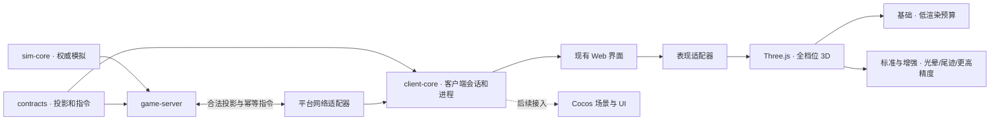

# 基础玩法与跨端客户端分层

2026-11-17：先跑通可验证的基础玩法，再接入 Cocos Creator。Web 作为低门槛入口，原生 App 作为长期体验渠道；所有受支持平台保留基础 3D，画面按设备能力缩减或增强特效，规则、进度、信息权限和服务端时间一致。本阶段保留现有 Web 视图，没有创建 Cocos 或原生工程。

## 已实现的基础切片

从 Tier 1、单世界出发，配置建设和长期托管，离线推进到第二世界与存续科技；解锁首次远征，经历在途、等待回执、已确认网络，再发展到 Tier 2。玩家可以从恒星详情断开或恢复同步。失稳可导致灭绝，终止增长与新操作，同时保留最终记录和未决指令重试。

这是当前 A/B 两节点参考切片的玩法闭环，**不是完整上线游戏**：仅有一次首次远征，正式账号登录、多席位、文明重开、自然天灾、L1 和完整多信使玩法仍未实现。网页继续显式使用开发令牌和只读回放，不伪装成正式登录或可写离线单机。

## 依赖边界

- `packages/client-core` 仅依赖 `contracts`，使用不包含 DOM 和 Node 类型的 TypeScript 配置。它不导入 Three.js、Cocos、系统时钟或 `sim-core`，不访问文件和存储。
- `GameSession` 管理开发会话、公共星表、单调投影、指令串行提交及不明结果重试。宿主注入 `ClientTransport` 和 UUIDv7 生成器。浏览器的 fetch、crypto 留在 `apps/web-client/src/transport.ts`。
- 投影必须匹配纪元、席位、文明世代；迟到连接结果和已断开连接的轮询结果被忽略，低版本或旧时钟不能覆盖当前状态。
- 网络错误、5xx 或异常受理回执保留原序列化信封。重试使用同一 ID、版本、载荷；未决期间阻止新指令和切换会话。明确的 4xx 释放待重试状态并刷新视图。令牌和信封只驻留内存，页面关闭后不保证恢复未决命令；持久化恢复机制需在正式账户阶段设计。
- `progression`、`coordinationControls` 只根据已收到投影推导界面阶段和按钮状态；服务端仍作最终裁定。到达时间和动画位置不得当作已确认控制证据。
- `presentationProfile` 只包含画面预算，没有世界规则和客户端平台优待。原生端也必须按设备测量能力，不能直接认为 App 必定适合最高档。

## 全平台 3D 基线与渐进增强

**基础档必须是完整 3D，不允许自动退为二维示意图。** 三档绘制相同的公开星表、节点、远征轨迹，保留透视、镜头旋转、缩放、选星与双视角；质量档位不改变可见情报与指令能力。

| 档位 | 渲染预算 | 额外表现 |
| --- | --- | --- |
| 基础 3D | 像素比上限 0.75、最高 30 FPS、低细分星体、关闭 MSAA | 保留所有必要 3D 对象和交互；关闭光晕与尾迹粒子 |
| 标准 3D | 像素比上限 1、最高 30 FPS、中等细分 | 每颗公开星体一层光晕、每艘可见在途远征 8 个尾迹粒子 |
| 增强 3D | 像素比上限 2、最高 60 FPS、高细分、MSAA | 双层光晕、24 个尾迹粒子，以及轻微光晕动态 |

光晕与尾迹均为视觉修饰，不代表多信使观测结果，不增加恒星、可拾取对象或隐藏情报。减少动态效果偏好关闭光晕动态，但不降低空间交互和几何精度。用户画质偏好在可选 localStorage 中保存。

自动档先采用标准 3D，节省流量时从基础 3D 开始；基础档仍必须加载 3D 引擎。渲染器跳过 120 帧预热后，每 240 个可见页 rAF 样本汇总帧间隔及绘制调用耗时。标准档持续有余量（帧间隔 <18ms、绘制调用 <8ms）时自动尝试增强；增强档帧间隔 >28ms 或绘制调用 >18ms 时退到标准，标准档超过 50ms 或 25ms 时退到基础。已降级后不自动升回，避免振荡；用户可重新选择档位。基础档即使仍慢也不会切换二维。以上是启发式预算，不是 GPU 完成时间测量，也不是实际真机帧率保证。

切档时保留相机、选星、视角与业务状态，重建图形资源。图形上下文丢失时尝试重建基础 3D；连基础 3D 都无法初始化时，显示兼容性提示和“重新启动 3D”按钮，不提供二维替代。业务数据与表单留在内存中，但该设备此时不满足 3D 游玩的最低条件。当前 Web 基线是 WebGL2；后续 Cocos 原生版本需验证各自 GPU 后端。

## 后续 Cocos 接入

1. 建立独立 Cocos 工程，验证 TypeScript 模块、contracts 校验库、网络与 UUIDv7 适配。当前 workspace 的模块导出方式不视为已通过 Cocos 构建验收。
2. 用 Cocos 组件重做 UI 和星图，订阅同一 `GameSession`；复用业务流程，不照搬 DOM 面板或 Three.js 资源。
3. 先发布 Web 基础 3D 档并验证真实 iOS Safari、Android Chrome；再构建 iOS/Android 原生包，加入按能力开放的高画质、触感和系统通知。
4. 双端用同一脚本验证相同指令和时间点得到相同投影。登录、账号迁移、未决指令恢复、重开与离线通知另行验收。Cocos 尚未接入前，不声称已实现原生增强。

## 验证

`pnpm check` 验证类型、全部测试、夹具生成与生产构建。`apps/game-server/src/client-flow.test.ts` 通过真实 Fastify API（内存仓储）驱动共享客户端，验证成长、同步、离线补算、灭绝与幂等重试；表现策略测试验证所有档位保留运行中的 3D 预算、无图形能力时明确失败、增加效果以及自动调档边界。

本轮 `pnpm check` 通过：101 项测试通过，3 项 PostgreSQL 集成测试因未配置测试库跳过；类型检查、夹具生成与生产构建通过。3D 模块仍有 minify 后体积超过 500 kB 的构建提示。

独立 Chromium 验证基础／标准／增强均创建 WebGL2 上下文；基础档可旋转、缩放、选星和切换天球视角。切档保留相机（浮点误差 <1e-10）、选星与回放时间；实际触发 WebGL 上下文丢失后成功重建基础 3D。模拟无法创建上下文时显示兼容性提示，不请求 Canvas2D，恢复能力后可通过按钮重试。节省流量模式也保留基础 3D。375px 移动布局无横向溢出；已查看 `output/playwright/all-3d-{basic,enhanced,mobile}.png`。

浏览器自动化验证功能行为，不代表真机帧率承诺。Cocos、iOS/Android 原生包和真机性能仍待下一阶段验收。
