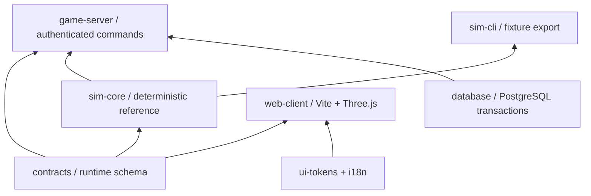

# 框架实施基线

本轮按架构 → 数据库 → 后端 → 前端搭建，依据当前工作区 GDD v0.17.0、ARCHITECTURE、SEAT-CONTRACT 和 M1–M2-FRONTIER。保留现有文档及标定修改。范围是可运行框架及 4 ly 因果接入参考切片，不等于完整 M1/M2 验收或生产上线。

## 依赖方向

`sim-core` 不依赖数据库、网络、系统时钟或 UI。客户端只读取公开星表与合法席位投影；权威快照和诊断事件不能进入客户端包。数据库负责原子提交，服务端在锁定文明世代后更新仿真快照与幂等结果。Redis 只预留为缓存/路由基础设施，不是状态真源。

## 当前实施决定

- pnpm workspace + TypeScript ESM，Node >=22.12；Fastify HTTP 边界，pg 显式 SQL 迁移，Three.js + Vite 原生 DOM HUD。
- 合同 `schema_version=0.2.0` 明确为 M1 子集，字段与席位契约同名；启用 `dispatch_expedition` 与节点协同指令，其余操作拒绝而不是模拟成功。
- 所有身份来自服务端开发鉴权适配器；客户端 `principal` 必须与认证结果一致，禁止自授服务身份或权限。Google OIDC、Apple、WSS 单次票据属于 M3/M4，暂不提供假登录按钮。
- 本地场景身份仅供开发，用显式开关和 loopback 绑定隔离，生产启动失败关闭。当前席位是文档定义的 Tier 2 协议夹具，不能当作真实新文明初态。
- 五类席位视图同一投影输出；哨兵、灭亡等未实施部分返回明确的空初态，不声称具备护航能力。
- 队列外部状态采用契约表中的 `queued`；正文 `ready` 视为内部瞬时可执行态。队列引擎待后续实现。
- 固定 kappa_t=525960，模拟年 31557600 秒；事件向上量化整数模拟毫秒，稳定排序；超出 JS 安全整数范围拒绝推进，数据库采用 bigint 预留长期时间。
- M1 世代坐标采用合法 SO(3) 单位旋转，仅作为固定夹具；随机世代旋转/星表生成器在后续阶段实现。
- 到达回执之前，远端当地建站/失败不能修改席位视图、版本序列、错误或推送；超时只是“结果未确认”。

## 延后与待验收

完整生产力/建造与托管、L1、弱异常凝视、真实 Tier 1 成长、万级八叉树/分片、WAL 接管、灭绝/重开、OIDC/WSS、Capacitor 均不在本轮完成范围。数据库中的预留表不代表对应运行时已实现。v0.17 标定文档和数值脚本由用户持续更新，本轮未运行完整蒙特卡洛回归，不将其列为框架通过证据。

参考实现依据 [Fastify Server](https://fastify.dev/docs/latest/Reference/Server/)、[Vite Guide](https://vite.dev/guide/) 和 [node-postgres transactions](https://node-postgres.com/features/transactions)；事务中的语句必须使用同一连接。

## v0.17 文档更新适配

已放弃最初 v0.16 的控制半径实现，契约升级 0.2.0：`dispatch_expedition` 代替 `set_sphere_radius`，删除 `r_civ/r_target`，采用 `cradle_span_ly`、`active_sync_span_ly`、`active_expeditions`。4 ly 场景为 2400 秒当地建站、2640 秒确认、2760 秒超时（旧 2394/2634/2754 不再适用）。节点状态采用 `confirmed/detached_autonomous/destroyed/seceded` 等文档口径。

`signals.ts` 提供无状态静止发射段的波壳内外边界、EM/中微子/GW 衰减、物理消散与非共线基线判定，并独立测试。移动发射源沿轨分段、真实接收机观测/凝视、完整多信使投影尚待接线；Web 不把示意波壳伪造为已抵达他者情报。

当前契约将 `dispatch_expedition.target_node_id` 设为必填，只支持公开星表目标；方向导航尚未实现。文档中的解锁前置文字有 `N_worlds >= 2 || persist < 1` 与后文 `N_worlds >= 2 && persist >= 1` 表述不一致，本轮使用明确已解锁的 Tier 2 隔离夹具，不据此前置歧义实施真实 Tier 1 解锁规则。`M1–M2` 末段仍残留“半径操作”，实现遵循上文定向远征主流程。
