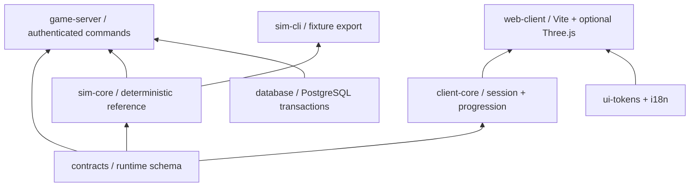

# 框架实施基线

本轮按架构 → 数据库 → 后端 → 前端搭建，依据当前工作区 GDD v0.17.0、ARCHITECTURE、SEAT-CONTRACT 和 M1–M2-FRONTIER。保留现有文档及标定修改。范围是可运行框架及 4 ly 因果接入参考切片，不等于完整 M1/M2 验收或生产上线。

## 客户端路线更新（2026-11-17）

本轮先完成共享客户端业务与 Web 分级表现，随后接入 Cocos。现有 Web 仍使用 Vite、Three.js 与 DOM 面板；会话、重试、文明进程已移至无 DOM 依赖的 `packages/client-core`。基础档同样保留完整 3D 星图与交互，标准／增强档增加光晕、尾迹与渲染精度；无法创建基础 3D 时明确提示不兼容，不退为二维。原生 App 尚未构建，旧 Capacitor 计划由后续 Cocos 原生路线替代。完整边界与验收见 [基础玩法与跨端客户端分层](CLIENT-FOUNDATION.md)。

## 依赖方向



`sim-core` 不依赖数据库、网络、系统时钟或 UI。客户端只读取公开星表与合法席位投影；权威快照和诊断事件不能进入客户端包。数据库负责原子提交，服务端在锁定文明世代后更新仿真快照与幂等结果。Redis 只预留为缓存/路由基础设施，不是状态真源。

## 当前实施决定

- pnpm workspace + TypeScript ESM，Node >=22.12；Fastify HTTP 边界，pg 显式 SQL 迁移，Three.js + Vite 原生 DOM HUD。
- 合同 `schema_version=0.7.0` 明确为 M1 子集，字段与席位契约同名；启用 `dispatch_expedition`、节点协同、`allocate_evolution_point` 与 `configure_allocation_plan` 指令，其余操作拒绝而不是模拟成功。
- 所有身份来自服务端开发鉴权适配器；客户端 `principal` 必须与认证结果一致，禁止自授服务身份或权限。Google OIDC、Apple、WSS 单次票据属于 M3/M4，暂不提供假登录按钮。
- 本地场景身份仅供开发，用显式开关和 loopback 绑定隔离，生产启动失败关闭。M1 回放仍是 Tier 2 协议夹具；空数据库席位改用真实 Tier 1 初态，旧存档保留原模式。
- 五类席位视图同一投影输出；哨兵、灭亡等未实施部分返回明确的空初态，不声称具备护航能力。
- 队列外部状态采用契约表中的 `queued`；正文 `ready` 视为内部瞬时可执行态。已实现单施工位、5 槽 FIFO、点数/前置等待、移除队列项与自动恢复；20 步长期托管计划已接入。
- 固定 kappa_t=525960，模拟年 31557600 秒；事件向上量化整数模拟毫秒，稳定排序；超出 JS 安全整数范围拒绝推进，数据库采用 bigint 预留长期时间。
- M1 世代坐标采用合法 SO(3) 单位旋转，仅作为固定夹具；随机世代旋转/星表生成器在后续阶段实现。
- 到达回执之前，远端当地建站/失败不能修改席位视图、版本序列、错误或推送；超时只是“结果未确认”。

## 延后与待验收

自然天灾/科技完整物理反馈、L1、弱异常凝视、万级八叉树/分片、WAL 接管、文明重开、OIDC/WSS、Capacitor 均不在本轮完成范围。数据库中的预留表不代表对应运行时已实现。v0.17 标定文档和数值脚本由用户持续更新，本轮未运行完整蒙特卡洛回归，不将其列为框架通过证据。

参考实现依据 [Fastify Server](https://fastify.dev/docs/latest/Reference/Server/)、[Vite Guide](https://vite.dev/guide/) 和 [node-postgres transactions](https://node-postgres.com/features/transactions)；事务中的语句必须使用同一连接。

## 演化点与建造队列内核（2026-11-16）

`packages/sim-core/src/evolution.ts` 实现当前建设切片，复用 HTTP `/api/commands`、席位事务与原有后台推进。新增的点数、流速、生产力、五科技等级、世界数、Tier、在建工程和队列均通过 `self.telemetry` 投影。Web 建设面板已接入点数、施工、队列和托管编辑；本地回放只读，连接开发服务后可操作。

- `allocate_evolution_point` 支持五科技、`world_up`、`k_tier_up`，以及 `queue_op: "remove_at"`（必填零基 `queue_index`，并校验对应维度）。分配操作要求 `ALLOW_AGENT_TECH_ALLOC` 权限；客户端不能指定费用、完工时间或跳级目标。
- 五科技按 1/2/4/8 点扣费，工期 15/45/90/180 模拟年；Lv.3/4 分别要求 Tier 2/3。扩建世界免费、30 模拟年、最多 4 世界；Tier 2/3 升级免费、60/150 模拟年，分别要求已确认星数 2/4 与 K ≥ 1.10/1.50。科研按人口×科学特质提速，物理建设只按人口提速。
- 只有单个在建项目，另外允许 5 个待建项目。队首点数不足或前置未满足时阻塞后续项目；开工才扣费。移除队首、完工、点数跨门槛或回执抵达后自动重估。不提前消费，不让免费项目插队。重复维度在执行时取下一等级，移除较早项目不会造成跳级。
- 生产力使用 GDD 参数 `exp(1.35 × (K − 0.56)) × exp(Xi) × max(0, 1 − SDI)`，点数基准为 `0.0056 pts/sim yr`。**本节的早期建设切片采用固定 K、Xi、SDI 与特质**，默认沿用 Tier 2 隔离夹具（K=1.10，Xi=0，SDI=0，中性特质），不代表真实 Tier 1 冷启动。K 微分演化与谐波/OU/跃迁随机流现已接入下节成长模式；动态 SDI 反馈及同步/冗余摘要已接入下节稳定性切片；科技的观测、攻防、热量完整运行时仍待接线。
- 点数由固定时间锚直接积分；费用门槛与完工时刻向上量化至模拟毫秒，不依赖轮询频率。相同时刻先应用全部因果报告，再判断建设前置；隐藏的远端建站不能提前解锁 Tier。
- 建设切片原升级至 `snapshot_version=3`（含托管扩展后为 v4）。合法 v2 快照保留事件、指令回执和时钟，新增经济账本从旧快照时刻以 0 点起算，不补发该时刻之前的点数。v1 旧半径快照仍拒绝。数据库继续复用现有 JSON 快照事务，无需改表或重置 seed。

验收覆盖费用/工期、FIFO 与容量、自动等待恢复、移除与重试、回执前信息隔离、轮询/离线/保存恢复完全一致、旧快照升级及 HTTP 并发幂等与重启补算。托管与 HUD 已在后续切片接入，K 成长与随机生产力也已接入下节的独立成长模式。

本批 `pnpm check` 通过：43 项测试通过，3 项需要 `TEST_DATABASE_URL` 的 PostgreSQL 集成测试跳过；类型检查、席位夹具生成与 Web 构建通过。原有 2639/2640 秒回执边界继续通过；本批未重跑真机浏览器与性能验收。

HTTP 联调时，先通过 `/api/dev/bootstrap` 取 `context`、`principal` 和当前 `view.view_version`，然后向 `/api/commands` 发送新 UUIDv7 `command_id` 的标准信封，`action` 示例为：

```json
{"type":"allocate_evolution_point","dimension":"persist","queue_op":"enqueue"}
```

移除等待队列第 0 项（假设该项为存续）用 `{"type":"allocate_evolution_point","dimension":"persist","queue_op":"remove_at","queue_index":0}`。操作后重新读取席位视图；网络重试应保留同一信封和幂等键。正式服务时钟没有加速接口，快速验证用 `pnpm exec vitest run packages/sim-core/src/evolution.test.ts apps/game-server/src/app.test.ts`。

## 长期托管与 Web 建设面板（2026-11-16）

- `configure_allocation_plan` 接受 `{enabled, template_id?, items}`，最多 20 步。每步可指定 `dimension`、`target_level` 和 `min_k`；目标等级按逐级建设达成，不跳级、不预扣点；已达到的目标直接跳过。未填写目标等级时，在该步骤首次接管时，按当前等级与该维度已有工程解析为下一等级（达到上限则视为已完成）。`template_id` 是路线标记，必须随附完整步骤，本批不提供模板库。
- `cursor_index` 只随目标完成推进。按 FIFO 追加托管工程，每次最多有 1 个托管工程处于排队或施工中，保留其余空间给手动排程。满队列时等待空位，不挤出手动项目；最低 K 未满足时保留游标、暂不入队。
- 同样的步骤与模板标记再次配置可暂停/恢复且保留游标。暂停移除未开工的托管项目，付费工程继续；替换步骤重置计划游标，已在建工程继续但不再归旧计划所有，手动队列保留。手动移除托管队列项会暂停计划，防止当刻重新补入。
- 快照 v4 保存计划、当前目标与内部工程归属。v3 经济快照以空计划升级，保留点数账本和在建工期；v2 仍遵循上一节迁移策略。客户端投影只含公开计划和工程字段，不暴露内部 `plan_index`。
- Web 增加双语建设面板：演化点、流速、世界数/科技、在建剩余时间、5 槽队列与移除操作，另有 20 步计划编辑器、目标等级/最低 K、草稿计数、暂停恢复。轮询不会覆盖未保存草稿，语言切换保留草稿。连接服务后才开放写操作，本地回放保持只读；真实服务不提供调速或重置按钮。
- 所有在线写操作统一走原有鉴权与幂等入口。网络/5xx 结果不明时保留完整原信封，阻止新的写操作并提供明确重试按钮；重试沿用原 `command_id`、版本与载荷。

固定模式旧存档的 K 与随机因子继续保持原参数；下节的成长模式会自动跨过可达 K 门槛。科技完整物理效果仍待接入。

验证：`pnpm check` 通过（53 项通过、3 项 PostgreSQL 集成测试因未配置测试库而跳过），最后的提示文案修复另通过 Web 类型检查与构建。独立 Chromium + 内存测试后端验证世界扩建、托管提交/暂停/恢复、重连保持工程、20 步上限、双语草稿保持；375 px 与 1440 px 无横向溢出。故意在服务端受理后向浏览器返回 503，重试使用完全相同信封，队列仅新增一项，成功提示恢复正确。测试截图保存在本地 `output/playwright/construction-{mobile,desktop}.png`（不纳入 Git），未做 iOS/Android 真机验收。现有单 JS chunk 体积警告仍在（约 153 kB gzip）。

## 真实 K 成长与种子化生产力（2026-11-17）

新建服务端席位默认通过 `createCivilization` 从 `K=0.56`、Tier 1、单世界、单恒星、0 点开始。`createSimulation` 继续作为隔离 M1 参考夹具。远征前置为第二个世界与存续 Lv.1；目前仍只有公开 B 星的单次 4 ly 远征，尚非完整程序化星表。

- `growth.ts` 按 GDD §5.2 实现 K 导数、世界/已确认恒星数对应的 K 上限、指数生产力、三模态谐波、OU 漂移和有衰减的随机跃迁。生产力参数沿用已定稿基准，不使用历史曲线作为播放脚本。当前星表 A/B 都以单位权重计入有效恒星数。
- 固定 `5 sim yr` 更新随机过程与导数，与标定脚本的 DT 一致。段内 K 按冻结导数线性演进，演化点对 `exp(1.35 K)` 解析积分；K 门槛和费用门槛用整数模拟毫秒二分求首次满足时刻。扩建或回执改变容量时，先按旧参数结算该段，再更新上限、夹紧 K 和重算导数，不重算已挣取的点数。
- 使用版本化快照中的 FNV-1a/Mulberry32 随机状态与固定相位，不调用系统随机源；OU 和跃迁只在世代起点锚定的 5 年网格更新。查询、命令重试与离线步长不消耗随机数，保存/恢复携带相位、OU、跃迁、积分锚和下一网格时刻。随机算法与 Python 标定器不同，不声称同一文本种子跨语言逐点相同。
- 回执前，成功、当地不可用和回执缺失分支的投影相同；未收到回执时不抬升 K 上限。损毁报告或本地断联决定生效后调整已确认活跃集合与容量，保留已挣点数。Tier 与 `min_k` 前置随成长自动重估，无需人工刷新或重新提交。
- 契约 0.5.0 新增 `k_value`、`k_max_confirmed`、`n_eff_stars`、`stage`；Web 显示当前 K、已确认上限和发展阶段，未解锁远征时显示建设前置。快照 v5 支持 v2–v4 升级，**旧固定模式存档不会被清零或自动切成成长模式**，原有经济账本、队列、托管与远征继续保留。

运行 `pnpm sim:growth` 可复跑固定种子的冷启动场景，输出 `artifacts/growth/cold-start.json`（只含合法席位投影）。初版固定 SDI 参考路线于 30 模拟年建成第二世界，400 年派出远征、444 年收到回执，600 年采样已升 Tier 2；动态 SDI 版时点见下节。这些时点属于固定种子和操作计划的场景结果，不是所有文明的保底时间。

数值验证使用独立 Python RK4（步长 0.01 模拟年）的中性、单世界、Xi=0、固定 SDI=0.27 参考，100–1000 年样点的 K 绝对误差 <0.0025、累计点数误差 <0.004。该参考采用 5 年分段数值近似与显式固定 SDI；新席位现已启用下节动态 SDI，灾害、冷战自毁、科技对观测/毁伤的完整反馈尚未接入，因此不把本切片视为历史时间窗或完整蒙特卡洛生存率验收。

本批验证：`pnpm check` 通过（65 项测试通过，3 项 PostgreSQL 集成测试因未配置测试库跳过），`pnpm sim:growth` 成功生成冷启动时间线。11 项成长专项测试覆盖数值误差预算、随机时钟、离线与恢复完全一致、最低 K 门槛、跨星因果隔离、完整冷启动路线及损毁回执夹紧；HTTP 测试验证默认 Tier 1 初始化与重启恢复。独立 Chromium + 内存后端验证面板冷启动读数、双建设前置解锁、双语成长显示、2639/2640 秒回执边界和 375 px 无横向溢出，截图在 `output/playwright/growth-mobile.png`。测试时间跳转只存在于忽略目录的测试后端，正式应用没有该接口。

## 动态 SDI 与同步张力（2026-11-17）

- 新建 `createCivilization` 默认启用动态 SDI：人口密度、单星集中压力、行星后勤、同步张力、Tier/打击/观测负荷、已确认多星治理与存续抵扣，按 GDD §6.1 及标定器当前参数计算。内部使用 0–1，公共 `sdi_total` 为 0–100；`sdi_raw` 保留负值和超载值，阻尼同时作用于 K 与点数生产力。
- 固定 5 模拟年采样，与随机增长网格一致；完工、已抵达报告和本地协同决定立即重采样。先按旧参数结算点数，再切换阻尼，不回算历史。读取、空计划、仅入队、远方物理事件不会额外采样或消耗随机数。`sdi_sampled_sim_s` 明确标出读数时点；段内 K 插值而 SDI 阻尼保持采样值。
- 同步记忆 U 按 15 年时间常数解析演进，先积旧目标再切新跨度。脱网立即缩小活跃跨度但不清空 U；并网只在回执抵达时扩大跨度。存续科技更新同步半径和抗毁冗余摘要，Lv.3 完工一次性赋予 −30 百分点固定调整并按 40 年常数衰减（不受 D_self 再次放大）。特质默认中性，可在服务端初始化中指定 D_self 与 S_org。
- 契约 0.6.0 增加 `sdi_mode`、`sdi_total`、`sdi_raw`、`sdi_sampled_sim_s`、`sdi_breakdown` 与 `r_sync_ly`。分项都是已乘特质的百分点，唯 `lag_strain_u` 为无量纲 U；额外 `lag` 是其百分点贡献，`tier_tech` 为能级/打击/观测/治理减存续的有符号净额。Web 展示总指数、增长倍率、分项和活跃/支持跨度，并支持中英切换。
- 快照 v6 保存 U、衰减固定项、采样时点和已确认结构签名。v2–v5 仍可迁移；旧成长快照保持其固定 SDI，既有进度不重算。固定 M1 夹具保持原数值与时序，`sdi_mode=fixed`、`r_sync_ly=null`；显式传入 `inputs.sdi_fraction` 的成长参考也默认维持固定模式。

当前仍是 A/B 两节点模型；动作脉冲、热沉、冲突模块未接入，对应分项为 0。SDI 初版只验证稳定性反馈；冷战自毁、系统崩解、政治解列及三级护盾现已接入下节生命周期切片。完整生存率和自然灾难仍待验收。

SDI 初版在未启用失稳事件时，400 年远征路线于 600 年出现 SDI 92.9%，最终仍升 Tier 2。该无死亡假设已被下节的两条真实失稳路线取代，不能继续作为当前生存结果。

验证：`pnpm check` 通过；补充独立公式/特质数值用例后，全套测试为 74 项通过、3 项 PostgreSQL 测试未配置测试库而跳过。9 项 SDI 专项覆盖单位与阻尼、完工卸压、超载停止增长、回执/脱网记忆、三级调整与恢复、轮询不采样、旧存档迁移与非法快照；原有离线/轮询一致及远方分支隔离测试继续通过。类型检查、夹具和 Web 构建通过；单 JS chunk 警告仍在，约 155 kB gzip。独立 Chromium + 内存后端验证初始 SDI 16%/倍率 0.840、双语分项、建设前置与远征回执边界，确认并网后同步张力推动 SDI 至 90.7%；375 px 与 1440 px 布局无横向溢出。截图位于 `output/playwright/stability-{mobile,desktop}.png`，已检查明细可读性；未做移动真机或完整性能验收。

## 失稳事件与灭绝生命周期（2026-11-17）

新建动态 SDI 文明默认启用失稳；固定 M1 和已有 v2–v6 存档保留原模式，不追溯抽取历史死亡。契约升为 0.7.0，快照升为 v7，新增独立的失稳随机状态、风险积分锚、一次性护盾标记、阈值重入门控、最近事件与灭绝报告。数值参考可显式传 `instability:false`，该开关不向客户端命令开放。

- 按 GDD §6.1 使用每模拟年的冷战风险率：SDI ≤ 0.38 时为 `0.0015 × (SDI/0.38)^3`，否则为 `0.0015 + 0.45 × ((SDI−0.38)/0.62)^2`；SDI > 0.50 时，局部危机率为上述值的 2.5 倍。使用独立于生产力的 FNV-1a/Mulberry32 流及指数等待阈值，按已采样的分段风险率累积暴露，首次越阈向上量化到模拟毫秒。查询与离线步长不改变随机抽取或结果。该连续事件实现与 Python 5 年末伯努利抽检不逐点等同，不声称跨语言种子一致。
- 局部危机先结算已挣点数，再减少 `0.015 K`（最低 0.56），更新 SDI 与未来增长；不会撤销正常施工或回收已挣点数。K 回落造成观测超前负荷超载时，同刻重评崩解。
- `sdi_raw >=100` 的首次上穿触发阈值事件。已确认活跃跨度超出同步半径时，当前 A/B 模型中的外围 B 永久解列，缩小已确认集合与容量；保留 U 的惯性，迟到确认也不能恢复已解列节点。否则优先消耗存续三级护盾，通过固定调整把指数降至 50%；无可用护盾则灭绝。沿用标定器 `collapse_armed` 门控，指数低于 100 后才重新允许下一次上穿，避免同刻解列后又因残余 U 连续崩解。护盾不免疫冷战自毁。
- 同刻顺序：增长网格、既有因果事件、完工/队列，再处理阈值与到期失稳时钟；两个失稳时钟同时到期时先死亡。已经累计到期的死亡风险不会被同刻完工抹除。模型仍只对指挥核已确认输入求值，隐藏分支不能改变风险时钟。
- 灭绝报告包含 `extinct:true`、`cause`（`ColdWar_SelfDestruct` 或 `SDI_System_Collapse`）、`t_extinct_sim_s`；只生成一次。点数账本与 K 冻结，增长率和生产力为 0，在建和等待队列终止、计划停用，已支付工程不退款。最后确认的星网作为记录保留；已发在途事件继续推进内部物理状态，迟到回执不复活协调核、不再抬升其账本或星网摘要。世界时钟仍前进。
- 新指令返回 `409 CIVILIZATION_EXTINCT`；同一已受理指令的原信封仍返回原幂等结果。HTTP 网关会在拒绝新指令的事务中持久化补算出的死亡，并保存拒绝回执；重启和重试不重复扣费或复活。Web 显示双语灭绝原因、时刻、最后记录，禁用建设、托管提交和远征，保留未决指令的精确重试。

`self.telemetry.instability` 只公开 `enabled`、`crisis_count`（局部危机与政治解列次数）、`shield_available`、`last_event`（`local_crisis/secession/shield` 的时刻及局部危机实际 K 损失）；随机状态、剩余暴露和未来事件时刻不进入席位投影。

`pnpm sim:growth` 现在导出同一固定种子的两条席位时间线：`cold-start.json` 先升存续二级、800 年远征，1000 年采样到达 Tier 2 且存活到 2000 年；`cold-start-risky.json` 在存续一级时于 400 年远征，经历一次局部危机后于约 474.02 模拟年冷战自毁，后续点数与 K 不再增长。它们是确定性示例，不是生存保证或蒙特卡洛结论。

本轮 `pnpm check` 通过：86 项测试通过、3 项 PostgreSQL 集成测试因未配置测试库跳过；类型检查、夹具生成和 Web 构建通过。11 项失稳专项验证风险积分、局部损失、冻结账本、幂等重试、在途事件、崩解/一次性护盾/永久解列、轮询与恢复一致、因果隔离、旧存档迁移和非法快照；HTTP 测试覆盖死亡后拒绝持久化与重启恢复。构建仍有单 JS chunk 提示，约 156 kB gzip。

独立 Chromium + 内存后端验收通过：从冷启动建设、远征与 2639/2640 秒回执边界走到约 474.02 年自毁，检查局部危机记录、终止产出、禁用远征/建设/托管，以及跳到 2000 年和刷新重连后仍保留 1.589 点及同一报告。中英切换正常，375 px / 1440 px 无横向溢出；截图 `output/playwright/instability-{mobile,desktop}.png` 已检查可读性。测试时钟只存在忽略目录中的内存后端，正式 API 没有调速入口，未做移动真机验收。

尚未实现 A 类 30 年抽检、B 类自然天灾、L1 自动护航、死后光锥回响与文明重开；空的 `posthumous_callbacks` 不代表已完成回响投影。当前没有重置真实席位数据的入口。

## v0.17 文档更新适配

已放弃最初 v0.16 的控制半径实现，远征契约原升级至 0.2.0（当前含建设、托管、成长、SDI 与失稳生命周期扩展为 0.7.0）：`dispatch_expedition` 代替 `set_sphere_radius`，删除 `r_civ/r_target`，采用 `cradle_span_ly`、`active_sync_span_ly`、`active_expeditions`。4 ly 场景为 2400 秒当地建站、2640 秒确认、2760 秒超时（旧 2394/2634/2754 不再适用）。节点状态采用 `confirmed/detached_autonomous/destroyed/seceded` 等文档口径。

`signals.ts` 提供无状态静止发射段的波壳内外边界、EM/中微子/GW 衰减、物理消散与非共线基线判定，并独立测试。移动发射源沿轨分段、真实接收机观测/凝视、完整多信使投影尚待接线；Web 不把示意波壳伪造为已抵达他者情报。

远征与协同子集受理 `dispatch_expedition{target_node_id, drive_mode?}`（`target_node_id` 必填、只支持公开星表目标）与 `set_node_coordination{node_id, mode}`；完整载荷中的 `origin_node_id`（出发枢纽选择）与 `local_dir_vec3`（M3+ 方向导航）本轮不受理。解锁前置在 GDD/SEAT-CONTRACT 已统一为「`N_worlds >= 2` 且 `存续 Lv.1` 后开放」（此前契约中的 `N_worlds >= 2 || persist < 1` 反写已修正）；M1 夹具继续使用已解锁的 Tier 2 隔离态；成长模式已按该前置实施真实 Tier 1 解锁。`abandon_node`（自愿弃守）已补入席位契约指令清单（第 11 项），M1 子集暂不受理。`M1–M2` 末段旧文“半径操作”按上文定向远征主流程理解，已在本轮文档修订中更正。
