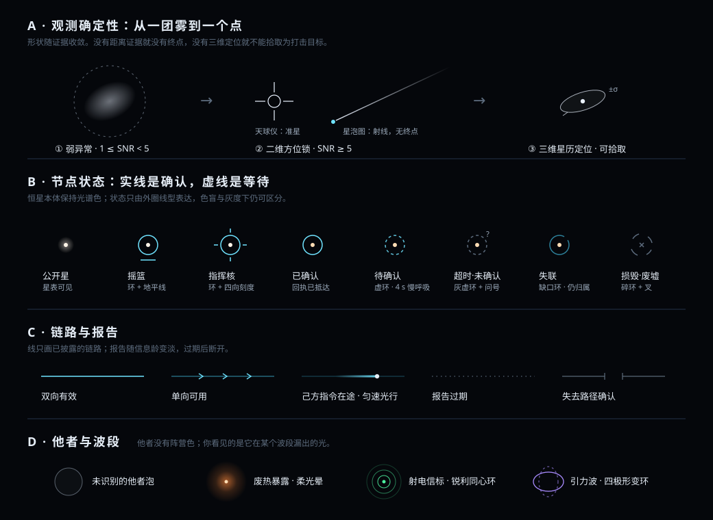
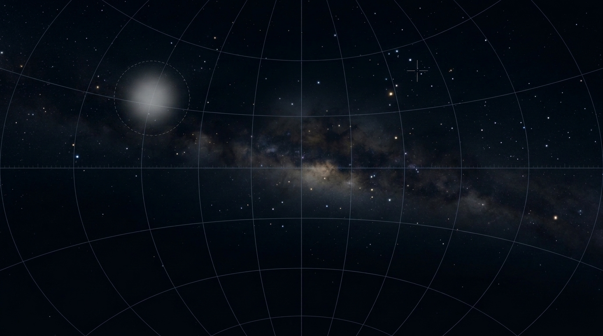
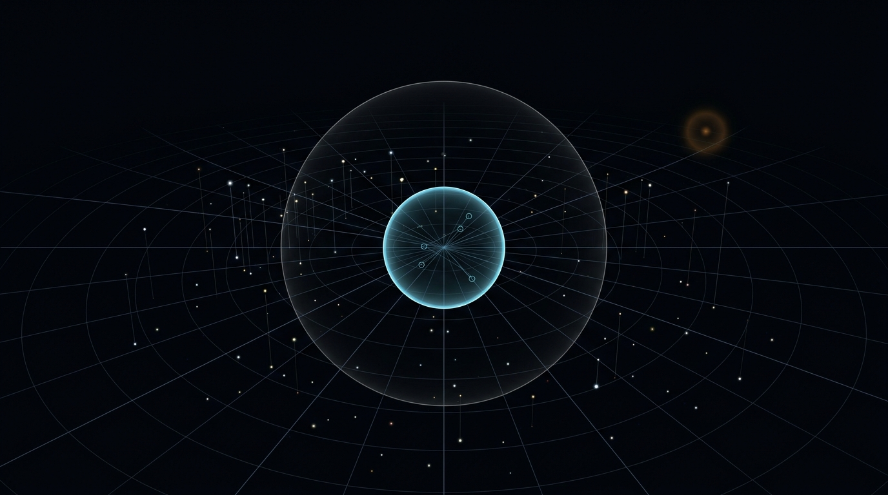
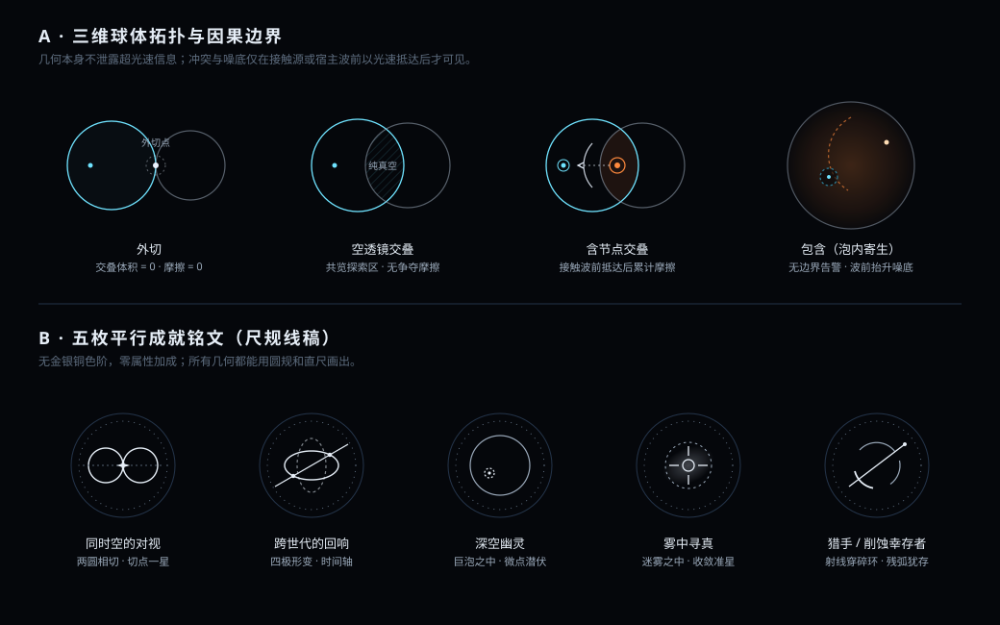
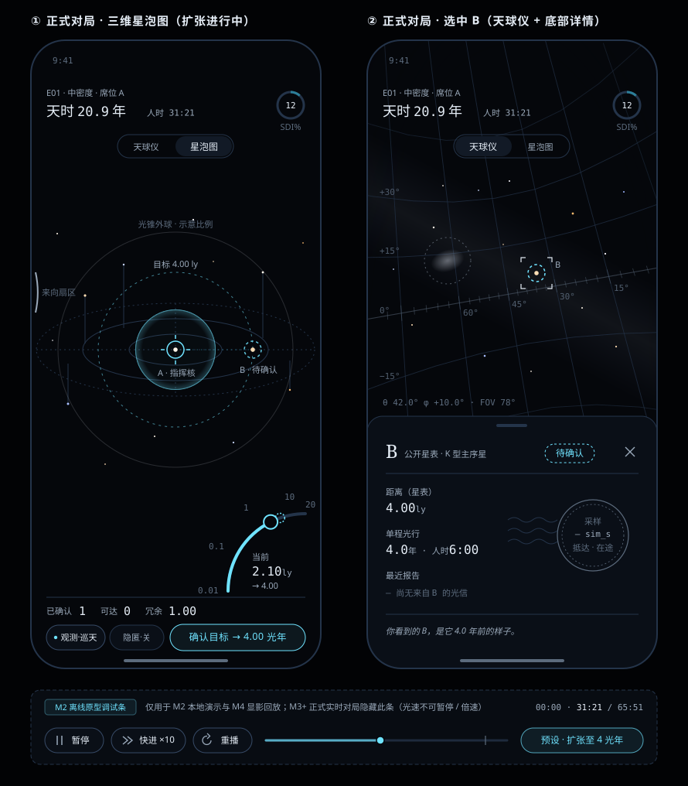

# 《光锥之外》美学设计（Art Direction v0.3 · 航天遥测 × 精密观星界面）

> 适用范围：M2 双视角 Web-First 原型起的全部客户端画面、界面、动效、声音与文案。机制以 [GDD v0.17.0](../../DESIGN.md) 为准，客户端工程约束见 [技术架构 §3](ARCHITECTURE.md#3-游戏客户端与海外-web-first-交付链路)，首个切片的交互流程见 [M1–M2 开发规格](M1-M2-FRONTIER.md#3-m2-web-first-原型与移动端适配)。


**设计原则摘要**：通过视觉与交互本身传达低打扰、高精密的宇宙观测体验，不在界面或宣发中空喊风格口号。在 **85% 以上的深空暗面画幅**之上悬浮航天发射级的**精密遥测航电（Launch Telemetry & Avionics）**——极细刻度线、制表等宽数字、光信因果里程碑弧线与矢量截面简图；画面保持冷、静、准、无压迫，让玩家把注意力放在星图与物理变化本身。

**美学关键词**：**迟到之光 · 精密遥测（航天航电 × 低打扰观星）**。

| 关键词 | 含义 | 反面 |
| --- | --- | --- |
| 迟 | 一切所见都带着时间差（$1\ \mathrm{ly}=1\ \mathrm{sim\ yr}=1\ \mathrm{real\ min}$），画面温和标出这段时差 | 即时刷新的全知地图 |
| 暗 | 黑暗是默认状态，既是物理隐蔽，也是深夜暗室的视觉安宁 | 满屏辉光、霓虹描边、刺眼红框 |
| 准 | 仪器级的线条、刻度与数字，误差也被精确画出 | 装饰性的科幻花纹 |
| 静 | 大面积留白，声音稀少（$-30\ \mathrm{LUFS}$ 底噪），无催促倒计时与红点 | 震屏、爆炸音效、频闪、战情室警报 |
| 疑 | 未经证实的东西在形状上就是不确定的 | 把推测画成事实 |

---

## 1. 气质定位

### 1.1 玩家应有的情绪曲线

画面温度、密度和声音层次随文明阶段推进，与 GDD 的人类文明跨度、深空巡天和实体遗迹对应。

| 阶段 | 对应机制 | 情绪 | 画面 | 声音 |
| --- | --- | --- | --- | --- |
| 摇篮 | 母星系摇篮（[§5.2](../../DESIGN.md#traits-and-tech)） | 独处、静谧 | 只有星点与母星摇篮的微小青色轨道环；贴边极简航电遥测栏保持最小占位 | 宇宙微波底噪与单音 |
| 扩张与挂机 | `0.10c` 定向远征、多信使波壳、预设建造队列（[§3.2](../../DESIGN.md#space-and-geometry)） | 从容、笃定 | 远征航迹外推、`1.00c` 信号波壳随距离渐隐至虚线 `R_diss` 消散环；已确认星节点链路细线增多，底部光信因果弧线匀速推移 | 加入缓慢弦乐长音 |
| 初次接触 | 波壳掠过、弱异常／中微子破壁（[§4.1](../../DESIGN.md#sphere-topology)） | 敬畏、审慎 | 屏幕边缘出现来向扇区；一团模糊方向雾（`Obs Lv.3+` 中微子可穿透热隐匿与宿主光雾，给出 `5°–15°` 宽视锥弱异常） | 窄带调谐音，音乐退后 |
| 凝视与远航 | 方位锁、`≥ 3` 星 GW 定标、火种迁徙（[§7](../../DESIGN.md#observation-and-combat)） | 深邃、旷远 | 准星、无尽射线、GW 跨天区弧带收敛至 `≥ 3` 星三角锁定误差椭球；在途远征与投射物只画己方已知部分 | 极慢低频脉冲，大段静默 |
| 自然脉冲与大过滤器 | B1–B4、SDI（[§6.1–6.2](../../DESIGN.md#sdi-and-cataclysms)） | 渺小、敬畏、守望 | 玩家或 L1 规则触发的 B1 偏转切线；顶部 `SDI / HEAT` 双通道细条平静标示余量；未防住则呈现冷峻撞击／自毁余辉 | 低频远雷后转为接收机绒音 |
| 灭亡简报 | 灭绝停摆与重开（[§8.3](../../DESIGN.md#systems-and-constitution)） | 克制、冷静 | 原址信号熄灭留存物理废墟／遗迹（含既建 `信标 Lv.4`），呈递一份简洁的灭亡简报后即可重开 | 回归纯底噪 |

### 1.2 不做什么（去战情室化铁律 · 与发射 UI 的边界）

- 不做赛博朋克霓虹、六边形军事 HUD、全息蓝光堆叠。
- **借鉴航天发射遥测的“真仪器感”，剥离其“倒计时焦虑”**：取 SpaceX 发射直播与 Crew Dragon 航电的纯黑半透底色、`1 px` 极细格栅、制表等宽数字与底部轨迹里程碑弧线；但**严禁**主画面放每秒跳动的 `T− mm:ss` 人类时间读秒倒计时、**严禁**刺眼警报红框、`ABORT` 式强压迫红字与未读红点角标。离线归来只呈递安静的“光信洗片抽屉”。
- 不给他者涂阵营色，不写“敌人”。他者在被观测到之前没有颜色。
- 真空中的天体事件不配爆炸音效。声音只来自玩家自己的暗室仪器。
- 不让任何界面变化跑在信息抵达之前，见原则 2。
- 不用连续闪烁吸引注意，闪烁频率受 §13 的上限约束。

---

## 2. 五条美学原则

每条原则都对应 GDD 的物理公理，美术违背原则时，玩家对规则的直觉也会跟着出错。

### 原则 1 · 所见皆往昔

**规则**：画面上的每一条情报都带着年龄。年龄 = 当前天时 − 采样时刻。

- 情报卡、节点详情和告警都显示采样时刻与抵达时刻，文案写“B · 4.0 年前”，而非“B”。
- 情报随年龄褪色：不透明度与饱和度按报告有效窗口衰减，到期后线型改为点线（§3.4）。
- 对应 GDD 公理 3「光速因果铁幕」与 [§3.2.1](../../DESIGN.md#space-and-geometry) 回执时间戳。

### 原则 2 · 可见即因果

**规则**：只画本席位已经知道的东西。任何界面变化都必须能指出它从哪里来、何时抵达。

- **己方发出的东西**可以画在途：`0.10c` 远征航迹、同步握手、己方 `1.00c` 信号波壳、己方动能体。指挥核知道自己何时、从哪里发出，可以按物理速率外推。
- **别处发来的东西**只在抵达那一帧出现：回执、节点接触报告、他者波前。抵达时在接收点打一圈涟漪，再沿来路回溯一道短光（300 ms），告诉玩家“它从那里来”。
- `0.10c` 远征抵达 B 后、在 B 的 `1.00c` 成功或失败确认报传回 A 之前，B 仍是待确认虚环。成功与失败两条分支在回执抵达前的画面逐像素一致，与 [M1–M2 §2.3](M1-M2-FRONTIER.md#23-自动化验收) 的“当地未接入”验收同口径。
- 他者的动能体只在其前导激波光抵达时出现（例如 20 ly 处 RKV 最早提前 `3.53 sim yr = 3.53 real min`）；尼科尔–戴森光束与光同到，**没有任何前兆动画**。

### 原则 3 · 亮即暴露

**规则**：亮度是代价。自身越亮，波壳就传播得越远、越晚消散。

- 己方标记的光晕大小直接映射真实热辐射与信标强度（§9.2）。玩家调高能级、派出 `0.10c` 定向远征或发射信标时，会亲眼看着对应活跃节点与远征尾迹发亮并放出 `1.00c` 信号波壳（纯观测预览 `R_diss` 环与真空波壳蔓延不虚增热辐射）；开启 `EMCON` / 热沉后源端转暗，既往电磁信号继续向外扩散成中心生出沉默暗腔的**空心波壳**，直到能量衰减跌破 `R_diss` 门限归零。
- 隐匿系升级让己方标记 EM 光晕收缩、有效 `R_diss` 缩短，界面随之“压低声音”；但高能级核聚变中微子本底与四极引力波源仍遵循各自物理扩散律，不因热隐匿而熄灭。
- 画面中的高亮区只留给真实的辐射源。界面控件不使用辉光，避免与暴露信号混淆。
- 对应 GDD 公理 2「热力学暴露与信号消散」与 [§7.1](../../DESIGN.md#observation-and-combat) 的衰减／SNR 公式。

### 原则 4 · 确定性即形状

**规则**：证据多少与信使物理属性共同决定图形是否收敛。从宽锥／环带，到无终点射线，再到带误差椭球的点。

- 弱异常按信使通道显形：EM 弱异常为模糊方向雾；`Obs Lv.3+` 中微子为 `5°–15°` 粗视锥且永久止步弱异常；`< 3` 星非共线阵列的 GW 为跨天区大环带弧。EM 二维方位锁在天球仪是准星，在星泡图是**没有终点的射线**；只有三维定位（含 `≥ 3` 星非共线协同节点的 GW 三角定标）才画成可拾取的点与误差椭球。
- 节点状态由外圈线型区分：实线确认、虚线等待、缺口失联、碎环损毁。颜色只作辅助，灰度下仍可读（§5）。
- 对应 GDD [§7.2](../../DESIGN.md#observation-and-combat) 三层披露与“单站高 SNR ≠ 三维距离”。

### 原则 5 · 仪器而非武器

**规则**：界面是天文台的仪器与深空遥测台，不是战舰的火控台。

- 线条源自尺规作图与工程制图：圆、直线、刻度、弧。图标都应能用圆规和直尺画出。
- 视觉结构融合**现代航天发射遥测与飞船航电界面（SpaceX Webcast Telemetry / Crew Dragon Avionics）**、现代天文软件（球面经纬网与视场准星）以及中国古代简仪、浑仪的刻度节律：克制精简、无阴影、以 `1 px` 细线作遥测格栅，去除了装饰性科幻花纹。天球仪是置身球心向外的第一人称全天幕观测窗。
- 打击操作同样使用测量语言：“提交拦截解”“预计散差 ±0.3 ly”，而非“开火！”。

---

## 3. 色彩系统


### 3.1 基底：暗室与半透航电面板

背景用带一点蓝的近黑，不用纯黑，在 OLED 上避免拖影，也为“比黑更黑”的死域和隐匿留出余地。借鉴航天发射直播覆盖层（Webcast Overlay），HUD 遥测条与详情抽屉采用半透暗室衬底（`void-1` 约 `86%` 不透明度）配 `1 px` `rule` 边框，**不使用投影阴影**。

| Token | 色值 | 用途 |
| --- | --- | --- |
| `void-0` 深空 | `#05070B` | 星图背景 |
| `void-1` 暗室 | `#0A0F17` | 遥测顶栏、底部详情、侧栏底色（HUD 浮层取 `86%` 不透明度） |
| `void-2` 镜筒 | `#121A26` | 选中态、按下态、分段控件滑块、状态芯片底色 |
| `rule` 刻度 | `#24344A` | 网格、分隔线、`1 px` 航电边框、未激活轨道 |
| `ink-3` 尘灰 | `#5C6B7D` | 次要标签、工程单位角标、过期信息、禁用 |
| `ink-2` 雾银 | `#9AA9BA` | 正文标签、遥测栏标题、未识别他者 |
| `ink-1` 月白 | `#E6EEF7` | 主要数字与正文 |

### 3.2 星光：黑体色温

恒星颜色只由光谱型决定，取黑体辐射在人眼中的近似色（Mitchell Charity 黑体色表），**不承担任何玩法语义**。

| 光谱型 | 温度 | 色值 |
| --- | --- | --- |
| O | ≥ 30,000 K | `#9DB4FF` |
| B | 10,000–30,000 K | `#AABFFF` |
| A | 7,500–10,000 K | `#CAD8FF` |
| F | 6,000–7,500 K | `#FBF8FF` |
| G | 5,200–6,000 K | `#FFF4E8` |
| K | 3,700–5,200 K | `#FFDDB4` |
| M | ≤ 3,700 K | `#FFBD6F` |

星点亮度按视星等映射为点径与光晕，分 5 档，避免远处恒星糊成一片。

### 3.3 语义伪彩色

不可见波段按天文图像（如 JWST、Chandra 合成图）的惯例上伪彩。**一种颜色只表达一种物理通道**，不能借给别的含义。

| Token | 色值 | 唯一含义 | 典型出现 |
| --- | --- | --- | --- |
| `self` 光锥青 | `#6FE3FF` | 己方：摇篮、已确认协同节点、远征航迹、主操作 | 摇篮轨道环、节点实环、在途 `0.10c` 矢线、主按钮描边 |
| `self-dim` 青影 | `#2C7F99` | 己方的弱化态 | `detach_outer_node` 自治失联节点、单向链路底线、SDI 低区 |
| `front` 波前白 | `#EAF2FF` | 波前基准：当前因果视界、波前外缘、观测线 | 信号波壳前沿、EMCON 空心外缘、方位射线、误差椭球 |
| `thermal` 红外琥珀 | `#FF8A3D` | EM 废热与红外暴露波壳 | 他者热波壳、己方暴露光晕、热沉排放与节点争夺环 |
| `radio` 射电磷绿 | `#4CF2A0` | 射电信标波壳、`[PING]`、通信 | 射电脉冲／同心波壳、共鸣握手 |
| `laser` 近红外品红 | `#FF4FA3` | 激光信标波壳、尼科尔–戴森光束 | 窄束光针波壳 |
| `neutrino` 中微子冰青 | `#78C2FF` | 高能聚变反应堆中微子波壳（`Obs Lv.3+`） | 穿透热隐匿与宿主 EM 光雾的极淡 `5°–15°` 粗视锥弱异常 |
| `gw` 引力波紫 | `#A98BFF` | 引力波壳、`信标 Lv.4` 物理星碑与天区定位弧 | 四极形变环、`1–2` 星天区环带、`≥ 3` 星三角锁定与永续银盘遗迹 |
| `alert` 余烬赭 | `#D96B43` | 仅限 HUD 的温润高熵警示（摒弃刺眼战情红） | SDI ≥ 90% 静态细环、未配置 L1 拦截的 B1 预警与临界危机静默标注 |

**状态色**：

- 他者无色：未识别的他者恒星／发光源用 `ink-2` 55% 描边；**空间中存在未消散波壳但未越过本席位各信使 `F_diss`／`H_diss` 门限与 `SNR ≥ 1` 门槛时绝不上色与绘制**。只有在对应波段合法检出后，才以该信使通道伪彩色出现。颜色要靠物理抵达与观测去挣。
- 锈绿 `#7E8A66`：冯·诺依曼狂战感染域与永久死域，低饱和、带颗粒噪点。

> [!NOTE]
> 情绪参考图里的黄铜色刻度很有仪器感，但琥珀色已分配给“废热暴露”，因此正式界面的刻度统一使用 `rule` 与 `ink` 系列，不引入铜色。中微子冰青 `#78C2FF` 比 `self` 青更偏冷蓝且仅在 `Obs Lv.3+` 以极低不透明度宽锥呈现，仍严格守住“高熵提示 ≤ 1% 面积”暗室纪律。

### 3.4 面积配比与动态规则

- **配比**：深空与暗室 ≥ 85%，星光与墨色约 10%，己方青约 4%，信号与高熵提示 ≤ 1%。截图检查超出配比时，优先删减界面线条与已接近 `R_diss` 的超淡波壳层数。
- **信息龄衰减**：设报告年龄 `age`、有效窗口 `T_valid`，则
  `opacity = 1 − 0.55 · clamp(age / T_valid, 0, 1)`，饱和度同比例下降；超过窗口后线型改为点线，并标注“报告过期”。信号波壳本身则随传播距离按物理稀释因子（EM 为 $1/r^2\cdot e^{-\kappa r}$，中微子为 $1/r^2$，GW 为线性应变 $1/r$）滑落并在超出各通道消散边界 `R_diss` 后彻底剔除。
- **多普勒色移**：仅对 β > 0.1 的相对论物体（动能体、火种）启用。迎面而来的偏向 O 型蓝，远离的偏向 M 型红，偏移量取 [§7.1](../../DESIGN.md#observation-and-combat) 的 `ν_r/ν_e`，再做对数压缩。
- **SDI（自毁指数）映射为仪器热噪声与大过滤器风险提示**：内部协同过载与冷战／奇点失稳风险不用刺眼红框表达，而用仪器热噪颗粒表达，类比低温传感器随热涨落上升的本底噪声。`grain = 0.02 + 0.06 · smoothstep(0.38, 1.0, SDI)`（跨过 `38%` 舒适线后，既进入真实冷战自毁风险区间，也令热噪颗粒平缓上升，提示玩家及时执行 `detach_outer_node` 断开外围高延迟协同或检查热沉与 L1 哨兵规则）。SDI ≥ 90% 后，HUD 的 SDI 细环转为不闪烁的余烬赭 `alert`（`#D96B43`）。

> **口诀：外部信号用光表达，内部熵增用热噪表达。**

---

## 4. 字体与数字排印（双轨：叙事宋体 × 航电遥测）

### 4.1 字体与双语对称选型（`zh-CN` / `en`）

| 角色 | `zh-CN`（简体中文） | `en`（English） | 授权 | 包体策略 |
| --- | --- | --- | --- | --- |
| 标题、叙事、天体名、成就铭文 | 思源宋体 Source Han Serif SC | Source Serif 4（或 Noto Serif） | SIL OFL | 按当前语言**按需分包**：静态文案子集化，切换语言时再懒加载另一语言 WOFF2 并写入 IndexedDB |
| 界面正文、工程遥测标签 | 系统字体：iOS 苹方，Android 系统黑体，PC 苹方或微软雅黑 | 系统几何无衬线：`-apple-system, BlinkMacSystemFont, "Segoe UI", Roboto, sans-serif` | 系统自带 | 零包体；英文全大写微标设字距 `0.06–0.10 em` |
| 数字、单位、坐标、时钟、遥测代号 | JetBrains Mono（开启 `tabular-nums`） | JetBrains Mono（开启 `tabular-nums`） | SIL OFL | 子集化 `0-9 . , + − × ± ° ′ ″ % : / A-Z a-z _ K W m ² ³ l y U c s i r ≈`，约 22 KB；高频刷新的数字用 BMFont |

**双轨分工（路线 A）**：叙事衬线体（`Source Han Serif SC` / `Source Serif 4`）负责天时总称、天体标题、光信提示句与灭亡简报；无衬线体与等宽遥测代号负责航天仪器与状态面板；`JetBrains Mono` 等宽制表数字保证遥测读数更新时纹丝不动。英文模式下**绝不把中文字体塞入首屏包**，确保海外用户首屏体积严格低于预算。

### 4.2 字号阶梯（375 pt 逻辑宽度）与三段式遥测单元

| 级别 | 字号 / 行高 | 字体 | 用途 |
| --- | --- | --- | --- |
| Display | 32 / 40 | 宋体 600 | 启航与简报主标题 |
| Title | 22 / 30 | 宋体 600 | 节点名、详情标题 |
| Head | 17 / 24 | 黑体 600 | 区块标题 |
| Body | 14 / 22 | 黑体 400 | 正文、说明 |
| Data | 16 / 22 | 等宽 500 | 关键遥测读数 |
| Caption | 12 / 18 | 黑体 400 | 标签、状态胶囊 |
| Micro | 10–11 / 14 | 黑体 / 等宽 400 | 工程微标（如 `R_SYNC`、`R_DISS`）、星图刻度与单位角标 |

**航天遥测三段式排印**：HUD 遥测格栅统一采用“**上/左工程微标（`ink-2` / `ink-3`，全大写紧字距，如 `协同跨度 · R_SYNC`、`消散边界 · R_DISS`、`演化速率 · V_E`）→ 核心高亮等宽数值（`ink-1`，如 `4.00`）→ 紧随弱化单位（`ink-3`，如 `LY`、`SIM YR`）**”，数值与单位之间使用不换行窄空格，主次分明且零装饰线。

### 4.3 数字书写规范（默认聚焦天时，折叠读秒倒计时）

- **双时钟分开命名，主界面去读秒焦虑**。玩家可见文案中，`sim_*` 称 **天时**，`real_*` 称 **人时**。在全服唯一倍率 `1 real min = 1.00 sim yr`（$\kappa_t=525{,}960$）下，$1\ \mathrm{ly}$ 光行时间恰好等于 `1.0 年`（`1 分钟`）：
  - **天时（主 HUD 常驻）**：借鉴航天任务纪元 `T+` 记法，采用宋体名 + 等宽数字 + 单位，例：`天时  T+ 20.0 年`（温和步进至 0.1 年，不做跳秒动画）。详情中可展开为精确整型 `sim_s` 纪元秒。
  - **人时（默认折叠于详情卡内）**：等宽，`mm:ss` 或 `h:mm:ss`，例：`人时 44:00`（对应 4.00 ly 远征回执帧 `2640` 秒）。主画面顶栏默认不展示每秒跳动的 `mm:ss` 读秒，仅在玩家点开施工队列、节点详情面板或 M2 调试条时辅助显示，避免发射读秒式的时钟催促感。
  - `′ ″` 只用于角度（天球仪），不用于时间。
- **距离**：保留两位小数并带单位，`4.00 ly`；叙事句中写“4 光年”。
- **科学计数**：玩家界面用 `1.42 × 10³ W/m²`，不用 `1.42e3`。调试面板与原始遥测 JSON 不受此限。
- **符号**：负号用真减号 `−`，正负号用 `±`，数字与单位之间用窄空格。长整数按三位分组，用窄空格分隔。
- **不确定度**：凡是估计值都带 `±σ`，例：`距离 20.3 ± 0.4 ly`。没有误差带的数字表示星表值或己方确知值。

---

## 5. 图形语法：确定性



### 5.1 观测三层（多信使口径）

| 层级 | GDD 条件 | 天球仪 | 三维星泡图 | 可交互 |
| --- | --- | --- | --- | --- |
| ① 弱异常 | EM `1 ≤ SNR < 5`；或 `Obs Lv.3+` 中微子；或 `< 3` 星非共线阵列 GW | EM 为高斯模糊方向雾；**中微子为 `5°–15°` 冰青极宽淡锥**（不升阶）；**`< 3` 星 GW 为跨天区大环带弧** | 极淡波段指示锥或天区大环带，不收敛终点 | 可选中查看，不可瞄准；中微子永久停在此阶 |
| ② 二维方位锁 | **EM `SNR ≥ 5`**，单站单历元（中微子物理不进此阶） | 十字准星 + 误差圆 | **从观测者出发、渐隐至无穷的射线**，不画终点 | 可选中，不可作为打击目标 |
| ③ 三维星历定位 | 方位锁 + 测距证据 + 多历元；或 **`Obs Lv.3+` 且 `N_stars,confirmed ≥ 3` 非共线 GW 三角定位** | 准星 + 距离标签（GW 旁注多星基线三角锁定） | 点 + 误差椭球，随时间沿自行外推 | 可拾取、可提交拦截解 |

射线、冰青宽锥与 GW 天区弧带共同构成这套确定性语法：分别把“只知电磁方向不知距离”“核反应堆中微子只能看个大概角度”“少于三星无法解出引力波波源真位置”直接画了出来，玩家无需读规则就能理解物理制约。

### 5.2 节点状态

| 状态 | 字形 | 线型 | 颜色 | 动态 |
| --- | --- | --- | --- | --- |
| 公开星 | 光谱色点 + 柔光晕 | — | 星光色 | 无 |
| 摇篮 | 实环 + 下方一条地平线 | 实线 | `self` | 无 |
| 指挥核 | 实环 + 四向刻度 | 实线 | `self` | 无 |
| 已确认 | 实环 | 实线 | `self` | 确认瞬间一次涟漪 |
| 待确认 | 虚环 | 4/4 虚线 | `self` 85% | 4 s 周期慢呼吸，幅度 ±15% |
| 超时·未确认 | 灰虚环 + `?` | 虚线 | `ink-3` | 无；合法迟到回执可将其更新为已确认 |
| 失联／自治 | 缺口环（缺 70°） | 实线 | `self-dim` | 无；物理仍属己方，由玩家或 L1 规则执行 `detach_outer_node` 转入断联自治待机亦沿用此语法 |
| 损毁·废墟 | 四段碎环 + 小叉 | 实线 | `ink-3` | 碎环在 1.2 s 内外散 4 px 后静止 |

摇篮与指挥核是同一节点时叠加两种字形（地平线 + 四向刻度）。

### 5.3 链路

| 状态 | 线型 |
| --- | --- |
| 双向有效 | `self` 实线 1.5 px |
| 单向可用 | `self-dim` 底线 + 指向可用方向的人字纹 |
| 己方指令在途 | 底线上一颗月白光点，带拖尾，**匀速**前进 |
| 回执抵达 | 接收点涟漪 + 自接收点向来源回溯的短光，300 ms |
| 报告过期 | `ink-3` 点线 |
| 失去路径确认 | 中段断开，两端各一道垂直短刻度 |

---

## 6. 两大视角与拓扑

### 6.1 天球仪：置身球心的第一人称全天幕



*情绪参考：第一人称全天幕、银河带与透视投影下的球面经纬线。*

- **第一人称构图**：置身己方指挥核，以**第一人称**向外环视 `4π sr` 全天球（如 Stellarium 等天文软件），星空与坐标网**铺满全屏**，不画外部球壳或圆顶边框。默认视场约 75°–90°，支持单指拖转视线与双指捏合／滚轮缩放视场（FOV 15°–110°）。
- **球面经纬网格与参考系**：默认采用与 [席位契约规格 §1](SEAT-CONTRACT.md#1-文明席位坐标系与双时钟口径) 严格一致的**席位世代局部惯性系 $(\theta,\phi)$**（以出生球心施加该席位独立随机 $SO(3)$ 旋转定轴）：
  - **基准统一**：本席位天球仪的基准赤道 $\phi=0^\circ$ 与三维星泡图的极坐标参考平面（$z_{\text{local}}=0$）共面，且读数 $(\theta,\phi)$ 与指令接口 `orient_telescope` 参数同口径；不同席位间经纬零点互相隔离，绝不泄露全局方向。
  - **物理意义**：正如地球天文学以自身赤道／黄道面定坐标，银河带自然斜穿席位局部经纬网；高速迁徙（如 `0.25c` 火种）时星空因相对论光行差向航向收拢，经纬网作为本端测量标尺保持刚性。
  - **视觉规格**：`rule` 细线按球面透视投影绘制（整体不透明度 ≤ 20%），随视场缩放自动切换疏密（30° / 15° / 5° / 1°）；基准赤道 $\phi=0^\circ$ 略亮并带度数刻度，角落保留指向与视场读数（如 `θ 42.0°  φ +10.0° · FOV 78°`）。另可提供可选开关，叠加仅标识银河盘倾角（不设全服银经零点）的辅助参考线。
- **凝视框**：开启 Lv.2–Lv.4 窄束凝视时，在屏幕中央绘制当前立体角 $\Omega_A$ 对应的视场框（角秒过小时保持最小可见准星并旁注真实立体角）。
- **他者**：微球是零维点；已合法观测到恒星盘或近距伴星结构时才按观测波段上伪彩与角误差圈。
- **协同网内**：已确认的多星协同节点与在途远征目标按来光方向标在天幕上，旁注距离与光行时间。
- **银河带**：用一张低分辨率全天贴图承载，亮度压到星点之下，作为方向感参照。

### 6.2 三维星泡图：暗室中的沙盘（相机相对浮动原点）



*情绪参考：离散恒星协同网与 `0.10c` 远征矢线、按 `1.00c` 扩至消散的空心多信使波壳、他者伪彩波前、带落地线的星点。*

- **相机相对浮动原点（Camera-Relative Floating Origin）**：在 100,000 ly 扁平旋臂银盘上，客户端始终以当前聚焦天体为双精度参考原点（$\Delta\mathbf x = \mathbf x_{\text{world}}-\mathbf x_{\text{cam}}$）向 WebGL2 传递相对坐标，彻底杜绝 $50{,}000\ \mathrm{ly}$ 处 `float32` 顶点抖动。
- **参考面**：与天球仪 $\phi=0^\circ$ 共面的席位基准面上画极坐标网格，同心距离环按 1 / 5 / 10 / 20 / 100 ly 标注，远处渐隐。
- **深度提示**：星点向参考面垂下一条落地线，线端画一个小点。这是三维星图在手机小屏上最便宜也最清楚的深度提示。
- **离散恒星协同网与定向远征（Expedition & Network Overlay）**：废除虚幻的连续“空间控制大球”。单星阶段仅在摇篮周围绘制核心行星轨道参考环；跨星后已确认恒星节点间以 `self` 细链路直连，派出 `0.10c` 远征时沿选定目标绘出匀速伸展的航迹矢线与 `ETA` 推算点，显式保留真实的空间真空留白。
- **多信使信号波壳与消散边界（1.00c Attenuating Wave Shells & R_diss）**：场景中的“星泡”物理上全权定义为**从发射节点以 `1.00c` 膨胀并随传播衰减的多信使信号波壳**——发射持续期间 $[t_{\text{start}}, t_{\text{end}}]$ 形成随距离渐隐的外前沿；一旦源端进入 `EMCON` / `heat_sink` 静默，内缘同时以 `1.00c` 向外追扩形成**中心暗腔空心波壳**；各信使波壳逼近其理论物理消散半径 `R_diss`（外侧以极淡点线参考环标识，EM 因星际消光更早坠落，$\nu$ 仅 $1/r^2$ 衰减，GW 按线性应变 $1/r$ 传播得最远）时平滑渐隐并在 `R_diss` 之外归零剔除。波壳与基准赤道面相交处画一圈极细 `front` 或波段伪彩交线环（不透明度 ≤ 18%），直观判断消息传播波前。
- **远近分级**：远景只显示文明标记与最大尺度波壳／GW 环；拉近后依次出现恒星协同链路、在途远征矢线、空心波壳细节与光信时间戳，与 [GDD §4.2](../../DESIGN.md#sphere-topology) 一致。
- **相机**：带惯性的轨道相机，缓动见 §8。视角切换时用 900 ms 完成第一人称到第三人称的镜头拉出：从球心沿原视线反方向退至星泡图轨道视角，同时锚定原视线方向或选中节点，两视角共享选中项与播放位置。

### 6.3 信号波壳交叠、恒星节点竞合与泡内 EM 噪底



三维波壳与恒星网络交互遵循原则 2「可见即因果」，严禁利用全局几何瞬间画出未抵达他者信号或制造真空假碰撞（[GDD §4.1](../../DESIGN.md#sphere-topology)）：

- **相离与纯真空波壳交叠**：未收到对方达标波壳前不绘制任何他者几何；两支文明的 `1.00c` 信号波壳在纯真空中迎面交叉时**完全透明穿透、零摩擦色、不触发告警**——只有当他者实测波壳抵达己方已确认观测网并跨过消散与 `SNR ≥ 1` 门限时，才在接收端呈现对应波段来向或弧带。
- **含节点接触与竞合（`boundary_contact`）**：仅当双方真实 `0.10c` 远征队或中继设施接触同一恒星节点、且接触报告以光速抵达指挥核后，才在受争节点上显现 `thermal` 冲突环、边缘来向扇区与来路回溯光；双向 `[PING]` 共鸣或一方退离报告抵达后，摩擦光环渐隐清零。
- **电磁波壳覆盖下的局地杂波（泡内 EM 光雾）**：当强功率他者 EM 波壳实际持续覆盖己方恒星节点时，仅电磁波段（IR / Radio / Laser）的局地杂波噪底 `N_local` 升高（最高可达 `10²–10³ N_bg`），导致天幕泛起一层散射光雾吞没弱 EM 信号；而中微子（`Obs Lv.3+`）与引力波（GW）通道完全穿透电磁光雾，保持透明清晰。

---

## 7. 物理现象的视觉化

所有物理传播都**线性匀速**，绝不缓动；光速是常数，动画也必须是常数。

| 现象 | GDD | 视觉 | 因果约束 |
| --- | --- | --- | --- |
| `0.10c` 定向远征 | §3.2 | `self` 航迹矢线按 `0.10c` 匀速向目标星伸展，尾焰映射 `thermal` 暴露 | 成功与否回执抵达 A 前，目标星 B 始终保持待确认虚环 |
| 节点并网与退网（`detach_outer_node` / `sync`） | §3.4 | 执行 `detach_outer_node` 时外围节点实环切为 `self-dim` 缺口环自治待机（不物理抹除）；`sync` 时发出 `1.00c` 握手光点，确认回执返抵恢复实环 | 严禁超光速强制删节点或秒连远端 |
| 远征抵达与确认 | §3.2 | 远征航迹抵达 B 时 B 仍保持虚环；B 发出的 `1.00c` 回执抵达 A 帧 B 转实环，A 处涟漪，计数跳变 | 计数只在回执抵达帧改变 |
| 己方多信使波壳（含 EMCON 空心壳） | §1 支柱 1 | EM / $\nu$ / GW 各自按实际发射窗口 `[t_start, t_end]` 从发射节点以 `1.00c` 膨胀成波壳；进入 `EMCON` / 热沉后 EM 内缘追扩成中心暗腔空心壳，外缘随 `1/r^2·e^{-κr}` 渐隐至虚线 `R_diss` 归零 | 从实际发射节点、实际发射／静默时刻出发 |
| 节点接触告警 | §4.1 | 屏幕边缘的来向扇区弧 + 窄带调谐音，不画对方全局领土半径 | 只披露到达时刻、类别、粗略扇区 |
| 他者热辐射（EM 波壳） | §7.1 | `thermal` 柔光晕与波壳交环，亮度随接收入流与 SNR 变化；低于 `F_diss` 彻底不可见 | 只在波前抵达并观测成功后出现 |
| 射电信标 / `[PING]` | §5.3 | `radio` 锐利同心波壳；双向 `PING` 为一呼一应两组波壳 | 对方的应答只在抵达时出现 |
| 激光信标 | §5.3 | `laser` 极细光针与窄束波前，旁瓣画为淡扇 | 同上 |
| 高能聚变中微子（`Obs Lv.3+`） | §7.1–7.2 | `neutrino` 冰青极淡 `5°–15°` 粗视锥；无视 `heat_sink` / `blackbody_mimic` 与宿主 EM 光雾穿透显示 | 物理受限于探测截面极小与背景散粒噪声，永久止步弱异常，不跳级至方位锁 |
| 四极 GW 波壳与 `≥ 3` 星三角锁定 | §5.3 / §7.2 | `gw` 紫色四极波壳按线性应变 `1/r` 衰减：单星／双星仅绘跨天区大弧带；`Obs Lv.3+` 且 `N_stars,confirmed ≥ 3` 非共线阵时呈现多基线交会误差椭球；`信标 Lv.4` 呈 6 s 交替横竖四极星碑环 | 仅在 `≥ 3` 星非共线阵收拢至准点后才允许提交 `target_node_id` 拦截解 |
| 动能脉冲 0.50c | §5.3 | 小光点 + 短拖尾，多普勒色移 | 他者发射的，在其前导光抵达后出现（20 ly 处提前 `20 sim yr = 20 real min`） |
| RKV 0.85c | §3.4 | 前向半角约 30° 的蓝白聚束锥，弹体本身几乎不可见 | 他者发射的，20 ly 处最早提前 `3.53 sim yr = 3.53 real min` 出现 |
| 狂战集群 0.25c | §7.3 | `dead` 锈绿感染星网，带颗粒；灭绝后转为永久死域，比深空更暗 | 感染前沿按 0.25c / 0.15c 匀速推进 |
| 尼科尔–戴森光束 | §7.3 | **无前兆**。受照节点瞬间白化 200 ms，随后留下 `laser` 余辉，按剂量判定碎环或保留 | 光束与光同到，不存在预警画面 |
| 诱导超新星 / B4 | §6.2 | 一次受限亮度的白闪，`front` 辐射壳以 c 推进，较慢的抛射物壳以 0.03c 跟进；壳扫过的节点逐个结算（无 `存续 Lv.3+` 与足够冗余的单星节点归于熄灭） | 远处节点要等壳抵达才结算 |
| B1a/B1b 暗天体与偏转 / 毁灭 | §6.2 | 预警期在天球仪上画一条缓慢逼近的轨迹弧（`30 sim yr = 30 real min`）；若玩家手动或 L1 规则执行 `deflect_b1`，画出 `self` 偏转切线平缓消散；若未偏转且冗余不足，摇篮出现撞击瞬态后信号与可控环熄灭，原址退化为静止遗迹点 | 需观测 Lv.1 才会出现预警轨迹，人机同律 |
| SDI 触顶 / 自毁与叛离解列 | §6.1 | 全屏热噪颗粒缓慢升至峰值：若活跃协同跨度 $R_{\text{active}}>R_{\text{sync}}$ 则外围节点强行断联叛离或留存废墟；若无 `存续 Lv.3` 护盾而发生 `ColdWar_SelfDestruct` / `SDI_System_Collapse`，可控节点与主动发射中止、既有在途波壳按 `1.00c` 扩至消散，原址按物理规律留存破损废墟，给出一份灭亡简报后即可直接重开 | 全席位人机同律，绝无隐形免死保护 |
| 火种迁徙 | §5.3 | 加减速段带 `thermal` 尾焰，巡航段近乎不可见（剥离外围网并将原址既有波壳留给时间自然消散） | 尾焰即暴露，与 4.0× 倍率一致 |
| 死后光锥回响 | §7.4 | 文明灭亡后的延迟告知机制：生前未锁定他者的灭绝席位在后续宇宙演化中按 §7.4 收到静默「光信回响」邮戳告知记录（仅含抵达时间偏移、波段与时态）；星图保持静默黑场，不画来向弧或他者节点 | 严格零坐标／方向／存亡态泄露，保护永续银盘在玩席位 |

---

## 8. 动效

### 8.1 原则

1. **物理匀速，界面缓动**：传播类动画一律线性；界面面板、相机、读数可以缓动。
2. **抵达才动**：别处来的信息在抵达帧触发动画，动画不得提前开始以“预热”（原则 2）。
3. **从源头来**：状态变化以涟漪、回溯光等形式标出来源位置。
4. **慢呼吸，不闪烁**：持续状态用 ≥ 2 s 周期的呼吸表达，不用快速闪烁。
5. **惯性而无弹跳**：天体级缓动，不使用回弹弹簧。

### 8.2 动效 Token

| Token | 时长 | 曲线 | 用途 |
| --- | --- | --- | --- |
| `motion.press` | 80 ms | `ease-out` | 按压反馈 |
| `motion.quick` | 160 ms | `cubic-bezier(0.2, 0, 0, 1)` | 分段切换、标签出现 |
| `motion.panel` | 280 ms | `cubic-bezier(0.16, 1, 0.3, 1)` | 底部详情展开、侧栏停靠 |
| `motion.arrival` | 600 ms | `ease-out` | 抵达涟漪：半径 0 → 24 px，不透明度 0.8 → 0 |
| `motion.trace` | 300 ms | `linear` | 抵达后的来路回溯光 |
| `motion.camera` | 900 ms | `cubic-bezier(0.16, 1, 0.3, 1)` | 视角切换、聚焦节点 |
| `motion.breath` | 4000 ms | 正弦 | 待确认呼吸 |
| `motion.propagate` | 按物理 | `linear` | 波前、前沿、在途物及底部**光信因果弧线**在途游标；时长 = 距离 / 速度 ÷ 快进倍率 |

快进只等比加快物理传播的播放速度，不改变动画之间的相对时序，与 [M1–M2 §1](M1-M2-FRONTIER.md#1-场景与时间基准) “快进只改变演示速度”一致。

### 8.3 减弱动态

系统或游戏内开启“减弱动态”后：涟漪改为一次性描边高亮；回溯光改为静态箭头 1 s；呼吸改为静态虚环；相机切换改为 200 ms 淡入淡出。

---

## 9. 界面与 HUD（航天遥测 × 暗室观星台）



线框画面对应 [M1–M2 主场景](M1-M2-FRONTIER.md#1-场景与时间基准) 天时 `20.0 年`（第 `1200` 人时秒）附近（前往 `4.00 ly` 候选星 B 的 `0.10c` 定向远征已启程半途，出发光信按 `1.00c` 外扩，B 仍待确认）：上方两屏为**正式实时对局 HUD**，下方虚线抽屉为隔离的 **M2 离线原型调试条**。

### 9.1 布局

- **手机竖屏为基线**（以 **375 pt 英文字符串最宽口径**做防截断校核），星图占满全屏，HUD 以半透航天遥测条贴边浮在上面并避开安全区，确保星图主体留白 ≥ 85%。
- **顶部遥测横条（去倒计时焦虑）**：`void-1`（`86%` 不透明度）+ `1 px` `rule` 底边线。左侧放席位标识（`旋臂扇区 · SEAT A`）、**主天时（`天时 T+ 20.0 年` / `SIM TIME T+ 20.0 YR`）**与演化流速 `V_E` 微标；右侧放**「纯享观星 / PURE SKY」开关（点击后平滑隐去全部 HUD 控件，仅留星幕）**，以及紧凑并列的 **`SDI` / `HEAT` 双通道细条仪**。每秒跳动的 `人时 mm:ss` 默认收起在详情抽屉内，不在顶栏常驻跳动。
- **中部**：`2–4 px` 微圆角视角分段控件（`天球仪` / `星泡图`；英文态 `CELESTIAL` / `BUBBLE MAP`）；星图；屏幕边缘的温和来向扇区提示。
- **下部遥测与控制区**：
  - **左下区**：3 格遥测计数（`已确认 NODES` / `可达 REACH` / `冗余 PERSIST`）与紧邻的**波壳与协同姿态微缩简图**（呈现当前协同跨度、在途 `0.10c` 远征进度与多信使消散边界比）。
  - **右下拇指热区**：**定向远征与波壳视界控件（Expedition & Wave Horizon Deck）**（切换目标星航线预览与 `EM / ν / GW` 波壳／`R_diss` 图层）。
  - **横贯底部的「光信因果任务弧线」**：贴合主按钮上方的一条极细浅弧轨迹（参考航天发射直播里程碑弧线），标出因果节点与光行进度。
  - **底栏操作行**：仪器模式按钮（`观测·巡天`、`隐匿·关` 等）与主操作按钮（`派出远征 → B (4.00 光年)` / `DISPATCH → B (4.00 LY)`）。
- **离线归来 · 光信洗片抽屉**：玩家挂机数小时或次日重返时，界面不弹刺眼红点或弹窗轰炸，仅在左下角浮现一枚温润的「待冲印光信（N）」胶囊，点开后像翻阅暗室洗出的相纸一样静看离线期间自动完成的队列与抵达的远方光信。
- **离线演示隔离（仅限 M2）**：`暂停 ||`、`快进 ×10 >>`、`重播 ↻`、时间轴进度条及 `预设 · 远征 B 星（4.00 光年）` 触发器只出现在 **M2 离线原型调试条**（[M1–M2 §3.1](M1-M2-FRONTIER.md#31-两种视角的演示流程)）。M3+ 正式联机对局因服务端光速时间轴对所有文明统一按 `1 real min = 1.00 sim yr` 流动，主画面不设时间暂停或倍速入口。
- **底部详情抽屉**：轻点节点后上滑展开（顶部 `4 px` 微圆角 + `1 px` `rule` 边框 + 顶部青色微条），星图压暗 40% 但不模糊（保持“仍在观测”）。
- **PC 宽屏**： 左侧为主星图视区（顶部悬浮遥测横条 + 底部横贯「光信因果任务弧线」+ 左下计数与模式控制）；右侧停靠航电侧栏（宽 `360 pt`），自上而下依次为定向远征航线与波壳图层面板（含 `EM / ν / GW` 通道与 `R_diss` 消散环预览）、选中节点光信邮戳与遥测格栅、`SDI / HEAT` 双通道细条仪与协同姿态微缩图、L1 离线护航卡以及带 `self` `2 px` 键盘焦点框的主按钮（与 [M1–M2 §3.2](M1-M2-FRONTIER.md#32-移动端优先与-pc-操作) 一致）。

### 9.2 招牌组件

**定向远征与波壳视界控件（Expedition & Wave Horizon Deck）**：取代原有“全向空间推球拨盘”，成为全局最重要的交互面板。

- 手机端位于右下角紧致航电区（PC 端停靠右侧栏顶部），聚焦两件真实物理操作：**① 选定候选恒星发起 `0.10c` 定向远征／或对已确认节点切换 `detach_outer_node / sync`；② 独立开关 `EM / ν / GW` 信号波壳通道与虚线 `R_diss` 消散边界预览环**。
- 选中候选目标星时，面板实时预览三段式后果读数：目标距离、航程 `ETA`（`dist / 0.10c`）、往返光信因果总时差（`1.00c`）、`0.10c` 尾迹暴露增量、以及纳入协同后的延迟同步压力 `Δ_lag`（带 `≈` 前缀，表示估计）。
- 尚未解锁跨星（`N_worlds < 2 || 存续 < 1`）时，恒星系外目标点以 `ink-3` 点线锁定并注明前置；解锁跨星后不再设 `8 / 20 ly` 人工硬锁，超过当前安全同步跨度 $R_{\text{sync}}$ 的远征目标改以 `thermal` 刻度标示延迟滞后与高 SDI 风险。
- 试探选星与开关 `R_diss` 消散环纯属本地光学测算（零指令、零暴露增加）；只有点击底部主操作按钮（`派出远征 → B (4.00 光年)` / `断开或恢复同步`）才真正提交控制指令。

**光信因果任务弧线（Light-Cone Causality Arc）**：借鉴航天发射直播底部的任务里程碑弧线，将“不可见的光速延迟”化为一眼可读的因果进度轨。

- 一条贯穿操作区上方的浅圆弧（曲率半径大、线宽 `1.2 px`），节点按因果事件顺序排布：已发生事件为实心月白点（`ink-1`），已走过线段为月白或 `self` 青；当前在途远征或回执位置以 `self` 游标线性匀速推进（`motion.propagate`）；尚未抵达的事件为空心虚环（`ink-3`）。
- 存在未确认远征或并网请求时，展示因果链（如 `T+0 受理` → `4.0yr 授权` → `40.0yr 抵达` → `44.0yr 回执`）；无在途远征与回执时无缝切换为 **5 槽 `build_queue` 预设建造队列轴**，不额外占用竖屏高度。

**双通道工程细条仪（`SDI` & `HEAT` Dual Bars）**：借鉴运载火箭 `LOX / CH4` 推进剂双通道遥测条，替代单一占空间的圆环，也可在缩略区配合圆形 `SDI` 标示使用。

- **`SDI` 熵噪条**：高 `4 px` 水平细条，在 `38%` 位置设一条竖直 `1 px` `ink-2` 风险阈值刻度线（对应冷战／协同过载危险率陡升拐点）。`0–38%` 为 `self-dim`；`38–90%` 渐变至 `thermal`，同时全屏仪器热噪缓慢上升；`≥ 90%` 转为**不闪烁的余烬赭 `alert`（`#D96B43`）**。
- **`HEAT` 热沉蓄热条**：同步展示废热蓄积或 `vent_sink` 排热进度；未启用热沉时显示稳态散热基准，启用 `隐匿 Lv.3` 蓄热后精确追踪 `0–100%`（提示满蓄前切换 `vent_sink` 耗时 `44.73 yr` 排空），接近满载时标示 `thermal` 暖琥珀提示。

**波壳与协同姿态微缩简图（Wave & Coordination Schematic）**：参考发射画面角落的箭体姿态矢量图。

- `36–44 px` 极简 `1 px` 线框截面，在星泡图下画出当前协同节点拓扑、`0.10c` 远征矢线与最远未消散波壳 / `R_diss` 比例并旁注速率（如 `+0.10c EXP / 1.00c WAVE`）；在天球仪下画出观测视场锥角与局部赤道基准倾角。纯矢量、无填充光泽。

**光信邮戳卡**：每份报告（回执、接触、观测）都是“一封来自过去的信”。

- 上方搭配 `2 × 2` 航电遥测格栅（星表距离、单程光行、最近报告）；右侧圆形邮戳印：采样时刻、抵达时刻、光行延迟；左侧三道波浪注销线。
- 卡片底部保留叙事衬线体时间提示：“*你看到的 B，是它 4.0 年前的样子。*”
- 邮戳随信息龄褪色（§3.4）。尚未收到任何报告时，邮戳显示“在途”或“—”。
- 玩家可见文案称“光信”（英文 `Light-Letter`），契约与 `SEAT-CONTRACT` 字段名保持不变。

**EM 通道暴露度光晕**：己方指挥核标记外的一圈光晕，按参考 EM 观测者在 20 ly、`G=1` 处对己方的热辐射 SNR 估值分四档，档位与 [§7.1 校准表](../../DESIGN.md#observation-and-combat) 对应（注：高能级聚变 $\nu$ 本底与四极 GW 波壳不因热隐匿而熄灭）。

| 档位 | EM SNR@20 ly | 典型配置 | 光晕 |
| --- | --- | --- | --- |
| 暗 | < 1 | Tier 1 + 隐匿 Lv.1（单星热隐匿／黑体伪装） | 无光晕，标记降到 70% 亮度 |
| 微 | 1 – 5 | Tier 1 无隐匿 | 半径 1.5× 标记，`thermal` 10% |
| 明 | 5 – 100 | Tier 2 | 半径 2.5×，`thermal` 20% |
| 炽 | > 100 | Tier 3 | 半径 4×，`thermal` 30%，缓慢起伏 |

**来向扇区**：屏幕边缘的一段细弧，弧长对应扇区宽度（EMCON / 强噪声弱异常更宽，$\nu$ 保持 `5°–15°` 粗弧），不给精确距离；点按后视线转向该扇区中心。

### 9.3 控件风格（航天航电细线规范）

- **容器与面板**：采用 `2–4 px` 微圆角矩形（`panelRadius: 4 px`，内嵌芯片/微标 `chipRadius: 2 px`），`1 px` `rule` 描边，半透 `void-1`（`86%`）背景，**零投影阴影**，内部以 `1 px` 细线格栅和留白分隔区块。
- **按钮**：`4 px` 微圆角或切角航电按键（填充不透明度 ≤ `8%`），主操作用 `self` `1 px` 描边，次操作用 `rule`；触控热区保持 `≥ 44 × 44 pt`。
- **状态标签**：`2 px` 微圆角框，严格继承五态线型语法——待确认 = `self` 虚线描边，已确认 = `self` 实线描边，超时 = `ink-3` 灰虚线，失联 = `self-dim` 缺口框。
- **图标**：`1.5 px` 线宽，`24 pt` 网格，只用圆、直线与弧，端点平头或小圆头，符合尺规作图原则。

### 9.4 M3–M4 专属界面（预设建造队列、L1 护航与灭亡简报）

- **加点托管计划（`allocation_plan`）、建造队列（`build_queue`）与 L1 哨兵护航（M2–M3，[技术架构 §3.4](ARCHITECTURE.md#34-离线-l1-护航规则防御与预留-agent--正念面板)）**：
  - 演化面板内设 **5 槽位近期建造队列条** 与 **长线加点托管计划（`allocation_plan`）**，支持玩家睡前一键选用模板或排入如 `[建造行星据点] → [建造行星据点] → [观测 Lv.1] → [打击 Lv.1] → [存续 Lv.1]` 等加点路线，离线期间按 $m_{\text{offline}}=1.00$ 全速静默流转；待 `观测 Lv.1 + 打击 Lv.1` 就绪后，面板提示玩家将其配入下方 L1 哨兵规则即可实现离线自动偏转。
  - L1 三槽位白名单哨兵排成三行“继电器跳线卡”：`[已抵达告警 / 遥测条件] ——▶ [本地动作]`（常用如 `b1_warning -> deflect_b1`、`heat_sink_pct >= 98 -> vent_sink`、`sdi >= 80 -> detach_outer_node / migrate_seed`，附 `仅离线接管 / 全时值守` 开关），不设自由脚本框，直观体现确定性哨兵与真实防线自主权，后端零大模型依赖。
  - 外部 Agent 副官槽位在 M1–M4 呈现为置灰锁定“预留未接入”；M4+ 重启外部 Agent 时沿用统一五态线框语法。
- **文明灭亡简报与直接重开（[GDD §8.3](../../DESIGN.md#systems-and-constitution)）**：
  - 不设全服公投、局域公约、自主星碑铭刻与全服年鉴；若文明因 `SDI` 自毁、`B1–B4` 天灾或打击灭亡，宇宙中仅原地停摆并留存物理废墟／残骸（及既建 `信标 Lv.4`）与继续传播的在途多信使波壳；玩家端仅给出一份简洁的**灭亡简报**（灭亡时刻、死因与物理结果，若满足 §7.4 条件则附记作为灭亡后告知机制的死后光锥回响），玩家即可直接重开。

### 9.5 M4+ 极简沉浸观星交互预留（Minimal Stargazing Hooks）

为保持高留白低打扰的观星体验，界面与动效层预留两项视听扩展点（M4+ 迭代实装，零数值加成）：

- **凝视对焦环（Focus Ring）**：当玩家在天球仪长按凝视一颗远方脉冲星、星云或前代信标时，中央准星外围浮现一圈极淡的 `front` 引导环伴随望远镜积分收敛。
- **纯享静观隐退（UI Quieting）**：开启隐退开关后，操作按钮、刻度数字与文字标签在 `1.5 s` 内柔和隐退，画面仅保留缓慢流转的银河星图与 $-30\ \mathrm{LUFS}$ 宇宙微波背景泛音。

---

## 10. 声音美学

### 10.1 原则

1. **静默为底**：大部分时间只有极低的底噪。
2. **声随信至**：除了按压反馈，所有声音都在信息抵达本席位的那一帧发出，下令时不配“发射音”。
3. **真空无声**：星图上的事件不配拟真音效；玩家听到的是自己仪器的声音，是接收机把信号转成的声音。
4. **亮即响**：背景音乐的和声密度随己方暴露度增加。越亮越喧闹，越隐匿越安静。

### 10.2 声音调色板

| 事件 | 声音 | 备注 |
| --- | --- | --- |
| 环境底噪 | 粉红噪声 + 极低频持续音，约 −30 LUFS | 宇宙微波背景的联想；切后台淡出 |
| 按压 / 刻度 | 短促木质或机械刻度声 | 半径推杆每过一个整数量级发出一次 |
| 回执抵达 | 纯五度双音铃 | 成功接入的唯一奖赏，克制 |
| 超时 | 单音下行，随即静默 | 不用失败音效 |
| 边界接触 | 窄带正弦缓慢上扫 | 与来向扇区同时出现 |
| 方位锁 | 接收机调谐声，杂讯收敛为一个清晰音 | 对应“从雾到点” |
| `[PING]` 共鸣 | 一呼一应两段旋律，中间隔着真实时延 | 成就 1 的核心体验 |
| 他者打击抵达 | 采样中断 300 ms 的完全静默，随后低频余震 + 接收机绒音 | 用静默表达远方节点的失联 |
| B4 辐射壳扫过 | 持续低频远雷，随节点结算逐一化作轻柔白噪 | — |
| 引力波星碑 | 啁啾（频率与振幅同步上扬） | 取意 LIGO 并合啁啾 |

### 10.3 音乐分层

- Tier 1：单音钢琴或正弦长音，极稀疏。
- Tier 2：加入弦乐长音与缓慢和声进行。
- Tier 3：加入人声或管风琴长和弦，和声更厚。
- 接触与审慎阶段：音乐退后，仅留极慢脉冲星节拍。
- 灭亡停摆：全部声部退隐，回归纯净宇宙微波底噪，呈递灭亡简报后即可重开。

**触感**：Android 移动浏览器使用 Web Vibration API（`navigator.vibrate(12)` 轻振回执），M4 Capacitor iOS/Android 原生辅端映射系统 Haptics（Light Impact）。触感可在设置中关闭。

---

## 11. 文案与语气

### 11.1 语气

- 像一份观测日志：冷静、克制、第三人称、陈述句。不用感叹号，不说“恭喜”。
- **时态严格**：没有回执的事情，不写成已发生。
- **每条情报带时间**：采样于何时，抵达于何时。
- **他者中性**：称“他者”“未知源”“信号源”，不称“敌人”。
- **测量语言**：用“提交拦截解”“预计散差”，不用“开火”“攻击”。

### 11.2 对照（中文 / English）

| 不要 | `zh-CN` 推荐写法 | `en` 推荐写法 |
| --- | --- | --- |
| 成功占领 B！ / Captured B! | B 接入回执已抵达。采样于 4.0 年前。 | Access receipt from B arrived. Sampled 4.0 yr ago. |
| 正在占领 B… / Capturing B… | B 待确认。若当地已接入，回执最早于天时 44.0 年（人时 44:00）抵达。 | B pending. If accessed locally, receipt arrives no earlier than T+ 44.0 sim yr (real 44:00). |
| 接入失败 / Access failed | 超时 · 结果未确认。迟到的回执仍会被受理。 | Timed out · unconfirmed. Late valid receipts are still accepted. |
| 发现敌人！ / Enemy spotted! | 西北扇区出现弱异常。方向不确定，距离未知。 | Weak anomaly in NW sector. Bearing uncertain; range unknown. |
| 敌人坐标已锁定 / Target locked | 方位锁定。缺少距离证据，尚不能作为打击目标。 | Bearing locked. Lacks ranging evidence; cannot target. |
| 开火！ / Fire! | 拦截解已提交。动能体以 0.85c 离港，预计 23.5 年（人时 23:32）后抵达。 | Intercept solution committed. 0.85c vehicle departed; ETA 23.5 sim yr (real 23:32). |
| 你被攻击了！ / Under attack! | 节点 C 失去回应。最后一份报告采样于 2.1 年前。 | Node C unresponsive. Last report sampled 2.1 yr ago. |
| 恭喜达成成就 / Achievement! | 铭文 · 同时空的对视 | Inscription · Simultaneous Gaze |

### 11.3 开场与载入语（双语对照）

载入画面一次只出一句，使用当前语言对应的叙事衬线体（`Source Han Serif SC` / `Source Serif 4`），下方小字注明出处或依据。

- 你看到的每一颗星，都是它的过去。 / *Every star you see is its own past.*
- 比邻星的光，走了 4.24 年才到你眼前。 / *Light from Proxima Centauri traveled 4.24 years to reach your eyes.*
- 旅行者 1 号飞了将近 49 年，才离开地球一光日。 / *Voyager 1 flew nearly 49 years just to pass one light-day from Earth.*
- 在这片星区，最安全的文明，是没人看见的那一个。 / *In this sector, the safest civilization is the one never seen.*
- 声音传不过真空。你听到的，只是自己的仪器。 / *Sound cannot cross a vacuum. What you hear is only your own instruments.*
- 越亮，越近。 / *Brighter means closer.*

### 11.4 多语言本地化配置（`zh-CN` / `en`）

考虑到海外 Web-First 交付定位，客户端首期正式支持**简体中文（`zh-CN`）**与**英文（`en`）**双语热切换，并在架构与排版上严守以下约束：

1. **Locale 标识与解析链**：
   - 支持枚举：`type Locale = "zh-CN" | "en"`，以字典键名管理全部可见文案（推荐置于 `packages/i18n`，与 `packages/ui-tokens` 配合导出）。
   - 自动检测优先级：**玩家显式选择**（持久化于本地存储及海外账号设置）→ **`navigator.languages` 匹配**（`zh*` 映射 `zh-CN`，其余默认 `en`）。
   - **无损热切换**：在登录前首屏或设置面板切换 `语言 / Language` 时，立即刷新 HUD 文案、单位格式与按需加载的衬线字体子集，**不重建 WebGL2 上下文、不重置相机视角与选中节点、不中断 M2 播放游标**。
2. **375 pt 英文优先防溢出规则**：
   - 中文 2–4 字短词译为英文常膨胀 `1.8×–2.8×`。所有 HUD 胶囊、分段控件、遥测格栅及底部因果弧线节点必须**以英文字符串最大宽度在 375 pt 竖屏下做防截断、防折行验收**；中文态在同尺寸容器内保持舒适留白。
   - 物理单位（`LY`、`SIM YR`、`SNR`、`SDI`、`HEAT`、`W/m²`、`K`）与工程微标代号（`R_SYNC`、`R_DISS`、`V_E`）在双语下保持一致的 ASCII 标准符号；叙事时间单位按语言区分并严格处理英文单复数（如 `1.0 yr` vs `4.0 years ago`、`1 pending light-letter` vs `3 pending light-letters`）。
3. **契约隔离与核心 HUD 双语词表**：
   - `SEAT-CONTRACT` 中的字段名、指令名（如 `dispatch_expedition`、`set_node_coordination`、`b1_warning`）与状态枚举一律保持英文机器契约不变，展示层仅通过 `i18n` 映射表渲染。

| 界面位置 / 语义 | `zh-CN` 文案 | `en` 文案 |
| --- | --- | --- |
| 品牌名 / 标语 | 光锥之外 · 所见皆往昔 | BEYOND THE LIGHT CONE · *Everything seen is the past* |
| 主时钟 / 折叠时钟 | `天时 T+ 20.0 年` / `人时 44:00` | `SIM TIME T+ 20.0 YR` / `REAL 44:00` |
| 顶栏开关 / 视角切换 | `纯享观星` · `天球仪` / `星泡图` | `PURE SKY` · `CELESTIAL` / `BUBBLE MAP` |
| 底栏三项遥测计数 | `已确认` / `可达` / `冗余` | `CONFIRMED` / `REACHABLE` / `PERSIST` |
| 仪器与队列按钮 | `观测·巡天` / `隐匿·关` / `队列` | `OBS · SURVEY` / `STEALTH · OFF` / `QUEUE` |
| 主操作按钮 | `派出远征 → B (4.00 光年)` | `DISPATCH → B (4.00 LY)` |
| 离线光信抽屉 | `待冲印光信（N）` | `PENDING LIGHT-LETTERS (N)` |
| 光信邮戳 / 提示句 | `采样` / `抵达 · 在途` / *你看到的 B，是它 4.0 年前的样子。* | `SAMPLED` / `ARRIVED · TRANSIT` / *You are seeing B as it was 4.0 years ago.* |
| 八种节点状态 | `公开星` / `摇篮` / `指挥核` / `已确认` / `待确认` / `超时·未确认` / `失联` / `损毁·废墟` | `CATALOG` / `CRADLE` / `CORE` / `CONFIRMED` / `PENDING` / `TIMED OUT` / `LINK LOST` / `RUINS` |

---

## 12. 品牌

**标志**：一枚闵可夫斯基光锥——两条 45° 线相交于“此刻”，上为未来锥，下为过去锥，锥外有一颗青色的点。锥外即物理学中的“类空区域”，也就是“光锥之外”：此刻存在、却无法被知道、也无法被触及的地方。

- 组合：标志 + 宋体中文名 + 等宽英文名 `BEYOND THE LIGHT CONE` + 标语“所见皆往昔”；英文模式下主标题采用 `Source Serif 4` 展示 `BEYOND THE LIGHT CONE`，副标语为 *Everything seen is the past*。
- 单色版：去掉锥内渐变，青点改为实心月白。
- 最小尺寸：标志 24 pt，中文名 14 pt。
- 应用图标：深空底 + 光锥线 + 青点，不放文字。

**五枚成就铭文**：每枚是一个可用尺规画出的几何徽记（见 §6.3 附图 B 栏），叙事衬线体铭文环绕，统一 `ink-1` 线稿，无颜色等级之分，与 [§8.1](../../DESIGN.md#systems-and-constitution) “横向平权”一致。

| 成就（`zh-CN` / `en`） | 徽记 |
| --- | --- |
| 同时空的对视 / Simultaneous Gaze | 两个相切的圆，切点一颗星 |
| 跨世代的回响 / Cross-Generational Echo | 四极形变环套着一道时间轴 |
| 深空幽灵 / Deep-Space Ghost | 大圆内一个几乎看不见的小点 |
| 雾中寻真 / Truth in the Mist | 一团雾中收敛出的十字准星 |
| 深空威慑者 · 削蚀幸存者 / Deterrent · Ablation Survivor | 一条射线穿过碎环 / 碎环中残存的一段实弧 |

---

## 13. 可访问性与舒适度

- **形状优先**：所有状态都能靠线型与字形区分。验收时把截图转灰度，八种节点状态和三层观测仍能分辨。
- **色觉辅助**：提供红绿与蓝黄色觉模式。红绿模式下 `radio` 改为 `#589CFF`（天蓝，明度仅为己方青的一半，与 `#6FE3FF` 拉开明度差与色相差）并加点阵纹理，`thermal` 改为 `#FFC24D`。
- **对比度**：正文对 `void-1` 的对比度 ≥ 4.5:1。`ink-2` 对 `#0A0F17` 为 8.0:1，`ink-1` 超过 16:1；`ink-3`（3.5:1）只用于非关键与过期信息。
- **光敏安全**：任何全屏亮度变化每秒不超过 3 次；超新星白闪峰值不超过画面平均亮度的 3 倍，持续 ≤ 200 ms；设置中可“减弱闪光”，将白闪改为描边高亮。
- **字号**：正文 ≥ 14 pt，关键读数 ≥ 16 pt，Micro 11 pt 仅用于非关键刻度。支持系统字号放大一级。
- **减弱动态**：见 §8.3。

---

## 14. 技术落地（Web-First Three.js / WebGL2 · Capacitor 移动辅端）

### 14.1 渲染分档

| 档位 | 星点 | 波壳与网链 | 光晕 | 后处理 |
| --- | --- | --- | --- | --- |
| 低 | ≤ 4k，单批点精灵 | 外缘波壳细线 + `0.10c` 远征矢线，单层 | 无 | 无 |
| 中（默认） | ≤ 12k | 空心波壳 + `R_diss` 虚线消散界 + 离散网链 | 预烘光晕精灵，加法混合 | 噪点叠加贴图 |
| 高 | ≤ 24k | 同上 + 基准面交线高亮 + GW 天区弧带 | 同上 | 单次合成：暗角 + 噪点 + 半分辨率辉光，仅作用于加法层 |

- 星点用一个批绘网格，按光谱型查一张 7 色的 1D 色带贴图，并采用相机相对浮动原点（Camera-Relative Floating Origin）传入顶点偏移。
- 辉光用预烘精灵替代全屏泛光，只有高档才开半分辨率辉光。
- 透明波壳叠加不超过 4 层，按到相机距离排序并按各信使 `R_diss` 边界提前剔除；波壳着色只算受照前沿与 `EMCON` 暗腔内缘，不做实体空间大球填充。
- 线条用屏幕空间等宽线（四边形展开），虚线用 UV 取模，避免依赖平台线宽。
- 图标与节点字形打进一张 SDF 图集，缩放不糊。

### 14.2 建议预算（以 M2 实测为准）

[技术架构 §3.2](ARCHITECTURE.md#32-google-登录与海外服务器域名链路) 与 [M1–M2 §3.3](M1-M2-FRONTIER.md#33-构建与验收) 要求以跨浏览器与移动壳端实测作为发布基线，下列为美术与渲染侧起始预算：

| 项目 | 起始预算 |
| --- | --- |
| 首屏核心工程与当前语言字体子集 | ≤ 1.5 MB（Brotli 压缩，海外 CDN 边缘缓存；`en` 与 `zh-CN` 字体子集按需加载，不混包） |
| 懒加载星图、另一语言包与字体增量子包 | ≤ 4 MB（IndexedDB 本地缓存复用） |
| 中档 Draw Call | ≤ 60（`THREE.InstancedMesh` 批绘星点与节点） |
| 同屏粒子 | ≤ 2,000 |
| 全天银河贴图 | 2048 × 1024，KTX2 / Basis Universal（或 WebP 无损高动态贴图） |

### 14.3 设计 Token

建议放在 `packages/ui-tokens`，同时导出 CSS Custom Properties（响应式 HTML HUD）与 TypeScript Three.js Shader/Color 常量（WebGL2 星图场景），保证色值与线宽改动只改一处。

```ts
export const color = {
  void0: '#05070B', void1: '#0A0F17', void2: '#121A26', rule: '#24344A',
  ink3: '#5C6B7D', ink2: '#9AA9BA', ink1: '#E6EEF7',
  self: '#6FE3FF', selfDim: '#2C7F99', front: '#EAF2FF',
  thermal: '#FF8A3D', radio: '#4CF2A0', laser: '#FF4FA3', neutrino: '#78C2FF', gw: '#A98BFF',
  alert: '#D96B43', dead: '#7E8A66',
  star: { O: '#9DB4FF', B: '#AABFFF', A: '#CAD8FF', F: '#FBF8FF', G: '#FFF4E8', K: '#FFDDB4', M: '#FFBD6F' },
  cb: { radio: '#589CFF', thermal: '#FFC24D' },
} as const;

export const motion = {
  press: 80, quick: 160, panel: 280, arrival: 600, trace: 300, camera: 900, breath: 4000,
} as const;

export const infoAge = {
  minOpacity: 0.45,          // 1 − 0.55
  expiredDash: [1.5, 5],     // 报告过期点线
} as const;

export const sdiGrain = { base: 0.02, gain: 0.06, from: 0.38, to: 1.0 } as const;

export const avionicsUi = {
  panelRadius: 4,
  chipRadius: 2,
  hairline: 1,
  panelSurface: 'rgba(10, 15, 23, 0.86)',
  telemetryBarHeight: 4,
  sdiThresholdTick: 0.38,
} as const;
```

---

## 15. M2 美术交付清单

只覆盖 4 光年切片所需，范围与 [M1–M2 §3](M1-M2-FRONTIER.md#3-m2-web-first-原型与移动端适配) 一一对应。

| 资产 | 规格 | 用于 |
| --- | --- | --- |
| 星点着色器 + 光谱色带 | 7 色 1D 贴图，5 档星等，浮动原点偏移 | 两视角背景星 |
| 节点字形图集 | 公开星、摇篮、指挥核、已确认、待确认、超时、失联、损毁，SDF | A、B 节点状态 |
| 信号波壳与远征轨着色器 | `1.00c` 多信使衰减波壳（含 `EMCON` 空心暗腔与 `R_diss` 虚线消散边界）+ `0.10c` 定向远征矢线 | 远征与波壳演示 |
| 链路线 | 实线 / 点线 / 在途光点 / 回溯光 | A→B 授权、回执抵达 |
| 天球经纬网格 | 席位局部惯性系球面经纬线（随 FOV 自适应疏密）+ $\phi=0^\circ$ 刻度 + $(\theta,\phi)$ 读数 | 天球仪 |
| 参考面网格 | 极坐标 + 距离环 + 落地线 | 三维星泡图 |
| 方位锁合成观测 | 准星（天球仪）+ 射线（星泡图）；含多信使弱异常与 GW 弧带占位 | 二维方向拾取验证 |
| HUD 组件与 M2 调试条 | 正式航天遥测 HUD（`T+` 天时主显、`SDI / HEAT` 双通道细条仪、纯享观星开关、三项计数、波壳协同姿态微缩图、视角分段、定向远征与波壳视界控件、底部光信因果弧线、派出远征主按钮）+ 独立 M2 演示条（暂停、快进、重播、远征 B 星 4.00 光年预设） | 主流程与离线演示 |
| 底部详情 + 光信邮戳 | 竖屏底部 / 宽屏侧栏两种布局 | 选星看详情、报告时间 |
| 声音 | 底噪、刻度声、回执双音铃、超时下行音 | 成功与超时分支 |
| 双语字体与词典 | 按需加载 `zh-CN`（思源宋体静态子集）/ `en`（Source Serif 4 子集）+ `JetBrains Mono` + `en`/`zh-CN` `i18n` 词典 | 全量双语文案 |

### 15.1 美学验收

| 验收项 | 通过条件 |
| --- | --- |
| 因果一致 | 主场景与“当地未接入”分支在第 **2640 人时秒（天时 44.0 年）**之前的录屏逐帧一致；B 实环、计数跳变、回执铃声和抵达涟漪都发生在 **2640 秒**那一帧。 |
| 匀速传播 | 前沿、授权光点与底部光信因果弧线游标在不同快进倍率下与 `κ_t = 525960`（`1 real min = 1.00 sim yr`）换算一致，无缓动。 |
| 灰度可读 | 截图转灰度后，待确认、已确认、超时三态、双通道细条刻度与方位锁射线仍可区分。 |
| 配比 | 主流程任意截图中，`self` 像素占比 ≤ 6%，高于 `ink-1` 亮度的像素占比 ≤ 15%。 |
| 光敏 | 全流程无每秒超过 3 次的全屏亮度变化。 |
| 文案与双语不溢出 | 回执抵达前，中/英文案均不出现“已接入”“成功” / `Confirmed` 字样；`zh-CN` 与 `en` 切换后在 `375 pt` 竖屏与桌面宽屏下均无截断、无折行错位、无 WebGL 上下文重置。 |
| 性能 | 记录中档在桌面浏览器（Chrome / Safari / Firefox）与移动端（iOS Safari / Android Chrome 及 Capacitor 壳端）的两视角帧耗时、Draw Call 与 Brotli 首包体积（分别核验 `en` 与 `zh-CN` 首包 `< 1.5 MB`），作为 §14.2 预算修订依据。 |

---

## 16. 参考与灵感

取其气质与方法，不复刻具体画面。

- **航天发射与飞船航电**：SpaceX Falcon 9 / Starship 发射直播遥测覆盖层（深空大留白、底部任务里程碑弧线、`LOX / CH4` 双通道细条、制表等宽读数与弱化单位角标、载体矢量截面缩略图）与 Crew Dragon 触控航电（高对比暗室衬底、无阴影 `1 px` 细线格栅、克制状态徽标）。
- **真实科学影像**：Gaia 全天星图（星点密度与银河带）；JWST / Chandra 伪彩色合成规范（波段上色方法）；旅行者金唱片的脉冲星地图（细线、刻度、尺规美学）；LIGO 啁啾信号（引力波声音）。
- **天文软件与古代仪器**：Stellarium／Gaia Sky（第一人称全天幕与球面经纬网格）；郭守敬简仪、明代浑仪（度数刻度与坐标节律）。
- **游戏**：*DEFCON*（冷峻矢量地图里的恐惧感）；*Homeworld* 的战术图（三维空间的深度提示）；*Mini Metro*（极简信息设计）；*Outer Wilds*（以光速、时间和观测驱动的叙事）。
- **影视**：《降临》（克制的色调与对“理解”的敬畏）；《星际穿越》（以科学为依据的视觉）；《三体》剧集对“宇宙闪烁”的处理。
- **工具**：Mitchell Charity *What color is a blackbody?*（光谱色表）；WCAG 2.2 关于闪烁与对比度的条款。
