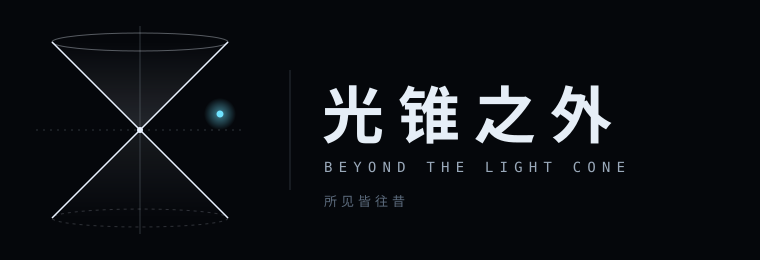
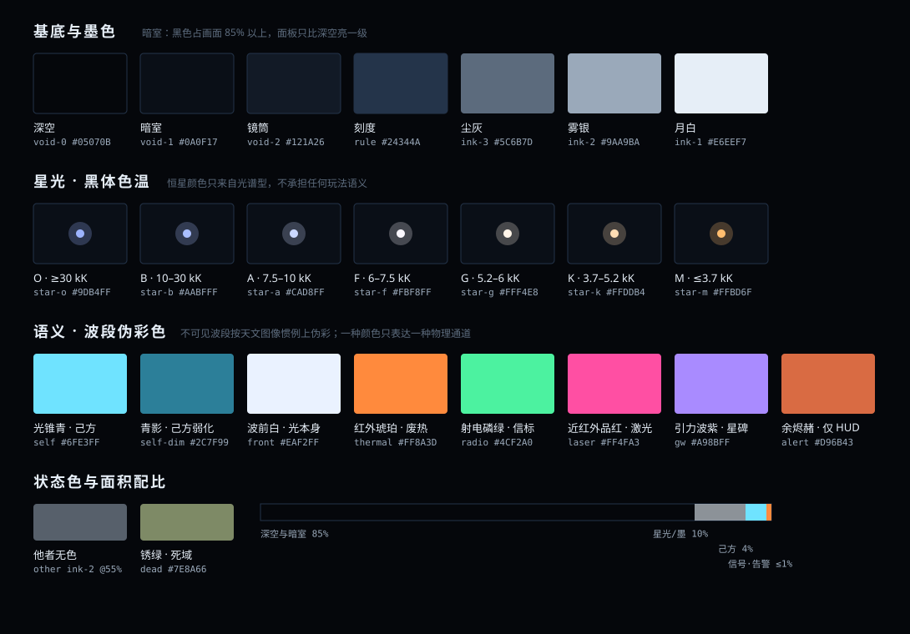
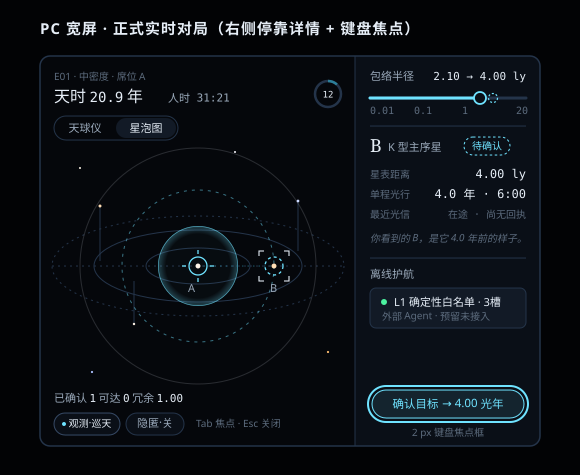

# 《光锥之外》美学设计（Art Direction v0.1）

> 适用范围：M2 双视角原型起的全部客户端画面、界面、动效、声音与文案。机制以 [GDD v0.13.0](../../DESIGN.md) 为准，客户端工程约束见 [技术架构 §3](ARCHITECTURE.md#3-游戏客户端与微信接入)，首个切片的交互流程见 [M1–M2 开发规格](M1-M2-FRONTIER.md#3-m2-微信小游戏原型)。



**一句话**：玩家坐在一间漆黑的观测室里，看到的每一束光都来自过去。画面要冷、静、准，让人对每一点光亮心存敬畏，对自己身上的光亮感到不安。

**美学母题**：**迟到之光 · 暗室观星**。

| 关键词 | 含义 | 反面 |
| --- | --- | --- |
| 迟 | 一切所见都带着时间差，画面主动标出这段时差 | 即时刷新的全知地图 |
| 暗 | 黑暗是默认状态，亮起来意味着被看见 | 满屏辉光、霓虹描边 |
| 准 | 仪器级的线条、刻度与数字，误差也被精确画出 | 装饰性的科幻花纹 |
| 静 | 大面积留白，声音稀少，动效缓慢 | 震屏、爆炸音效、频闪 |
| 疑 | 未经证实的东西在形状上就是不确定的 | 把推测画成事实 |

---

## 1. 气质定位

### 1.1 玩家应有的情绪曲线

画面温度、密度和声音层次随文明阶段推进，与 GDD 的能级、接触和宪政节点对应。

| 阶段 | 对应机制 | 情绪 | 画面 | 声音 |
| --- | --- | --- | --- | --- |
| 摇篮 | Tier 1 微球（[§5.2](../../DESIGN.md#traits-and-tech)） | 孤独、静谧 | 只有星点与一个微小的青色环；几乎没有界面线条 | 底噪与单音 |
| 扩张 | 推半径、接入节点（[§3.2](../../DESIGN.md#space-and-geometry)） | 好奇、掌控 | 包络边缘渐亮，链路细线增多，自身光晕开始变大 | 加入弦乐长音 |
| 初次接触 | `boundary_contact`、弱异常（[§4.1](../../DESIGN.md#sphere-topology)） | 不安 | 屏幕边缘出现来向扇区；一团模糊的方向雾 | 窄带告警音，音乐退后 |
| 猜疑与打击 | 方位锁、三维定位、动能体（[§7](../../DESIGN.md#observation-and-combat)） | 寒意 | 准星、射线、误差椭球；在途物只画己方已知部分 | 心跳般的低频脉冲，大段静默 |
| 灾变 | B1–B4（[§6.2](../../DESIGN.md#sdi-and-cataclysms)） | 渺小 | 辐射壳以恒定速度扫过星区，节点逐个结算 | 低频轰鸣后转为接收机杂讯 |
| 大坍缩 | 宪政公投与过渡（[§8.3](../../DESIGN.md#systems-and-constitution)） | 庄严 | 色彩逐步退去，只余波前与星碑 | 管风琴或人声长和弦 |
| 显影 | 纪元结算后的全知回放 | 真相、释然 | 底片反相：白底黑星，第一次看到所有人 | 回到单音，渐弱 |

### 1.2 不做什么

- 不做赛博朋克霓虹、六边形军事 HUD、全息蓝光堆叠。
- 不给他者涂阵营色，不写“敌人”。他者在被观测到之前没有颜色。
- 真空中的毁伤事件不配音效。声音只来自玩家自己的仪器。
- 不让任何界面变化跑在信息抵达之前，见原则 2。
- 不用连续闪烁吸引注意，闪烁频率受 §13 的上限约束。

---

## 2. 五条美学原则

每条原则都对应 GDD 的物理公理，美术违背原则时，玩家对规则的直觉也会跟着出错。

### 原则 1 · 所见皆往昔

**规则**：画面上的每一条情报都带着年龄。年龄 = 当前天时 − 采样时刻。

- 情报卡、节点详情和告警都显示采样时刻与抵达时刻，文案写“B · 4.0 年前”，而非“B”。
- 情报随年龄褪色：不透明度与饱和度按报告有效窗口衰减，到期后线型改为点线（§3.4）。
- 对应 GDD 公理 3「光速因果铁幕」与 [§3.2.1](../../DESIGN.md#space-and-geometry) 回执时间戳。

### 原则 2 · 可见即因果

**规则**：只画本席位已经知道的东西。任何界面变化都必须能指出它从哪里来、何时抵达。

- **己方发出的东西**可以画在途：接入授权、己方波前、己方动能体。指挥核知道自己何时、从哪里发出，可以按计划外推。
- **别处发来的东西**只在抵达那一帧出现：回执、接触报告、他者信号。抵达时在接收点打一圈涟漪，再沿来路回溯一道短光（300 ms），告诉玩家“它从那里来”。
- 前沿扫过 B 后，B 仍是待确认虚环。成功与失败两条分支在回执抵达前的画面逐像素一致，与 [M1–M2 §2.3](M1-M2-FRONTIER.md#23-自动化验收) 的“当地未接入”验收同口径。
- 他者的动能体只在其前导激波光抵达时出现（RKV 最早提前 5.29 real min）；尼科尔–戴森光束与光同到，**没有任何前兆动画**。最可怕的是空白。

### 原则 3 · 亮即暴露

**规则**：亮度是代价。自身越亮，越容易被看见。

- 己方标记的光晕大小直接映射自身热辐射与信标强度（§9.2）。玩家调高能级、扩大半径时，会亲眼看着自己变亮。
- 隐匿系升级让己方标记变暗、光晕收缩，界面也随之“压低声音”。
- 画面中的高亮区只留给真实的辐射源。界面控件不使用辉光，避免与暴露信号混淆。
- 对应 GDD 公理 2「热力学暴露」与 [§7.1](../../DESIGN.md#observation-and-combat) 的 SNR 公式。

### 原则 4 · 确定性即形状

**规则**：证据多少决定图形是否收敛。从一团雾，到一条射线，到一个带误差椭球的点。

- 弱异常是模糊方向雾；二维方位锁在天球仪是准星，在星泡图是**没有终点的射线**；只有三维定位才画成可拾取的点。
- 节点状态由外圈线型区分：实线确认、虚线等待、缺口失联、碎环损毁。颜色只作辅助，灰度下仍可读（§5）。
- 对应 GDD [§7.2](../../DESIGN.md#observation-and-combat) 三层披露与“单站高 SNR ≠ 三维距离”。

### 原则 5 · 仪器而非武器

**规则**：界面是天文台的仪器，不是战舰的火控台。

- 线条源自尺规作图：圆、直线、刻度、弧。图标都应能用圆规和直尺画出。
- 结构取现代天文软件（球面经纬网与视场准星）与中国古代简仪、浑仪的刻度节律，克制精简。天球仪是置身球心向外的第一人称全天幕观测窗。
- 打击操作同样使用测量语言：“提交拦截解”“预计散差 ±0.3 ly”，而非“开火！”。

---

## 3. 色彩系统



### 3.1 基底：暗室

背景用带一点蓝的近黑，不用纯黑，在 OLED 上避免拖影，也为“比黑更黑”的死域和隐匿留出余地。

| Token | 色值 | 用途 |
| --- | --- | --- |
| `void-0` 深空 | `#05070B` | 星图背景 |
| `void-1` 暗室 | `#0A0F17` | 底部详情、侧栏底色 |
| `void-2` 镜筒 | `#121A26` | 选中态、按下态、分段控件滑块 |
| `rule` 刻度 | `#24344A` | 网格、分隔线、未激活轨道 |
| `ink-3` 尘灰 | `#5C6B7D` | 次要标签、过期信息、禁用 |
| `ink-2` 雾银 | `#9AA9BA` | 正文标签、未识别他者 |
| `ink-1` 月白 | `#E6EEF7` | 主要数字与正文 |

### 3.2 星光：黑体色温

恒星颜色只由光谱型决定，取黑体辐射在人眼中的近似色（Mitchell Charity 黑体色表），**不承担任何玩法语义**。

| 光谱型 | 温度 | 色值 |
| --- | --- | --- |
| O | ≥ 30,000 K | `#9DB4FF` |
| B | 10,000–30,000 K | `#AABFFF` |
| A | 7,500–10,000 K | `#CAD8FF` |
| F | 6,000–7,500 K | `#FBF8FF` |
| G | 5,200–6,000 K | `#FFF4E8` |
| K | 3,700–5,200 K | `#FFDDB4` |
| M | ≤ 3,700 K | `#FFBD6F` |

星点亮度按视星等映射为点径与光晕，分 5 档，避免远处恒星糊成一片。

### 3.3 语义伪彩色

不可见波段按天文图像（如 JWST、Chandra 合成图）的惯例上伪彩。**一种颜色只表达一种物理通道**，不能借给别的含义。

| Token | 色值 | 唯一含义 | 典型出现 |
| --- | --- | --- | --- |
| `self` 光锥青 | `#6FE3FF` | 己方：包络、已确认节点、主操作 | 包络菲涅尔边、节点实环、主按钮描边 |
| `self-dim` 青影 | `#2C7F99` | 己方的弱化态 | 失联节点、单向链路底线、SDI 低区 |
| `front` 波前白 | `#EAF2FF` | 光本身：外球、波前、观测线 | 光锥外球、方位射线、误差椭球 |
| `thermal` 红外琥珀 | `#FF8A3D` | 废热、红外暴露 | 他者热晕、己方暴露光晕、热沉排放 |
| `radio` 射电磷绿 | `#4CF2A0` | 射电信标、`[PING]`、通信 | 信标同心环、共鸣握手 |
| `laser` 近红外品红 | `#FF4FA3` | 激光信标、尼科尔–戴森光束 | 窄束光针 |
| `gw` 引力波紫 | `#A98BFF` | 引力波、星碑、跨纪元遗迹 | 星碑四极形变环、纪元传承 |
| `alert` 警示赤 | `#FF3B47` | 仅限 HUD 的临界告警 | SDI ≥ 90%、来袭倒计时 |

**状态色**：

- 他者无色：未识别的他者泡用 `ink-2` 55% 描边。只有在某个波段被观测到时，才以该波段的伪彩色出现。颜色要靠观测去挣。
- 锈绿 `#7E8A66`：冯·诺依曼狂战感染球与永久死域，低饱和、带颗粒噪点。

> [!NOTE]
> 情绪参考图里的黄铜色刻度很有仪器感，但琥珀色已分配给“废热暴露”，因此正式界面的刻度统一使用 `rule` 与 `ink` 系列，不引入铜色。

### 3.4 面积配比与动态规则

- **配比**：深空与暗室 ≥ 85%，星光与墨色约 10%，己方青约 4%，信号与告警 ≤ 1%。截图检查超出配比时，优先删减界面线条。
- **信息龄衰减**：设报告年龄 `age`、有效窗口 `T_valid`，则
  `opacity = 1 − 0.55 · clamp(age / T_valid, 0, 1)`，饱和度同比例下降；超过窗口后线型改为点线，并标注“报告过期”。
- **多普勒色移**：仅对 β > 0.1 的相对论物体（动能体、火种）启用。迎面而来的偏向 O 型蓝，远离的偏向 M 型红，偏移量取 [§7.1](../../DESIGN.md#observation-and-combat) 的 `ν_r/ν_e`，再做对数压缩。
- **SDI 映射为热噪声**：内部熵增不用红色表达，而用仪器噪点表达，类比电阻的热噪声随温度上升。`grain = 0.02 + 0.06 · smoothstep(0.38, 1.0, SDI)`（跨过 `38%` 安全线后噪点随冷战危机率升高逐渐爬升）。SDI ≥ 90% 后，HUD 的 SDI 环改用 `alert`。

> **口诀：外部威胁用光表达，内部危机用噪声表达。**

---

## 4. 字体与数字排印

### 4.1 字体

| 角色 | 字体 | 授权 | 包体策略 |
| --- | --- | --- | --- |
| 标题、叙事、纪元名、成就铭文 | 思源宋体 Source Han Serif SC | SIL OFL | 只对静态文案子集化，或预烘为位图字 |
| 界面正文 | 系统字体：iOS 苹方，Android 系统黑体，PC 苹方或微软雅黑 | 系统自带 | 零包体 |
| 数字、单位、坐标、时钟 | JetBrains Mono | SIL OFL | 子集化 `0-9 . , + − × ± ° ′ ″ % : / K W m ² ³ l y A U c s i r _ ≈`，约 20 KB；高频刷新的数字用 BMFont |

宋体的笔意带来文学感与庄重感，用于“叙事的声音”；黑体负责“仪器的声音”；等宽数字保证倒计时跳动时不抖。

### 4.2 字号阶梯（375 pt 逻辑宽度）

| 级别 | 字号 / 行高 | 字体 | 用途 |
| --- | --- | --- | --- |
| Display | 32 / 40 | 宋体 600 | 纪元开场、显影标题 |
| Title | 22 / 30 | 宋体 600 | 节点名、详情标题 |
| Head | 17 / 24 | 黑体 600 | 区块标题 |
| Body | 14 / 22 | 黑体 400 | 正文、说明 |
| Data | 16 / 22 | 等宽 500 | 关键读数 |
| Caption | 12 / 18 | 黑体 400 | 标签、单位 |
| Micro | 11 / 14 | 黑体 400 | 仅限星图刻度标签等非关键信息 |

### 4.3 数字书写规范

- **双时钟分开命名**。玩家可见文案中，`sim_*` 称 **天时**，`real_*` 称 **人时**。两者始终带名称，绝不裸露数字。
  - 天时：宋体名 + 等宽数字 + “年”，例：`天时 20.9 年`。详情中可展开为 `1 259 148 240 sim_s`。
  - 人时：等宽，`mm:ss` 或 `h:mm:ss`，例：`人时 59:51`。
  - `′ ″` 只用于角度（天球仪），不用于时间。
- **距离**：保留两位小数并带单位，`4.00 ly`；叙事句中写“4 光年”。
- **科学计数**：玩家界面用 `1.42 × 10³ W/m²`，不用 `1.42e3`。MCP 与调试面板不受此限。
- **符号**：负号用真减号 `−`，正负号用 `±`，数字与单位之间用窄空格。长整数按三位分组，用窄空格分隔。
- **不确定度**：凡是估计值都带 `±σ`，例：`距离 20.3 ± 0.4 ly`。没有误差带的数字表示星表值或己方确知值。

---

## 5. 图形语法：确定性


### 5.1 观测三层

| 层级 | GDD 条件 | 天球仪 | 三维星泡图 | 可交互 |
| --- | --- | --- | --- | --- |
| ① 弱异常 | 1 ≤ SNR < 5 | 高斯模糊的方向雾 + 虚线误差圆 | 不绘制，或沿观测方向画一段淡锥 | 可选中查看，不可瞄准 |
| ② 二维方位锁 | SNR ≥ 5，单站单历元 | 十字准星 + 误差圆 | **从观测者出发、渐隐至无穷的射线**，不画终点 | 可选中，不可作为打击目标 |
| ③ 三维星历定位 | 方位锁 + 测距证据 + 多历元 | 准星 + 距离标签 | 点 + 误差椭球，随时间沿自行外推 | 可拾取、可提交拦截解 |

射线是这套语法的关键：它把“知道方向、不知道距离”这件事直接画了出来，玩家无需读规则就能理解为什么不能开火。

### 5.2 节点状态

| 状态 | 字形 | 线型 | 颜色 | 动态 |
| --- | --- | --- | --- | --- |
| 公开星 | 光谱色点 + 柔光晕 | — | 星光色 | 无 |
| 摇篮 | 实环 + 下方一条地平线 | 实线 | `self` | 无 |
| 指挥核 | 实环 + 四向刻度 | 实线 | `self` | 无 |
| 已确认 | 实环 | 实线 | `self` | 确认瞬间一次涟漪 |
| 待确认 | 虚环 | 4/4 虚线 | `self` 85% | 4 s 周期慢呼吸，幅度 ±15% |
| 超时·未确认 | 灰虚环 + `?` | 虚线 | `ink-3` | 无；合法迟到回执可将其更新为已确认 |
| 失联 | 缺口环（缺 70°） | 实线 | `self-dim` | 无；仍属己方 |
| 损毁·废墟 | 四段碎环 + 小叉 | 实线 | `ink-3` | 碎环在 1.2 s 内外散 4 px 后静止 |

摇篮与指挥核是同一节点时叠加两种字形（地平线 + 四向刻度）。

### 5.3 链路

| 状态 | 线型 |
| --- | --- |
| 双向有效 | `self` 实线 1.5 px |
| 单向可用 | `self-dim` 底线 + 指向可用方向的人字纹 |
| 己方指令在途 | 底线上一颗月白光点，带拖尾，**匀速**前进 |
| 回执抵达 | 接收点涟漪 + 自接收点向来源回溯的短光，300 ms |
| 报告过期 | `ink-3` 点线 |
| 失去路径确认 | 中段断开，两端各一道垂直短刻度 |

---

## 6. 两大视角、拓扑与显影回放

### 6.1 天球仪：置身球心的第一人称全天幕


*情绪参考：第一人称全天幕、银河带与透视投影下的球面经纬线。*

- **第一人称构图**：置身己方指挥核，以**第一人称**向外环视 `4π sr` 全天球（如 Stellarium 等天文软件），星空与坐标网**铺满全屏**，不画外部球壳或圆顶边框。默认视场约 75°–90°，支持单指拖转视线与双指捏合／滚轮缩放视场（FOV 15°–110°）。
- **球面经纬网格与参考系**：默认采用与 [MCP 接口规格 §1](MCP.md#1-文明席位坐标系与双时钟口径) 严格一致的**席位世代局部惯性系 $(\theta,\phi)$**（以出生球心施加该席位独立随机 $SO(3)$ 旋转定轴）：
  - **基准统一**：本席位天球仪的基准赤道 $\phi=0^\circ$ 与三维星泡图的极坐标参考平面（$z_{\text{local}}=0$）共面，且读数 $(\theta,\phi)$ 与副官 `orient_telescope` 参数同口径；不同席位间经纬零点互相隔离，绝不泄露全局方向。
  - **物理意义**：正如地球天文学以自身赤道／黄道面定坐标，银河带自然斜穿席位局部经纬网；高速迁徙（如 `0.25c` 火种）时星空因相对论光行差向航向收拢，经纬网作为本端测量标尺保持刚性。
  - **视觉规格**：`rule` 细线按球面透视投影绘制（整体不透明度 ≤ 20%），随视场缩放自动切换疏密（30° / 15° / 5° / 1°）；基准赤道 $\phi=0^\circ$ 略亮并带度数刻度，角落保留指向与视场读数（如 `θ 42.0°  φ +10.0° · FOV 78°`）。另可提供可选开关，叠加仅标识银河盘倾角（不设全服银经零点）的辅助参考线。
- **凝视框**：开启 Lv.2–Lv.4 窄束凝视时，在屏幕中央绘制当前立体角 $\Omega_A$ 对应的视场框（角秒过小时保持最小可见准星并旁注真实立体角）。
- **他者**：微球是零维点；已合法观测到视直径的巨泡画成贴合天幕的角直径 `Δθ = 2 arcsin(R/d)` 半透明圆斑，描边按观测波段上伪彩。
- **包络内**：观测者处在己方包络内时，已确认节点按来光方向标在天幕上，旁注距离与光行时间。
- **银河带**：用一张低分辨率全天贴图承载，亮度压到星点之下，作为方向感参照。

### 6.2 三维星泡图：暗室中的沙盘


*情绪参考：菲涅尔边缘的包络、极淡的光锥外球、远处他者的红外热晕、带落地线的星点。*

- **参考面**：与天球仪 $\phi=0^\circ$ 共面的席位基准面上画极坐标网格，同心距离环按 1 / 5 / 10 / 20 ly 标注，远处渐隐。
- **深度提示**：星点向参考面垂下一条落地线，线端画一个小点。这是三维星图在手机小屏上最便宜也最清楚的深度提示。
- **内球（包络）**：只画菲涅尔边缘，填充不透明度 ≤ 4%。边缘亮度随正在扩张或收缩而略增。目标半径用 `self` 虚线轮廓。
- **外球（光锥）**：`front` 极细线，不透明度 ≤ 18%。具体信号的波前从实际发射节点出发，单独绘制。波前与参考面相交处画一圈稍亮的环，帮助判断它已扫到哪里。
- **远近分级**：远景只显示文明标记；拉近后依次出现包络、已确认节点、链路与报告时间，与 [GDD §4.2](../../DESIGN.md#sphere-topology) 一致。
- **相机**：带惯性的轨道相机，缓动见 §8。视角切换时用 900 ms 完成第一人称到第三人称的镜头拉出：从球心沿原视线反方向退至星泡图轨道视角，同时锚定原视线方向或选中节点，两视角共享选中项与播放位置。

### 6.3 显影：纪元结算后的全知回放



纪元关闭后，回放进入**底片反相**模式：白底（`#F4F6F8`）、黑星（`#11161F`）、墨线，像一张冲洗出来的天文玻璃底片。

- 局内的一切都在黑暗中观看；只有纪元结束，“真相”才被显影。反相让玩家一眼区分“当时我知道的”和“其实发生的”。
- 回放可叠加“当时视野”图层：把某个席位当时的未观测范围以暗色半透明蒙版覆盖在底片上，展示信息差。
- 冻结写入档案的在途物（[§8.3](../../DESIGN.md#systems-and-constitution)）在底片上画成带箭头的铅笔虚线，旁注“未抵达”。
- 引力波星碑以档案紫（`#6E46D6`）保留彩色，是底片上唯一的颜色，也将以 `gw` 紫出现在下一纪元的天幕上。
- 时间回放控件（`暂停 ||`、`快进 ×10 >>`、`重播 ↻` 与时间轴滑块）收拢在底片底栏中，与正式实时对局的仪器 HUD 严格隔离。

### 6.4 球体拓扑与泡内噪底


三维球体交锋遵循原则 2「可见即因果」，严禁利用全局几何瞬间画出敌我边界（[GDD §4.1](../../DESIGN.md#sphere-topology)）：

- **相离与外切**：未获知对方边界时不绘制对方包络；外切处交叠体积与摩擦均以零渲染。只有当外切点存在真实中继或前沿探测网、且接触报告以光速抵达指挥核后，才在屏幕边缘提示来向扇区。
- **空透镜交叠**：若交叠区仅为不含任何节点与外围设施的纯真空，允许根据各自已合法取得的几何资料，用极淡对角斜线（`rule` 25%）预览共同探索空间，不产生争夺摩擦色。
- **含节点交叠**：仅当冲突报告以光速抵达指挥核后，才显现受争节点／中继上的 `thermal` 冲突环与来路回溯光；双向 `[PING]` 共鸣或脱离波前抵达后，摩擦光环渐隐清零。
- **包含（泡内寄生）**：大球吞小球时不显示常规边界告警。随着宿主外围节点的实际红外／电磁波前扫过己方微球，微球周围天幕会随局地杂波噪底 `N_local` 升高（最高可达 `10²–10³ N_bg`）而泛起一层均匀的散射薄雾，用直观的“背景光雾吞没信号”表达隐蔽度与信噪比压迫。

---

## 7. 物理现象的视觉化

所有物理传播都**线性匀速**，绝不缓动；光速是常数，动画也必须是常数。

| 现象 | GDD | 视觉 | 因果约束 |
| --- | --- | --- | --- |
| 包络扩张 / 收缩 | §3.4 | 菲涅尔边以 `0.10c` / `0.25c` 匀速推移，边缘略亮 | 画的是己方计划；远端节点仍按回执更新 |
| 节点接入 | §3.2 | 前沿扫过 B 时 B **不变**；回执抵达 A 时 B 虚环转实环，A 处涟漪，计数跳变 | 计数只在回执抵达帧改变 |
| 己方波前 / 外球 | §1 支柱 1 | `front` 细壳，与参考面相交处成环 | 从实际发射节点、发射时刻出发 |
| 边界接触 | §4.1 | 屏幕边缘的来向扇区弧 + 窄带告警音，不画对方位置或半径 | 只披露到达时刻、类别、粗略扇区 |
| 他者热辐射 | §7.1 | `thermal` 柔光晕，大小随 SNR 对数增长 | 只在观测成功后出现 |
| 射电信标 / `[PING]` | §5.3 | `radio` 锐利同心环；双向 `PING` 为一呼一应两组环 | 对方的应答只在抵达时出现 |
| 激光信标 | §5.3 | `laser` 极细光针，旁瓣画为淡扇 | 同上 |
| 动能脉冲 0.50c | §5.3 | 小光点 + 短拖尾，多普勒色移 | 他者发射的，在其前导光抵达后出现，最早提前 30 real min |
| RKV 0.85c | §3.4 | 前向半角约 30° 的蓝白聚束锥，弹体本身几乎不可见 | 他者发射的，最早提前 5.29 real min 出现 |
| 狂战集群 0.25c | §7.3 | `dead` 锈绿感染球，带颗粒；灭绝后转为永久死域，比深空更暗 | 感染球按 0.15c 匀速扩张 |
| 尼科尔–戴森光束 | §7.3 | **无前兆**。受照节点瞬间白化 200 ms，随后留下 `laser` 余辉，按剂量判定碎环或保留 | 光束与光同到，不存在预警画面 |
| 诱导超新星 / B4 | §6.2 | 一次受限亮度的白闪，`front` 辐射壳以 c 推进，较慢的抛射物壳以 0.03c 跟进；壳扫过的节点逐个结算 | 远处节点要等壳抵达才结算 |
| B1a/B1b 暗天体与撞击 | §6.2 | 预警期在天球仪上画一条缓慢逼近的轨迹弧，30 real min 倒计时 | 需观测 Lv.1 才会出现 |
| SDI 破百 / 解列 | §6.1 | 全屏噪点在 1 s 内升到峰值后回落；包络边缘破碎回缩；指挥端在对应脉冲或报告抵达时看到解列与至多 4 座废墟发出的 `front` 全向环 | 球外节点按当地事件退网 |
| 火种迁徙 | §5.3 | 加减速段带 `thermal` 尾焰，巡航段近乎不可见 | 尾焰即暴露，与 4.0× 倍率一致 |
| 引力波星碑 | §5.3 | `gw` 紫色四极形变环，横竖椭圆交替，周期 6 s | 消光为零，跨纪元留存 |
| 死后光锥回响 | §7.4 | 仅在已灭绝席位的纪元墓碑卡上生成一枚低饱和 `gw`/`front`「光信回响」邮戳；星图保持静默黑场，不画来向弧或他者节点 | 严格零坐标／方向／存亡态泄露，直到公投结算关闭后随全知回放解锁 |

---

## 8. 动效

### 8.1 原则

1. **物理匀速，界面缓动**：传播类动画一律线性；界面面板、相机、读数可以缓动。
2. **抵达才动**：别处来的信息在抵达帧触发动画，动画不得提前开始以“预热”（原则 2）。
3. **从源头来**：状态变化以涟漪、回溯光等形式标出来源位置。
4. **慢呼吸，不闪烁**：持续状态用 ≥ 2 s 周期的呼吸表达，不用快速闪烁。
5. **惯性而无弹跳**：天体级缓动，不使用回弹弹簧。

### 8.2 动效 Token

| Token | 时长 | 曲线 | 用途 |
| --- | --- | --- | --- |
| `motion.press` | 80 ms | `ease-out` | 按压反馈 |
| `motion.quick` | 160 ms | `cubic-bezier(0.2, 0, 0, 1)` | 分段切换、标签出现 |
| `motion.panel` | 280 ms | `cubic-bezier(0.16, 1, 0.3, 1)` | 底部详情展开、侧栏停靠 |
| `motion.arrival` | 600 ms | `ease-out` | 抵达涟漪：半径 0 → 24 px，不透明度 0.8 → 0 |
| `motion.trace` | 300 ms | `linear` | 抵达后的来路回溯光 |
| `motion.camera` | 900 ms | `cubic-bezier(0.16, 1, 0.3, 1)` | 视角切换、聚焦节点 |
| `motion.breath` | 4000 ms | 正弦 | 待确认呼吸 |
| `motion.propagate` | 按物理 | `linear` | 波前、前沿、在途物；时长 = 距离 / 速度 ÷ 快进倍率 |

快进只等比加快物理传播的播放速度，不改变动画之间的相对时序，与 [M1–M2 §1](M1-M2-FRONTIER.md#1-场景与时间基准) “快进只改变演示速度”一致。

### 8.3 减弱动态

系统或游戏内开启“减弱动态”后：涟漪改为一次性描边高亮；回溯光改为静态箭头 1 s；呼吸改为静态虚环；相机切换改为 200 ms 淡入淡出。

---

## 9. 界面与 HUD


线框画面对应 [M1–M2 主场景](M1-M2-FRONTIER.md#1-场景与时间基准) 第 1881 人时秒附近（包络 2.10 ly，目标 4.00 ly，B 仍待确认）：上方两屏为**正式实时对局 HUD**，下方虚线抽屉为隔离的 **M2 离线原型调试条**。

### 9.1 布局

- **手机竖屏为基线**，星图占满全屏，HUD 浮在上面并避开安全区。上沿放状态，下沿放操作，拇指热区（右下）留给半径推杆。
- **顶部**：纪元与席位、天时（大）、人时（小，正式对局仅显示连续流动的基准时间，不带倍速或暂停角标）、SDI 环。
- **中部**：视角分段控件；星图；屏幕边缘的来向扇区提示。
- **底部**：已确认 / 可达 / 冗余三项计数；仪器模式开关（`观测`、`隐匿` 胶囊切换）；主操作按钮（`确认目标 → X.XX 光年`，与半径推杆配合提交目标）。
- **离线演示与显影回放隔离**：`暂停 ||`、`快进 ×10 >>`、`重播 ↻`、时间轴进度条及 `预设 · 扩张至 4 光年` 触发器只出现在 **M2 离线原型调试条**（[M1–M2 §3.1](M1-M2-FRONTIER.md#31-两种视角的演示流程)）与 **M4 纪元结算显影底栏**（§6.3）。M3+ 正式联机对局因服务端光速时间轴对所有文明统一流动，主画面不设时间暂停或倍速入口。
- **底部详情**：轻点节点后上滑展开，星图压暗 40% 但不模糊（保持“仍在观测”）。
- **PC 宽屏**：同一详情面板停靠右侧栏（宽 360 pt），半径推杆改为侧栏顶部的横向对数刻度尺；键盘焦点用 `self` 2 px 外描边（见 §6.3 附图左栏），与 [M1–M2 §3.2](M1-M2-FRONTIER.md#32-移动端优先与-pc-操作) 一致。

### 9.2 招牌组件

**半径推杆（对数弧）**：全局最重要的控件，单独设计。

- 右下角四分之一圆弧，对数刻度 0.01 – 20 ly，标注 0.01 / 0.1 / 1 / 10 / 20。
- 实心旋钮为当前半径，虚线小环为目标半径，已走过的弧段为 `self`。
- 拖动时在弧内侧实时预览后果：光行半径 `R/c`、预计新增候选节点数、暴露等级变化、同步压力变化。数字带 `≈` 前缀，表示估计。
- 超出当前能级上限的弧段以 `ink-3` 点线显示，并注明解锁条件。
- 拖动推杆只移动目标预览虚线环与后果估值，点击底部主操作按钮（`确认目标 → X.XX 光年`）才真正提交扩张／收缩指令；视场缩放、视角拖转与试探拖动均不修改节点目标，也不增加指令次数。

**光信邮戳卡**：每份报告（回执、接触、观测）都是“一封来自过去的信”。

- 右侧圆形邮戳印：采样时刻、抵达时刻、光行延迟；左侧三道波浪注销线。
- 卡片底部一句时间提示：“你看到的 B，是它 4.0 年前的样子。”
- 邮戳随信息龄褪色（§3.4）。尚未收到任何报告时，邮戳显示“在途”或“—”。
- 玩家可见文案称“光信”，契约与 MCP 字段名保持不变。

**暴露度光晕**：己方指挥核标记外的一圈光晕，按参考观测者在 20 ly、`G=1` 处对己方的 SNR 估值分四档，档位与 [§7.1 校准表](../../DESIGN.md#observation-and-combat) 对应。

| 档位 | SNR@20 ly | 典型配置 | 光晕 |
| --- | --- | --- | --- |
| 暗 | < 1 | Tier 1 + 隐匿 Lv.1；Tier 3 + 隐匿 Lv.4 | 无光晕，标记降到 70% 亮度 |
| 微 | 1 – 5 | Tier 1 无隐匿 | 半径 1.5× 标记，`thermal` 10% |
| 明 | 5 – 100 | Tier 2 | 半径 2.5×，`thermal` 20% |
| 炽 | > 100 | Tier 3 | 半径 4×，`thermal` 30%，缓慢起伏 |

**SDI 环**：细圆环。0–38%（安全区）为 `self-dim`；38–90%（含 55–85% 冷战边缘带）随险度渐变至 `thermal`，同时全屏噪点上升；≥ 90% 转 `alert`。环本身不闪烁。

**来向扇区**：屏幕边缘的一段细弧，弧长对应扇区宽度，不给精确方向；点按后视线转向该扇区中心。

### 9.3 控件风格

- 按钮：胶囊形，1 px 描边，填充不透明度 ≤ 8%。主操作用 `self` 描边，其他用 `rule`。
- 状态标签：与节点同语法。待确认 = 虚线描边，已确认 = 实线描边，超时 = 灰虚线。
- 图标：1.5 px 线宽，24 pt 网格，只用圆、直线与弧，端点圆头。
- 分隔：用 `rule` 细线和留白分隔区块，不用卡片阴影。
- 触控热区 ≥ 44 × 44 pt，视觉尺寸可以更小。

### 9.4 M3–M4 专属界面（副官管理与宪政公投）

- **MCP 副官管理（M3，[技术架构 §3.4](ARCHITECTURE.md#34-mcp-副官管理)）**：
  - 五种授权状态复用节点线框语法：未授权（`rule` 虚线）、待授权（`self` 虚线 + 慢呼吸）、已授权（`self` 实线）、已撤销（`ink-3` 实线带斜杠）、已过期（`ink-3` 点线）。
  - 能力分组以仪器图标区分：只读观测（目镜）、半径调控（刻度尺）、科研分配（星标）、指向打击（准星印章；`ALLOW_AGENT_STRIKE` 等高危写入开关采用 `thermal` 描边，需长按 800 ms 确认，避免误触）。
  - L1 三槽位白名单条件反射排成三行“继电器跳线卡”：`[已抵达告警 / 遥测条件] ——▶ [本地动作]`，不设自由脚本框，直观体现确定性反射。
  - 最近指令记录按“受理 / 拒绝 / 回执已抵达”三栏时间轴排印，证明外部副官与 HUD 共用同一份席位事实。
- **宪政五阶段公投（M4，[GDD §8.3](../../DESIGN.md#systems-and-constitution)）**：
  - 排印气质像一份“联合天文台公报与档案白皮书”：宋体标题 + 等宽统计表，不用进度条炫光或竞选投票动效。
  - **立宪动议**：发起确认页标明扣除代价与 `S_beacon = 5.0` 的 2 小时（人时）全向暴露状态；广播期间顶部边缘亮起一条 1 px 常亮细线，提示“本席位正在全向暴露”。
  - **公民联署与白皮书**：白皮书提前采用 §6.3 的玻璃底片纸色卡片，冷静列出废墟数、平均节点／半径、打击次数与能源熵。
  - **秘密公投**：只显示本席位匿名票据回执码与公开参与率；开票前不画倾向趋势线。
  - **大坍缩过渡（60 real min）**：顶部出现 `距归档封存` 人时倒计时；各节点收到局部停火令后点亮“停火已抵达”印记，画面色彩饱和度在最后 10 分钟随倒计时抽离，并在 `t_close` 抵达的瞬间定格切入显影底片。

---

## 10. 声音美学

### 10.1 原则

1. **静默为底**：大部分时间只有极低的底噪。
2. **声随信至**：除了按压反馈，所有声音都在信息抵达本席位的那一帧发出，下令时不配“发射音”。
3. **真空无声**：星图上的事件不配拟真音效；玩家听到的是自己仪器的声音，是接收机把信号转成的声音。
4. **亮即响**：背景音乐的和声密度随己方暴露度增加。越亮越喧闹，越隐匿越安静。

### 10.2 声音调色板

| 事件 | 声音 | 备注 |
| --- | --- | --- |
| 环境底噪 | 粉红噪声 + 极低频持续音，约 −30 LUFS | 宇宙微波背景的联想；切后台淡出 |
| 按压 / 刻度 | 短促木质或机械刻度声 | 半径推杆每过一个整数量级发出一次 |
| 回执抵达 | 纯五度双音铃 | 成功接入的唯一奖赏，克制 |
| 超时 | 单音下行，随即静默 | 不用失败音效 |
| 边界接触 | 窄带正弦缓慢上扫 | 与来向扇区同时出现 |
| 方位锁 | 接收机调谐声，杂讯收敛为一个清晰音 | 对应“从雾到点” |
| `[PING]` 共鸣 | 一呼一应两段旋律，中间隔着真实时延 | 成就 1 的核心体验 |
| 他者打击抵达 | 采样中断 300 ms 的完全静默，随后低频冲击 + 杂讯 | 用静默表达毁灭 |
| B4 辐射壳扫过 | 持续低频轰鸣，随节点结算逐一掉落为杂讯 | — |
| 引力波星碑 | 啁啾（频率与振幅同步上扬） | 取意 LIGO 并合啁啾 |

### 10.3 音乐分层

- Tier 1：单音钢琴或正弦长音，极稀疏。
- Tier 2：加入弦乐长音与缓慢和声进行。
- Tier 3：加入人声或管风琴长和弦，和声更厚。
- 接触与猜疑阶段：音乐退后，节奏层被低频脉冲替代。
- 大坍缩过渡：全部声部合为一个长和弦，60 real min 内缓慢衰减。

**触感**：微信端回执抵达时调用一次轻振动（`wx.vibrateShort`，`type: light`），打击抵达用一次重振动。触感可在设置中关闭。

---

## 11. 文案与语气

### 11.1 语气

- 像一份观测日志：冷静、克制、第三人称、陈述句。不用感叹号，不说“恭喜”。
- **时态严格**：没有回执的事情，不写成已发生。
- **每条情报带时间**：采样于何时，抵达于何时。
- **他者中性**：称“他者”“未知源”“信号源”，不称“敌人”。
- **测量语言**：用“提交拦截解”“预计散差”，不用“开火”“攻击”。

### 11.2 对照

| 不要 | 要 |
| --- | --- |
| 成功占领 B！ | B 接入回执已抵达。采样于 4.0 年前。 |
| 正在占领 B… | B 待确认。若当地已接入，回执最早于人时 65:51 抵达。 |
| 接入失败 | 超时 · 结果未确认。迟到的回执仍会被受理。 |
| 发现敌人！ | 西北扇区出现弱异常。方向不确定，距离未知。 |
| 敌人坐标已锁定 | 方位锁定。缺少距离证据，尚不能作为打击目标。 |
| 开火！ | 拦截解已提交。动能体以 0.85c 离港，预计 35.3 人时分钟后抵达。 |
| 你被攻击了！ | 节点 C 失去回应。最后一份报告采样于 2.1 年前。 |
| 恭喜达成成就 | 铭文 · 同时空的对视 |

### 11.3 开场与载入语

载入画面一次只出一句，用宋体，下方小字注明出处或依据。

- 你看到的每一颗星，都是它的过去。
- 比邻星的光，走了 4.24 年才到你眼前。
- 旅行者 1 号飞了将近 49 年，才离开地球一光日。
- 在这片星区，最安全的文明，是没人看见的那一个。
- 声音传不过真空。你听到的，只是自己的仪器。
- 越亮，越近。

---

## 12. 品牌

**标志**：一枚闵可夫斯基光锥——两条 45° 线相交于“此刻”，上为未来锥，下为过去锥，锥外有一颗青色的点。锥外即物理学中的“类空区域”，也就是“光锥之外”：此刻存在、却无法被知道、也无法被触及的地方。

- 组合：标志 + 宋体中文名 + 等宽英文名 `BEYOND THE LIGHT CONE` + 标语“所见皆往昔”。
- 单色版：去掉锥内渐变，青点改为实心月白。
- 最小尺寸：标志 24 pt，中文名 14 pt。
- 应用图标：深空底 + 光锥线 + 青点，不放文字。

**纪元名**：每个纪元给一个以天文现象命名的宋体标题（如“第一纪元 · 微光”），显影回放与白皮书沿用。

**五枚成就铭文**：每枚是一个可用尺规画出的几何徽记（见 §6.4 附图 B 栏），宋体铭文环绕，统一 `ink-1` 线稿，无颜色等级之分，与 [§8.1](../../DESIGN.md#systems-and-constitution) “横向平权”一致。

| 成就 | 徽记 |
| --- | --- |
| 同时空的对视 | 两个相切的圆，切点一颗星 |
| 跨世代的回响 | 四极形变环套着一道时间轴 |
| 深空幽灵 | 大圆内一个几乎看不见的小点 |
| 雾中寻真 | 一团雾中收敛出的十字准星 |
| 黑暗森林猎手 / 削蚀幸存者 | 一条射线穿过碎环 / 碎环中残存的一段实弧 |

---

## 13. 可访问性与舒适度

- **形状优先**：所有状态都能靠线型与字形区分。验收时把截图转灰度，八种节点状态和三层观测仍能分辨。
- **色觉辅助**：提供红绿与蓝黄色觉模式。红绿模式下 `radio` 改为 `#589CFF`（天蓝，明度仅为己方青的一半，与 `#6FE3FF` 拉开明度差与色相差）并加点阵纹理，`thermal` 改为 `#FFC24D`。
- **对比度**：正文对 `void-1` 的对比度 ≥ 4.5:1。`ink-2` 对 `#0A0F17` 为 8.0:1，`ink-1` 超过 16:1；`ink-3`（3.5:1）只用于非关键与过期信息。显影玻璃底片模式下，`plate.ink` 与 `plate.inkMid` 对底片底色的对比度分别为 16.7:1 与 5.5:1。
- **光敏安全**：任何全屏亮度变化每秒不超过 3 次；超新星白闪峰值不超过画面平均亮度的 3 倍，持续 ≤ 200 ms；设置中可“减弱闪光”，将白闪改为描边高亮。
- **字号**：正文 ≥ 14 pt，关键读数 ≥ 16 pt，Micro 11 pt 仅用于非关键刻度。支持系统字号放大一级。
- **减弱动态**：见 §8.3。

---

## 14. 技术落地（Cocos Creator 3.8 · 微信小游戏）

### 14.1 渲染分档

| 档位 | 星点 | 包络 | 光晕 | 后处理 |
| --- | --- | --- | --- | --- |
| 低 | ≤ 4k，单批点精灵 | 菲涅尔边缘，单层 | 无 | 无 |
| 中（默认） | ≤ 12k | 菲涅尔边缘 + 目标虚轮廓 | 预烘光晕精灵，加法混合 | 噪点叠加贴图 |
| 高 | ≤ 24k | 同上 + 参考面交线高亮 | 同上 | 单次合成：暗角 + 噪点 + 半分辨率辉光，仅作用于加法层 |

- 星点用一个批绘网格，按光谱型查一张 7 色的 1D 色带贴图。
- 辉光用预烘精灵替代全屏泛光，只有高档才开半分辨率辉光。
- 透明球体叠加不超过 4 层，包络按到相机距离排序；菲涅尔着色只算边缘，不做体积。
- 线条用屏幕空间等宽线（四边形展开），虚线用 UV 取模，避免依赖平台线宽。
- 图标与节点字形打进一张 SDF 图集，缩放不糊。

### 14.2 建议预算（以 M2 实测为准）

[技术架构 §3.2](ARCHITECTURE.md#32-微信登录与发布链路) 与 [M1–M2 §3.3](M1-M2-FRONTIER.md#33-构建与验收) 要求以真机实测作为发布基线，下列为美术侧的起始预算：

| 项目 | 起始预算 |
| --- | --- |
| 首包美术资源（含字体子集） | ≤ 1.5 MB |
| 星图分包（全天贴图、星表、图集） | ≤ 4 MB |
| 中档 Draw Call | ≤ 60 |
| 同屏粒子 | ≤ 2,000 |
| 全天银河贴图 | 2048 × 1024，ETC2/ASTC 压缩 |

### 14.3 设计 Token

建议放在 `packages/ui-tokens`，由 Cocos 场景与 Web 预览共用，色值改动只改一处。

```ts
export const color = {
  void0: '#05070B', void1: '#0A0F17', void2: '#121A26', rule: '#24344A',
  ink3: '#5C6B7D', ink2: '#9AA9BA', ink1: '#E6EEF7',
  self: '#6FE3FF', selfDim: '#2C7F99', front: '#EAF2FF',
  thermal: '#FF8A3D', radio: '#4CF2A0', laser: '#FF4FA3', gw: '#A98BFF',
  alert: '#FF3B47', dead: '#7E8A66',
  star: { O: '#9DB4FF', B: '#AABFFF', A: '#CAD8FF', F: '#FBF8FF', G: '#FFF4E8', K: '#FFDDB4', M: '#FFBD6F' },
  plate: { paper: '#F4F6F8', ink: '#11161F', inkMid: '#5A6575', rule: '#D5DCE4', gw: '#6E46D6' },
  cb: { radio: '#589CFF', thermal: '#FFC24D' },
} as const;

export const motion = {
  press: 80, quick: 160, panel: 280, arrival: 600, trace: 300, camera: 900, breath: 4000,
} as const;

export const infoAge = {
  minOpacity: 0.45,          // 1 − 0.55
  expiredDash: [1.5, 5],     // 报告过期点线
} as const;

export const sdiGrain = { base: 0.02, gain: 0.06, from: 0.5, to: 1.0 } as const;
```

---

## 15. M2 美术交付清单

只覆盖 4 光年切片所需，范围与 [M1–M2 §3](M1-M2-FRONTIER.md#3-m2-微信小游戏原型) 一一对应。

| 资产 | 规格 | 用于 |
| --- | --- | --- |
| 星点着色器 + 光谱色带 | 7 色 1D 贴图，5 档星等 | 两视角背景星 |
| 节点字形图集 | 公开星、摇篮、指挥核、已确认、待确认、超时、失联、损毁，SDF | A、B 节点状态 |
| 包络着色器 | 菲涅尔边缘 + 目标虚轮廓 + 光锥外球细线 | 扩张演示 |
| 链路线 | 实线 / 点线 / 在途光点 / 回溯光 | A→B 授权、回执抵达 |
| 天球经纬网格 | 席位局部惯性系球面经纬线（随 FOV 自适应疏密）+ $\phi=0^\circ$ 刻度 + $(\theta,\phi)$ 读数 | 天球仪 |
| 参考面网格 | 极坐标 + 距离环 + 落地线 | 三维星泡图 |
| 方位锁合成观测 | 准星（天球仪）+ 射线（星泡图） | 二维方向拾取验证 |
| HUD 组件与 M2 调试条 | 正式 HUD（双时钟、SDI 环、计数、视角分段、观测/隐匿模式切换、对数半径推杆、确认目标主按钮）+ 独立 M2 演示条（暂停、快进、重播、扩张至 4 光年预设） | 主流程与离线演示 |
| 底部详情 + 光信邮戳 | 竖屏底部 / 宽屏侧栏两种布局 | 选星看详情、报告时间 |
| 声音 | 底噪、刻度声、回执双音铃、超时下行音 | 成功与超时分支 |
| 字体子集 | 宋体静态字 + 等宽数字 | 全部文案 |

### 15.1 美学验收

| 验收项 | 通过条件 |
| --- | --- |
| 因果一致 | 主场景与“当地未接入”分支在第 3951 人时秒之前的录屏逐帧一致；B 实环、计数跳变、回执铃声和抵达涟漪都发生在 3951 秒那一帧。 |
| 匀速传播 | 前沿与授权光点的屏幕速度在不同快进倍率下与 `κ_t` 换算一致，无缓动。 |
| 灰度可读 | 截图转灰度后，待确认、已确认、超时三态与方位锁射线仍可区分。 |
| 配比 | 主流程任意截图中，`self` 像素占比 ≤ 6%，高于 `ink-1` 亮度的像素占比 ≤ 15%。 |
| 光敏 | 全流程无每秒超过 3 次的全屏亮度变化。 |
| 文案 | 回执抵达前，所有文案不出现“已接入”“成功”字样。 |
| 性能 | 记录中档在 iOS 与 Android 微信真机上的两视角帧耗时与首包大小，作为 §14.2 预算的修订依据。 |

---

## 16. 参考与灵感

取其气质与方法，不复刻具体画面。

- **真实科学影像**：Gaia 全天星图（星点密度与银河带）；JWST / Chandra 伪彩色合成规范（波段上色方法）；哈佛天文台玻璃底片档案（显影回放的反相质感）；旅行者金唱片的脉冲星地图（细线、刻度、尺规美学）；LIGO 啁啾信号（引力波声音）。
- **天文软件与古代仪器**：Stellarium／Gaia Sky（第一人称全天幕与球面经纬网格）；郭守敬简仪、明代浑仪（度数刻度与坐标节律）。
- **游戏**：*DEFCON*（冷峻矢量地图里的恐惧感）；*Homeworld* 的战术图（三维空间的深度提示）；*Mini Metro*（极简信息设计）；*Outer Wilds*（以光速、时间和观测驱动的叙事）。
- **影视**：《降临》（克制的色调与对“理解”的敬畏）；《星际穿越》（以科学为依据的视觉）；《三体》剧集对“宇宙闪烁”的处理。
- **工具**：Mitchell Charity *What color is a blackbody?*（光谱色表）；WCAG 2.2 关于闪烁与对比度的条款。
