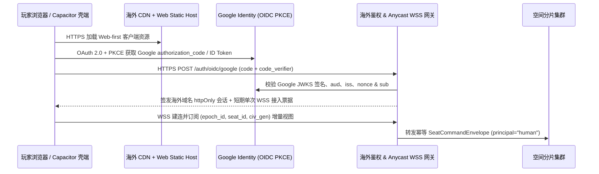

# 《光锥之外》技术架构

设计基线为 **GDD v0.16.0**。本文定义 M1–M4 的模块边界、**10 万光年永续银河万级同服架构**、**海外 Web-First + Google 登录交付链路**、数据流与验收条件。规则与数值查 GDD，席位投影、幂等指令与预留 Agent 扩展总线查配套席位契约；技术选型、内部数据结构与待定口径默认方案属于实施提案。[GDD §9](../../DESIGN.md#implementation-and-acceptance) · [席位契约规格](SEAT-CONTRACT.md)

---

## 1. 总体架构

全服共用**单一永续 100,000 光年扁平旋臂圆盘银河**（$D_{\text{disk}}=100{,}000\ \mathrm{ly}$，有效薄盘厚度 $H_{\text{thin}}\approx 1{,}500\ \mathrm{ly}$，程序化恒星基数 $\sim 1.5\times 10^{11}$，活跃文明席位容量 $M=15{,}000$，可扩展至 $10{,}000\text{–}30{,}000$），采用**全服唯一时间倍率 `1 real min = 1.00 sim yr`（$\kappa_t=525{,}960$，$1\ \mathrm{ly}$ 光行时间 $\equiv 1\ \mathrm{real\ min}$）**，依托**中国大陆境外云区域 + 全球 Anycast CDN 边缘节点 + 海外独立域名**提供低延迟 HTTPS / WSS 服务。

服务端永不执行删档清零，并借助**空间八叉树 + 最大视界剪枝 + 相对论因果前瞻分片（Causal Sector Shards）**支撑万级席位在同一连续宇宙空间内异步降生、全速离线挂机（$m_{\text{offline}}=1.00$ + 5 槽 `build_queue`）与长期演化，严格杜绝跨分片超光速泄露。客户端 HUD（Web-first + Capacitor iOS/Android）、服务端 L1 确定性离线护航、内置生态 AI 以及 M4+ 预留扩展的外部 Agent 副官统一消费同口径 `SeatViewProjection`，所有控制指令均经统一 `SeatCommand` 仲裁入口进入仿真内核。[GDD §3](../../DESIGN.md#space-and-geometry) · [GDD §8](../../DESIGN.md#systems-and-constitution)

| 层 | 推荐技术栈 | 交付与部署方式 |
| --- | --- | --- |
| **Web 游戏客户端（主交付）** | TypeScript、Three.js（WebGL2 / InstancedMesh + Camera-Relative Floating Origin）、原生响应式 HTML/CSS 暗室 HUD、Vite | 单套现代 Web 工程直出 PC 桌面浏览器与移动 Safari / Chrome，零应用商店包体审批周期，随海外 CDN 瞬时灰度更新。 |
| **移动端辅端（iOS / Android）** | Capacitor（复用 Web 工程构建产物 + 系统 Haptics / 安全区 / App-Switch PKCE 插件） | 辅端交付渠道；iOS 端在提供 Google 登录的同时按 App Store Guideline 4.8 预留 `Sign in with Apple` OIDC 对等槽位，与 Web 端账号体系互通。 |
| **海外边缘与鉴权** | Overseas Cloud + Global CDN + Anycast WSS + Google OAuth 2.0 / OIDC | 脱离微信小程序／小游戏与内地 ICP／白名单体系；采用海外域名、TLS 1.3、`httpOnly` 会话 Cookie + WSS 短期票据，无微信运行时依赖。 |
| **万级单图仿真集群** | TypeScript / Node.js Worker Threads 或 Rust / Go 高吞吐分片算核（M1–M2 先用 TS `sim-core` 统一参考语义） | 按三维星图八叉树将万级席位切分至多台扇区计算节点；相邻分片借助物理最大作用视界与 $c$ 有限光速建立**因果前瞻幽灵带（$\Delta t_{\text{lookahead}}=L_{\text{ghost}}/c$）**，保证分片结算与全图单线程参考结果逐比特一致。 |
| **星表与永续银盘存储** | 确定性种子星表生成器 + PostgreSQL（稀疏增量与快照） + Redis（扇区路由与热缓存） | 银河 $\sim 1.5\times 10^{11}$ 级恒星底图不落全库，仅以细胞哈希按需生成；数据库与 WAL 仅持久化文明态、被占/修改/毁伤节点与永久星碑（Sparse Delta Overlay）、在途波前与事件提交水位。 |
| **离线队列、L1 护航与预留 Agent 接口** | 服务端 5 槽 `build_queue` + 3 槽确定性白名单 L1 反射自动机（M1–M4）；M4+ 可插拔 `external_agent` 网关 | **M1–M4 移除所有大模型运行时与 MCP Server**；以统一 `ActorPrincipal` 与 `SeatCommandEnvelope` 保留离线规则防御与未来扩展面。[席位契约 §4](SEAT-CONTRACT.md#4-l1-离线确定性护航与-m4-外部-agent-扩展边界) |

| 代码目录 | 职责 |
| --- | --- |
| `packages/sim-core` | 零 UI / 网络依赖的几何计算、双时钟（$\kappa_t=525{,}960$）、人类拟合生产力与随机过程、预设建造队列、节点/链路、曝光积分、毁伤与事件队列。 |
| `packages/contracts` | 席位视图投影、统一指令信封 `SeatCommand`、`ActorPrincipal` 权限枚举与灭亡简报载荷及运行时校验（Web、Capacitor 与服务端共用）。 |
| `packages/ui-tokens` | 设计令牌（深空暗室色板、字体、比例尺与静谧状态语义，CSS Variables 与 Three.js 材质常数同源）。 |
| `apps/sim-cli`、`scenarios/m1` | 固定种子 CLI、M1 夹具复跑、单机万级空间分片差分校验、§9.2 大过滤器五策略蒙特卡洛回归对照。 |
| `apps/game-server` | 海外 OIDC 鉴权、Anycast WSS 网关、因果扇区分片调度器、稀疏持久化、内置生态 AI、全速离线队列与 L1 护航。 |
| `apps/web-client`、`apps/capacitor-shell` | Web-first 游戏主端（Three.js + Responsive HUD）与 iOS/Android Capacitor 原生薄壳打包工程。 |

---

## 2. 仿真内核与万级单图数据所有权

| 状态域 | 内容、存储位置及更新条件 |
| --- | --- |
| **程序化背景星表** | 由 `(galaxy_seed, octree_cell_id)` 按指数薄盘 + 四主旋臂分布确定性生成的恒星坐标、光谱型与光度权重 $\omega_i$；全客户端与服务端无状态按需计算，只读公开。 |
| **永续银河稀疏世界状态** | **仅存储偏离基准底图的稀疏增量**（Sparse Delta Overlay）：被占据/纳入/毁伤的恒星节点、行星据点数 $N_{\text{worlds}}$、文明包络轨迹段、既建物理引力波星碑（`信标 Lv.4`）、灭绝废墟/死域与在途信号/武器；由物理仲裁与分片计算核持有。 |
| **节点当地状态** | 已部署设备、当地已知链路与有效期、已抵达指令、L1 预授权反射护航规则（含 `b1_warning -> deflect_b1`、`vent_sink` 等）及当地观测采样。仅按该恒星系节点自身因果事件序更新。 |
| **指挥核知识状态** | 已确认受控节点、`links` 有向链路报告、`pending_frontier_requests`、多历元观测/星历证据、可见 SDI 分项、连续演化点流 `evo_points_avail` / $\Pi(t)$ 与预设建造队列 `build_queue`。仅在指挥核当地事件与送达报告后更新。 |
| **席位视图投影** | 由指挥核知识裁剪生成的授权视图（应用世代局部 $SO(3)$ 旋转、隔离目标 ID 与字段白名单）。Web HUD、Capacitor 壳端、内置 AI 及未来外部 Agent 消费同一视图版本。[席位契约 §2](SEAT-CONTRACT.md#2-同口径席位视图投影read-projections) |

### 2.1 唯一时间倍率、全速离线队列与排程

- **物理模拟钟（`*_sim_s`）**负责波前传播、恒星自行、相对论载具轨迹、SDI 脉冲/应变衰减（$\tau_{\text{pulse}}=40\ \mathrm{sim\ yr},\,\tau_{\text{lag}}=15\ \mathrm{sim\ yr}$）、人类拟合生产力随机叠加步进（三模态周期 / OU 漂移 / Poisson 跃迁）与热力学积分。内部几何使用 IEEE-754 双精度光年坐标（在 $50{,}000\ \mathrm{ly}$ 处精度优于 $10^{-11}\ \mathrm{ly}$）。
- **现实操作钟（`*_real_s`）**与物理模拟钟通过**全服唯一锁定倍速 $\kappa_t = 525{,}960$（`1 real min = 1.00 sim yr`，$1\ \mathrm{ly}$ 光行时间 $\equiv 1\ \mathrm{real\ min} = 60\ \mathrm{real\ s}$）**严格换算，负责科技与 `world_up` 施工、冷却、凝视（$\tau_0=2.5\ \mathrm{real\ s}$）、Lv.4 焦点轨重构（`45 real s = 0.75 sim yr`）与热沉窗口。[GDD §3.4](../../DESIGN.md#space-and-geometry) · [GDD §5.2](../../DESIGN.md#traits-and-tech)
- **连续演化点积分与全速离线队列**：服务端在物理时间步按 $v_E(t)=v_{E0}\,\Pi(t)\,P_{\text{pop}}\,I_{\text{sci}}\,m_{\text{offline}}$（其中在线与离线统一取 **$m_{\text{offline}}=1.00$**）对连续点数 `evo_points_avail` 积分，升级按几何阶梯 `1 / 2 / 4 / 8 pts` 扣除；当前施工项完工时，服务端自动从 `build_queue`（上限 5 项）弹出下一项无缝衔接施工。
- **事件队列与因果分片一致**：单个算核或扇区分片严格按 `(due_sim_ms, phase_rank, stable_seq)` 出队，到达时刻向上量化至整数模拟毫秒以杜绝早到，几何求交、剂量与指数曲线仍以 IEEE-754 双精度求值。由于真空中物理信号传播严格满足 $|\mathbf v|\le c$，分片边界设置厚度为 $L_{\text{ghost}}$ 的冗余邻区：分片内部可独立安全向前推进 $\Delta t_{\text{safe}} < L_{\text{ghost}}/c$ 而无需等待远区全局锁，边界外发事件通过有序因果邮箱（Causal Mailbox）按 `t_emit_sim_s` 投递；任何跨分片优化在 M3 须与 M1 全图单核参考实现做**逐事件差分等价测试**。

### 2.2 包络、节点与链路

包络以 $\le 0.25c$ 向目标半径连续演进；候选恒星接入与撤收退网均发生在目标恒星节点当地，在指挥核发出授权与该节点实际执行完毕并返回光速回执之前，指挥端视图仅显示 `pending_frontier_requests` 等待态。链路预算与有向可用路径分开确认，迟到旧采样不覆写较新确认状态。[席位契约 §2](SEAT-CONTRACT.md#关键因果与网络摘要约束)

### 2.3 接触、观测、自毁与天灾毁伤

| 计算链 | 内核与分片处理 |
| --- | --- |
| **空间八叉树 → 拓扑接触** | 八叉树粗筛潜在交叠／视界内实体；双精度精确判定相离、外切、部分交叠、内切与包含。仅当存在实际节点、中继或设施冲突时，接触点按光速向指挥核发报；连续收到有效冲突每满 `10 sim yr`（`10 real min`）累计摩擦，脱离或双向 `[PING]` 回波抵达后清零。 |
| **波前抵达 → 信噪比 → 星历** | 对最大有效视野内抵达节点的光／热／射电／激波／GW 波前结算多普勒 $\mathcal D_r^2\mathcal D_e^4$、消光、局地噪底与凝视积分；基于光滑基线 $G_0(K)$ 与 `观测 Lv.1–4` 计算全向/聚焦增益。无测距证据时 $\mathrm{SNR}\ge 5$ 仅形成二维方位锁；获星表、基线视差或往返回波后解锁三维星历与 `target_node_id`。 |
| **发射星历 → 在途轨迹 → 毁伤与 B1–B4 天灾** | 发射锚定当时已确认星历及其不确定度；抵达时按真实节点、受照注量（如戴森光束散焦 vs 聚焦）及当地冗余裁定。**全席位统一适用 `B1–B4` 天灾毁灭规则**（B1a/B1b 须手动或通过 L1 `b1_warning -> deflect_b1` 偏转，B4 按抵达通量与 `存续 Lv.3+`/冗余裁定），人类席位无隐形免死。 |
| **当地与指挥核自毁指数（SDI）** | 区分结构/凝聚应力 $\Delta_{\text{conc}}$ /脉冲/滞后应变/摩擦分项与夹紧值 `0..100%`；**全席位（人类与 AI 同律）统一结算连续冷战自毁率 $\lambda_{100}(\mathrm{SDI})$（38% 以上陡增）与 $s_{\mathrm{raw}}\ge 100\%$ 临界崩解**（超距态强缩解列；否则消耗 `存续 Lv.3` 护盾或触发 `SDI_System_Collapse` 灭绝并留下星域遗迹）。 |
| **热力学 → 蓄热／排热／过载** | 热沉按模拟秒累积废热总量并严格能量守恒：蓄热 `180 sim yr`（`180 real min`）满载后**须手动或经 L1 规则（`heat_sink_pct >= 98 -> vent_sink`）切换至 `vent_sink` 排热**（$5.0\times$ 稳态排热精确耗时 **`44.73 sim yr`（`44.73 real min`）** 排空），未切换而继续封印将按 `+1.5 百分点/sim yr` 持续累计 `E_fixed` 直至排热或过载自毁。 |

---

## 3. 游戏客户端与海外 Web-First 交付链路

### 3.1 Web 优先、移动壳端共享工程

放弃微信小程序与小游戏生态、`wx.*` API 与重型传统引擎包袱；采用 **`apps/web-client`（TypeScript + Three.js WebGL2 + 响应式 HTML/CSS HUD + Vite）作为第一主端**，移动端发布通过 **`apps/capacitor-shell`（Capacitor 包装同一套 Web 构建产物）作为辅端**。两套交付共享 `packages/sim-core`、`packages/contracts`、`packages/ui-tokens` 及完整触控/键鼠交互逻辑：

| 发布目标 | 优先级与阶段 | 交付形态与主要验收 |
| --- | --- | --- |
| **桌面 & 移动 Web 浏览器** | **P0 · 主端（M2 预览，M3 上线）** | 海外域名前端直出桌面（Chrome / Safari / Edge / Firefox）与移动浏览器（iOS Safari / Android Chrome）；首屏 JS/资源增量分包加载，支持 URL 书签直入席位、响应式横/竖屏双布局。 |
| **iOS / Android App（Capacitor 壳端）** | **P1 · 辅端（M3 联调，M4 上架）** | 复用 Web-first 构建产物 + 原生插件（Web Haptics 映射原生 Taptic Engine、系统安全区适配、Google OAuth App-Switch PKCE 回跳、`Sign in with Apple` OIDC 合规入口）。 |

### 3.2 Google 登录与海外服务器／域名链路

1. **身份与席位隔离**：玩家在 Web 或 Capacitor 壳端发起 **Google OAuth 2.0 / OIDC Authorization Code + PKCE** 登录；海外服务端校验 Google ID Token 签名、绑定唯一 `google_sub` 至内部 `account_id`，维护真人玩家在永续银盘内的当前席位与灭亡重开后的新世代会话主权。若上架 Apple App Store 需兼容多登录规范，增挂同口径 `apple_sub` OIDC 绑定同一 `account_id`。
2. **海外服务器与全链路传输**：生产集群部署于境外主流云区域（例如 Tokyo / Singapore / US-West / Frankfurt 多区域就近边缘接入，核心状态分片互通高速内网），绑定独立海外域名与全球 CDN；全站强制 HTTPS (TLS 1.3 + HSTS) 与 WSS 二进制/JSON 压缩信道。
3. **资源分发与轻量体验**：不再受小游戏 4MB/20MB 首包限制与微信域名白名单制约；首屏仅下发核心渲染脚本与星表着色器（$< 1.5\ \mathrm{MB}$ Brotli），天体纹理与静谧界面资源均由海外 CDN 按需懒加载与持久化 IndexedDB 缓存。

### 3.3 双视角、相机相对浮动原点与静谧仪表

- **天球仪 & 三维星泡图（Camera-Relative Floating Origin）**：WebGL2 借助 `InstancedMesh` 与定制着色器在 100,000 ly 银河背景星表中高效绘制局部视界恒星与动态波前壳层；客户端以当前相机聚焦天体为双精度参考原点（$\Delta\mathbf x = \mathbf x_{\text{world}}-\mathbf x_{\text{cam}}$），从根源上消除 $50{,}000\ \mathrm{ly}$ 处 `float32` 精度劣化，并严格按席位 $SO(3)$ 与因果抵达状态过滤可拾取对象。
- **人类拟合曲率、预设建造队列与静谧遥测**：HUD 采用低打扰暗室风格，展示当前「天时」模拟年、连续点流速 $v_E(t)$、最多 5 项预设建造队列（`build_queue`）与已冲印抵达的深空光信；离线断线重连通过 `last_view_version` 增量补齐或快照重建，零丢失连续点数与队列进度。

### 3.4 离线 L1 护航、规则防御与预留 Agent / 正念面板

M3 席位设置提供「离线护航与建造队列」面板，玩家可配置最多 5 项 `build_queue` 并以纯表单编辑最多 **3 条确定性白名单反射槽位**（如 `b1_warning -> deflect_b1` 自动偏转 B1 天灾、`heat_sink_pct >= 98 -> vent_sink` 及时排热防过载、`sdi >= 80 -> shrink / set_dormancy / migrate_seed`；系统不提供未配规则的免死兜底）；原「外部副官管理」入口在 M1–M4 展示为**预留扩展槽位说明**，同时在客户端预留 M4+ **正念观星与入定交互（呼吸焦距环与热静默降噪态）**扩展点。[席位契约 §4](SEAT-CONTRACT.md#4-l1-离线确定性护航与-m4-外部-agent-扩展边界)

---

## 4. 会话、统一指令总线与 Agent 扩展接口

**读路径**：鉴权服务核验 Google OIDC 会话或内部 Worker 凭据，锁定 `(epoch_id, seat_id, civ_gen)` 映射并由所在扇区分片投影该席位专属视图，严格执行 `SO(3)` 坐标系转换与未披露节点 ID 隔离。

**写路径**：Web HUD、Capacitor 壳端、服务端 L1 护航自动机及内置生态 AI 一律提交统一格式 `SeatCommandEnvelope`，携带 `command_id`（全局幂等键）、`base_view_version` 与 `principal: ActorPrincipal`；同一 `(epoch_id, seat_id, civ_gen, principal.kind, command_id)` 重复投递返回原受理结果，同键异参返回 `409 IDEMPOTENCY_CONFLICT`；M1–M4 期间，网关拦截所有 `principal.kind === "external_agent"` 请求。[席位契约 §3–4](SEAT-CONTRACT.md#3-统一指令信封与领域控制原语)

**扩展性保障（M4+ 重新开放 Agent 辅助）**：`sim-core` 与星区分片 Worker 完全不感知调用方背后是真人玩家鼠标点击、L1 规则引擎还是 LLM Agent——一切逻辑均只识别 `ActorPrincipal.kind` 与 `granted_scopes`。未来随时可在不触动核心仿真、分片协议、PostgreSQL 表结构与 Web 客户端的前提下旁挂独立 `agent-gateway`（支持 MCP / OpenAI Tool / WebSocket SDK）。

---

## 5. 恢复、永续银盘留存与灭亡简报

- **M1 复跑**：固定场景 `manifest + timeline.json` 完整保存随机流状态（含生产力随机过程 `harmonics/OU/jump` 状态）、双时钟及队列游标，确保跨机器 100% 数值一致。
- **M3 万级分片 Checkpoint 与 WAL 恢复**：每个扇区分片通过分布式单写者租约（Lease）按序提交权威事件批次与稀疏增量表，定期写入带全球一致因果水位 `epoch_sim_ms` 的快照；节点宕机时可从最近邻区幽灵缓冲与 PostgreSQL Checkpoint 秒级接管重建。
- **M4 永续银盘物理留存与灭亡简报（全服永不删档）**：
  - 不设全服大坍缩公投、局域系统公约、`monument_ascension` 或全服公共年鉴；
  - 若席位因 `ColdWar_SelfDestruct`、`SDI_System_Collapse`、`B1–B4` 天灾或打击灭亡，所在扇区分片按实际物理规律停止其可控活动、在 Sparse Delta Overlay 中原地仅留存物理废墟／死域（及生前已建成的 `信标 Lv.4` 引力波星碑设施），继续推进灭亡前已发出的在途波前，并生成事实性 `extinction.report` **灭亡简报**（含死因、灭绝时刻及满足 §7.4 条件时作为灭亡后告知机制的死后光锥回响），供玩家直接重开新摇篮；全银河其余席位无中断继续运行。[GDD §8.3](../../DESIGN.md#systems-and-constitution)

---

## 6. 里程碑与验收

| 阶段 | 可交付结果 | 验收条件 |
| --- | --- | --- |
| **M1 仿真内核** | `sim-core` CLI、种子化场景、全图参考核、非线性生产力与建造队列引擎 | 以下 M1 固定场景（统一 `1 real min = 1.00 sim yr`）全部自动化断言通过；§9.2 人类曲线拟合 $R^2_{\log}\ge 0.99$ 与 5,000 局全席位统一大过滤器五策略分叉回归通过。 |
| **M2 Web 双视角** | Web-first 暗室双视角原型（Three.js 浮动原点 + 静谧 HUD + 预设队列）、离线时间线播放 | 桌面浏览器键鼠与移动浏览器触控均可完成 4 光年扩张、视角切换、建造队列编排与超时分支；未知节点与二维锁不可三维拾取；记录首包 `< 1.5 MB` 与 60 FPS 帧耗时基线。 |
| **M3 万级在线服** | 海外 Google OIDC 登录、Anycast WSS 网关、10 万光年因果空间八叉树分片（验证 10,000+ 并发/模拟席位）、全速离线护航、内置生态 AI 与 Sparse Persistence | ① Web 端 Google 登录、离线全速建造队列与断网重连闭环；② 15,000 席位压测中跨分片因果裁定与 M1 全图参考核结果完全一致（差分 `0` 误判）；③ L1 三槽离线护航（B1 偏转、热沉自动排热、高熵收束）、统一自毁/天灾灭绝物理留存、灭亡简报（含 §7.4 死后光锥回响告知）与 `ActorPrincipal` 预留网关阻断测试通过。 |
| **M4 永续稳定 & 移动辅端** | 长期异步银盘稳态验证、灭亡简报与直接重开链路、Capacitor iOS/Android 封装 | 复核真人账户会话隔离、物理遗迹与既建 `信标 Lv.4` 星碑永久留存及在途波前不断链；验证 iOS/Android Capacitor 壳端触感、安全区与登录回跳。 |

### M1 固定场景（统一时间倍率 `κ_t = 525960`，`1 real min = 1.00 sim yr`）

| 场景 | 最小自动化断言 |
| --- | --- |
| **外切与同形透镜** | 外切摩擦为零。共享中继组（距 A 9 ly、距 B 11 ly）在 **9.0／11.0 现实分钟**（`9.0／11.0 sim yr`）出现两端告警，连续冲突满 10 分钟后在 **19.0／21.0 现实分钟**首次累计摩擦。空透镜组无新增告警和摩擦。 |
| **包含与泡内凝视** | 噪底随波前抵达变化。弱信号由凝视检出，无测距证据时保持二维方位锁。 |
| **三角与链式拓扑** | 同一消息（4 ly 直达 vs 8 ly 经中继）在 **4.0／8.0 现实分钟**抵达，基线 4／8 光年。中继失效后链式组保留完好节点归属，确认路径依报告或等待窗口更新。 |
| **跨星接入回执** | 距指挥核 4 ly 候选节点：纯返程光行下，成功与无回执组在第 **4.0 现实分钟**（`240 现实秒`）前指挥端视图一致，成功组在第 **4.0 现实分钟**确认；含 `0.10c` 前锋推进（`2,394 现实秒`）的完整切片于 **`2,634 现实秒`（`43.9 现实分钟`）**确认。另测过期链路与晚到旧采样。 |
| **点打击与单星冗余** | 点打击只移除命中节点。基准本底且无存续升级的单星在半径 0.01–0.08 光年间保持冗余 1.00。 |
| **剂量、热守恒与过载自毁** | 热沉满蓄 `180 现实分钟`（`180 sim yr`）后若未切入 `vent_sink` 排热，绝热过载按 `+1.5 百分点/sim yr` 持续推高 `E_fixed` 直至触发过载自毁；切换 `vent_sink` 后精确耗时 **44.73 现实分钟**（`44.73 sim yr`）排空且不自毁。戴森光束在 1 AU 散焦时无节点毁伤，聚焦达阈时判毁。B4 随注量与喷流方向分别结算，主序星不可诱导超新星。 |
| **唯一时钟、离线队列与灭绝物理留存** | 全服唯一倍速下 **45 现实秒等于 0.75 模拟年**。离线席位保持 `m_offline = 1.00` 全速发育并自动流转 `build_queue` 预设队列。灭绝夹具验证原址仅留物理废墟/遗迹（及既建 `信标 Lv.4`）、呈递灭亡简报（满足 §7.4 时附死后光锥回响告知）、在途波前继续传播且全服其余席位无中断演进。 |

配对隔离测试仅改变未被该席位观测的世界真值，比较信息合法抵达前的 Web HUD 视图、指令错误和事件推送。性能压测在 100,000 光年单图万级设置下覆盖 `15,000` 席位全星图基准，校验八叉树剪枝与因果前瞻分片零语义漂移。[GDD §9.1–9.2](../../DESIGN.md#implementation-and-acceptance)

---

## 7. 待定口径

| 需定稿项 | 实施影响 |
| --- | --- |
| 前沿部署时长、链路预算、报告有效期与重试间隔 | M1 用显式夹具配置覆盖直达、中继、断联与迟到。全服默认参数待 M3 压测后锁定。 |
| 星历误差门限、动能 `D_ref` 到 `D_strike` 的映射、戴森临界剂量 | 决定三维披露与毁伤边界。M1 参数化各门限，固定场景验证前后两侧。 |
| 因果前瞻幽灵带宽度 $L_{\text{ghost}}$ 与扇区再平衡周期 | 影响万级单图多核扩展上限；以“跨片大速度包络不突破前瞻窗口”为硬约束，支持负载热迁。 |
| 连续随机叠加参数与客户端平滑动效插值策略 | 确保连续点流速 $v_E(t)$ 在高频 WSS 推送中兼顾数值精确（后端双精度随机步进）与前端平滑显示。 |
| L1 白名单结构化条件枚举范围 | 在冻结 `packages/contracts` 前锁定 `ReflexCondition` 允许观察的弱信号／边界接触字段，供 M3 护航与未来 M4+ Agent 共用。 |
| iOS App Store 上架合规细节 | M4 Capacitor iOS 打包发布时同步提供 Google OIDC 与 `Sign in with Apple` 对等入口及海外隐私声明。 |
