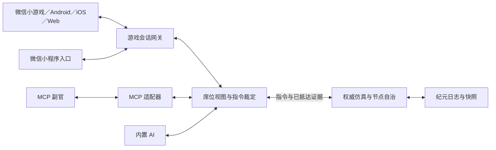

# 《光锥之外》技术架构

设计基线为 GDD v0.13.0。本文定义 M1–M4 的模块边界、数据流与验收条件。规则与数值查 GDD，MCP 对外字段查配套接口规格。技术选型、内部数据结构及待定规则的默认处理属于实施提案。[GDD §9](../../DESIGN.md#implementation-and-acceptance) · [MCP 接口规格](MCP.md)

## 1. 总体架构

服务端按纪元运行权威仿真。每个恒星系在当地结算接入、退网、观测、转发和毁伤。指挥核根据已抵达的证据维护席位视图。HUD、内置 AI 和 MCP 副官读取同口径的席位视图，指令经统一裁定入口进入仿真。L1 自治在执行节点读取当地已知信息，沿用相同的领域规则。[GDD §3](../../DESIGN.md#space-and-geometry) · [GDD §8](../../DESIGN.md#systems-and-constitution)

| 层 | 建议选型 | 交付方式 |
| --- | --- | --- |
| 游戏客户端 | Cocos Creator 3.8 系列、TypeScript | 一套工程承载天球仪、三维星泡图和 HUD，首发微信小游戏，后续导出 Android、iOS 和 Web。引擎补丁版本随 M2 真机验证锁定。 [多平台发布](https://docs.cocos.com/creator/3.8/manual/zh/editor/publish/) |
| 微信小程序入口 | 微信原生小程序、TypeScript | 独立构建账号与席位入口，主玩法在小游戏运行。小游戏跳转与账号衔接以对应 AppID 的配置和真机验证为准。 |
| 仿真与游戏服务 | TypeScript、Node.js | M1 用无界面的 CLI 和测试场景驱动内核。M2 由本地开发服务提供席位视图。M3 接入正式会话、HTTPS 指令和 WSS 更新。 |
| 纪元持久化 | M1 本地快照和日志文件，M3 PostgreSQL | 同一纪元由一个执行者按序写入。存储事务提交后确认受理并发布席位变更。 |
| MCP | 独立传输适配器，JSON-RPC 2.0、Streamable HTTP | 复用游戏会话的业务服务与权限裁定。接入层协商 MCP 协议版本，项目业务字段按 MCP 接口规格版本化。 [MCP 传输规范](https://modelcontextprotocol.io/specification/2025-11-25/basic/transports) |

建议工程目录在对应里程碑启用。

| 目录 | 职责 |
| --- | --- |
| `packages/sim-core` | 无 UI 和网络依赖的几何、双时钟、节点、观测、毁伤及事件队列。 |
| `packages/contracts` | 可发给客户端的视图、指令、错误和版本定义，含运行时输入校验。以独立 TypeScript 包供 Cocos、小程序和服务端构建引用，保持平台无关。 |
| `apps/sim-cli`、`scenarios/m1` | 固定种子、场景夹具、快照复跑、平衡实验和验收报告。 |
| `apps/game-server` | 纪元执行者、席位视图、会话、持久化、AI 及 MCP 入口。 |
| `apps/game-client`、`apps/wechat-miniprogram` | Cocos 跨平台游戏工程与独立微信小程序入口，共用公开契约。 |

## 2. 仿真内核与数据所有权

| 状态 | 内容及更新条件 |
| --- | --- |
| 纪元世界 | 权威星表、恒星自行、独占控制权、完好状态、文明包络轨迹、在途信号与武器。物理裁定可读世界真值。 |
| 节点当地 | 已部署设备、当地已知链路和状态、有效指令、预授权计划、到达的观测样本。按节点自己的事件顺序更新。 |
| 指挥核知识 | 已确认节点、带有效期的有向链路、待回执请求、观测与星历、可见 SDI 分项。由指挥核当地事件及已收到的报告更新。 |
| 席位视图 | 从指挥核知识生成的授权字段、席位坐标、作用域标识和独立版本号。游戏客户端、内置 AI 和 MCP 消费同口径的数据。 |

### 2.1 双时钟与排程

- **模拟钟**负责传播、恒星自行、载具轨迹与物理能量积分。内部几何用双精度光年坐标，单位换算集中处理。光速及儒略年常数遵循 GDD。对外物理时间用距纪元起点的 `*_sim_s`。
- **操作钟**负责施工、任期、发点、冷却、凝视、热沉窗口和公投阶段。以 `*_real_s` 对外表示，通过纪元锁定的 `κ_t` 投影为模拟队列截止时刻。闪电服只按规则压缩工期。M1 由场景驱动虚拟操作钟，联机服由服务端推进。[GDD §3.4](../../DESIGN.md#space-and-geometry) · [GDD §5.2](../../DESIGN.md#traits-and-tech)
- **事件队列**按 `(到期模拟时间, 同刻处理阶段, 稳定序号)` 取出最小项。M1 建议用整数模拟毫秒作队列键，将计算出的到达时刻向上量化，防止提前抵达。到达方程、几何求交、剂量与阈值仍用双精度计算。各类同刻冲突由场景锁定顺序，例如多方接入同一节点且同刻满足条件时按稳定文明 ID 裁定。
- **传播**冻结发射时刻、位置和发射参数，按发射点与移动接收端的世界线求到达时刻。中继在当地收信并完成处理后另起一跳。调度时检查候选，结算时按实际接收端状态判定。已发出的波前在源节点失效后仍沿原轨迹传播。
- **可复现性**固定种子、规则版本、输入顺序和引擎版本。星表、文明本底、灾变及 AI 决策使用独立随机流。时间推进采用下一事件与分段积分，M1 夹具控制世界线、持续发射区间和积分误差容限。

### 2.2 包络、节点与链路

半径指令在指挥核形成 `目标半径 → 实际包络前沿 → 当地接入／退网 → 指挥核回执`。接入需要包络覆盖、必要指令已抵达、当地节点可用且满足部署条件。前沿和当地条件分别调度。单节点毁伤修改该节点及受影响的当地链路。完好但失联的节点保留归属与已有当地能力，按预先授权计划运行。摇篮损毁时由有效备份计划接管，指挥端获知后再更新半径下限。[GDD §3.2](../../DESIGN.md#space-and-geometry)

链路预算和路径选择按方向结算。每条报告保留采样时刻、抵达时刻和有效期。晚到旧采样保留历史记录，当前状态按更新的采样维护。指挥核分别计算已确认完好受控节点数、基于有效有向链路的出站可达数、各节点回传路径。待回执超时只改变指挥端的等待状态，接入、退网、损毁仍以送达的证据更新。多站样本在同一端汇聚后才参与联合解算。[MCP 指挥核网络视图](MCP.md#指挥核的网络视图)

### 2.3 接触、观测与毁伤

| 计算链 | 内核处理 |
| --- | --- |
| 球体拓扑 → 接触报告 | 双精度几何给出相离、外切、部分交叠、内切、包含，先处理同心重合。存在实际节点、中继或探测网接触时，由接触点发报。空透镜和包含本身无争夺摩擦。各指挥核独立记录已抵达的冲突报告，每满连续 10 现实分钟按有效报告累计摩擦，收到脱离或双向共鸣报告后清零。 |
| 波前抵达 → 信噪比 → 星历 | 对已抵达信号计算多普勒、光行差、消光、接收噪底和凝视积分。全天球视场用巡天增益。`SNR < 1` 无可见检出，`1 ≤ SNR < 5` 披露粗方向与强度，`SNR ≥ 5` 可形成二维方位锁。具备星表匹配、视差或往返回波的测距证据及所需自行解算后，才生成三维星历、误差与作用域目标引用。 |
| 发射星历 → 在途轨迹 → 节点毁伤 | 发射使用当时获知的星历及误差。抵达时按实际目标节点、捕获范围、受照注量和当地冗余裁定。动能命中、戴森光束、狂战感染与 B4 灾变分别实现。B4 辐射壳按喷流与距离计算，每节点每事件结算一次。 |
| 当地事件／已抵达报告 → SDI | 保存原始值、展示夹紧值及结构、脉冲、固定事件、摩擦分项。破百触发采用 GDD 的重新武装条件，护盾消耗和撤收计划各自记账。节点灾变使用当地已确认冗余，指挥核摘要用自己的确认集合。同一损毁报告只计一次。 |
| 热功率 → 蓄热／辐射 | 热沉保存能量，按模拟物理秒积分，按操作钟执行蓄热上限与满蓄惩罚。满蓄排热夹具以恒定基准功率得出 44.73 现实分钟。各发射节点的热辐射经传播后影响接收端噪底。 |

[GDD §4](../../DESIGN.md#sphere-topology) · [GDD §6](../../DESIGN.md#sdi-and-cataclysms) · [GDD §7](../../DESIGN.md#observation-and-combat)

## 3. 游戏客户端与微信接入

### 3.1 跨平台工程

`apps/game-client` 共享 Cocos 场景、星图渲染、HUD、席位状态和交互逻辑。平台适配集中在登录、HTTPS/WSS、资源缓存、前后台事件、触摸／键鼠输入、安全区和构建配置。游戏模块通过适配器调用平台能力，微信 `wx.*` 调用集中在微信端。Android、iOS 和 Web 复用协议与场景，分别提供登录、输入和生命周期实现。[Cocos 多平台发布](https://docs.cocos.com/creator/3.8/manual/zh/editor/publish/)

交互以手机触控为基线。紧凑布局优先保留星图、状态和主操作，详情按需从底部展开。宽屏可将同一详情面板停靠在侧栏。布局随可用视口和安全区调整，输入按实际可用的触摸、鼠标和键盘处理。各端将输入映射为同一组选择、旋转、缩放、切换视角和提交指令的操作，共用席位状态、可见性规则与指令入口。[M2 交互规格](M1-M2-FRONTIER.md#32-移动端优先与-pc-操作)

| 发布目标 | 实施顺序 | 主要验收 |
| --- | --- | --- |
| 微信小游戏 | M2 先验证真机双视角，M3 接正式会话 | Cocos 构建产物可导入微信开发者工具。iOS、Android 微信真机验证登录、两视角切换、首次资源加载和前后台重连。 |
| 微信小程序 | M3 接入微信入口 | 单独配置 AppID 与登录，验证入口到小游戏的启动和席位衔接。小程序和小游戏共享内部账号、授权 API 与契约。 |
| Web | M2 验收 PC 兼容，后续独立发布 | 同一场景在 PC 浏览器用键鼠完成触控版的主流程。后续接入 Web 登录和同一会话协议。 |
| Android、iOS | 后续分别打包发布 | 用同一 Cocos 工程构建，在各自原生目标验证输入、安全区、挂起恢复和游戏会话。 |

### 3.2 微信登录与发布链路

1. 小游戏端通过 `wx.login` 取得微信临时登录凭证，通过 HTTPS 发给业务服务端。服务端用对应应用的配置向微信换取平台身份，映射为内部 `account_id` 并签发业务会话。`AppSecret` 与微信 `session_key` 留在服务端。账号、纪元席位和 MCP 委托令牌分别管理。若小程序与小游戏使用不同 AppID，各自的 `openid` 带应用作用域，经服务端已验证的关联流程映射至同一账号。
2. 业务接口与资源使用 HTTPS，席位更新使用 WSS。客户端用业务会话换取短期单次连接票据，在连接鉴权完成后订阅席位。微信开发配置区分测试与生产 AppID、接口域名、Socket 域名和资源下载域名。M3 在启用域名及证书校验的微信真机上验证登录、连接和资源加载。[腾讯云小游戏网络说明](https://intl.cloud.tencent.com/zh/document/product/1219/68066)
3. 构建链为 `Cocos 构建 → 微信开发者工具预览 → 微信真机体验 → 平台审核发布`。首屏资源随首包，星图资源按场景以 Asset Bundle 分包或从配置的远端下载，资源清单带版本。包体、分包与缓存额度在选定基础库和提审时核对。画面以微信真机可用的渲染能力为基线，首版验证星点批绘制、球面透明效果与相机交互。[Cocos 微信小游戏发布](https://docs.cocos.com/creator/3.8/manual/zh/editor/publish/publish-wechatgame.html) · [小游戏分包](https://docs.cocos.com/creator/3.8/manual/zh/editor/publish/subpackage.html)

### 3.3 双视角与重连

- **天球仪**以指挥核接收方向为基准，用方向锥或角直径呈现可见信号与误差。**三维星泡图**绘制合法取得坐标的节点和星历，显示已知链路、报告时间、待确认与路径过期。文明包络和实际发射节点的波前分别绘制。客户端将目标半径、当前半径和已确认节点数量分别显示。[GDD §4.2](../../DESIGN.md#sphere-topology)
- 装饰星点用独立种子和批量缓冲绘制。公开导航星表单独提供，只有服务端披露的导航引用可提交迁徙。二维方位锁只参与角度呈现与选取。实时端的渲染、拾取、调试数据和本地缓存均使用席位作用域数据。
- 首次进入读取席位快照，此后按席位版本接收增量。切后台、网络切换或 WSS 断连后恢复会话，从最后确认版本续传，版本缺口超出保留窗口时重取快照。客户端可插值已知轨迹和倒计时，服务端更新到达后校准。指令超时以原请求 ID 重试，界面等待当地执行结果和后续回执。

### 3.4 MCP 副官管理

M3 在席位设置中加入「MCP 副官」。手机可在底部面板查看当前授权、权限和最近活动，并修改权限或撤销。PC 授权页提供键鼠可操作的同一组管理动作，后续 PC 游戏界面复用。授权页显示正在授权的纪元、席位、外部客户端与能力范围。管理面板以服务端记录显示未授权、待授权、已授权、已撤销或已过期。最近指令分别显示受理、拒绝及已收到回执的结果，最近活动时间独立于授权状态。

外部 L2 副官直接连接游戏服务端的 MCP 入口，由外部客户端负责运行。玩家切后台、退出微信或关闭 PC 游戏界面后，有效授权仍可供副官使用。L1 是服务端根据当地证据执行的白名单规则，玩家在席位设置中单独管理。[GDD §8.2](../../DESIGN.md#systems-and-constitution) · [MCP 副官授权](MCP.md#4-外部副官授权与-m3-联调)

## 4. 会话、指令与 MCP

**读路径。** 依据已认证账号或委托令牌选定纪元、席位和能力范围。将出生球心为原点的世代局部 `SO(3)` 坐标应用于合法方向和位置。节点、导航和目标引用按各自用途签发，目标引用按纪元、席位和文明世代隔离。二维、三维、接触告警各自使用字段白名单。边界告警只带类别、粗方向和抵达时刻。席位订阅的快照、增量、版本和通知只随该席位可见状态变更。[MCP §1](MCP.md#1-文明席位坐标系与双时钟口径)

**写路径。** HTTPS 与 MCP 统一解码到领域指令。入口校验 `epoch_id`、`client_request_id`、主体能力、枚举、数值范围及作用域引用。服务端将 `(纪元, 席位, 主体, client_request_id)` 和规范化参数摘要作为幂等依据。相同请求返回原受理结果，同键异参返回冲突。JSON-RPC `id` 用于传输关联。受理只承诺请求已经记录与排程，实际效果在当地时点结算。未知目标与越权目标使用同一错误口径。副官的科技分配与攻击分别校验对应能力标志。[MCP §2–3](MCP.md#2-局内控制工具)

**自动化与订阅。** L1 以最多三个结构化槽位匹配当地已抵达告警或合法遥测，通过白名单动作进入当地指令裁定。内置 AI 使用相同领域指令与席位视图。外部 MCP 副官通过资源读取、工具调用和资源更新通知工作，客户端收到通知后重新读取授权资源。连接、读取、写入和通知发送均校验授权，撤销后停止发送。Streamable HTTP 入口验证 `Origin` 并执行会话鉴权。可选本地 CLI 桥接复用远程授权与投影。[MCP 传输](https://modelcontextprotocol.io/specification/2025-11-25/basic/transports) · [MCP 资源订阅](https://modelcontextprotocol.io/specification/2025-11-25/server/resources#subscriptions)

## 5. 恢复、归档与宪政结算

- **M1 复跑。** 场景清单携带规则版本、种子、初始世界、双时钟配置、按序输入和断言。快照记录当前双时钟、世界及各端知识、待处理队列、在途轨迹、随机流状态和下一个稳定序号。使用同一引擎与规则版本从快照续跑，比较结算与席位视图。
- **M3 恢复。** 每个纪元使用一个有写入权的执行者，提交有序输入、处理水位、幂等结果和必要的业务事件，定期保存带序号的权威快照。恢复从最近已提交快照读入，再复跑快照之后的输入与时钟推进至提交水位，核对事件与视图结果。应用侧按事件与目标去重结算。席位可见增量在对应提交后发布，重连可从快照恢复。
- **M4 结算。** 宪政服务在首倡时冻结合格真人选民集，以现实操作钟推进阶段并验证阈值。终投消费一次性匿名票据，参与率与票据验重记录隔离。公投通过后登记 `t_close_sim_s` 和下一纪元配置，入口停止受理新敌对打击。局内停火令按节点的抵达时刻执行，在途武器与波前继续演化。关局将未到达轨迹及队列随旧纪元快照归档，归档提交后开放全知回放，下一纪元继承 GDD 指定的引力波星碑。[GDD §8.3](../../DESIGN.md#systems-and-constitution)

## 6. 里程碑与验收

| 阶段 | 可交付结果 | 验收条件 |
| --- | --- | --- |
| M1 仿真 | CLI、种子化场景、逐接收者参考实现、快照复跑 | 下表固定场景可逐一复跑。同一输入在保存前后得到相同离散结算与席位视图，数值按夹具容差比较。按 GDD §9.2 跑 1,000 局高／中／低密度对照并输出指标。 |
| M2 双视角 | 微信小游戏真机原型、兼容键鼠的 PC Web 预览、同一席位接口 | 手机触控和 PC 键鼠均可完成接入与回执演示。两端按同一证据时刻更新席位状态，隐藏节点和二维锁在三维场景不可拾取。记录首包、首次加载、内存和帧率基线。 |
| M3 在线服务 | 微信登录与入口、游戏会话与重连、持久化、内置 AI、L1、MCP 与副官授权管理 | 在手机端授权和撤销，使用外部 MCP 客户端和同席位 HUD 验证 4 光年回执。断网／重启恢复、写入重试、能力撤销、单向链路、旧报告迟到与回执重放通过。空间索引或候选剪枝与 M1 逐接收者结果一致。 |
| M4 实验服 | 五阶段宪政、冻结存档、全知回放和纪元切换 | 复核选民快照、阈值、匿名票据、局部停火、在途结算、未抵达轨迹归档与星碑继承。 |

首个开发切片以中密度 4 光年接入为目标。CLI 驱动半径指令、前沿当地裁定、回执传播和席位视图更新，导出指挥端从待确认到已确认的时间线。M2 用这条时间线验收两视角的节点状态和时间显示。[M1–M2 开发规格](M1-M2-FRONTIER.md)

### M1 固定场景

| 场景 | 最小自动化断言 |
| --- | --- |
| 外切与同形透镜 | 外切摩擦为零。共享中继组在 13.5／16.5 现实分钟出现两端告警，在 23.5／26.5 分钟首次累计摩擦。空透镜组无新增告警和摩擦。 |
| 包含与泡内凝视 | 噪底随波前抵达变化。弱信号由凝视检出，无测距证据时保持二维方位锁。 |
| 三角与链式拓扑 | 同一消息 6／12 现实分钟抵达，基线 4／8 光年。中继失效后链式组保留完好节点归属，确认路径依报告或等待窗口更新。 |
| 跨星接入回执 | 当地接入成功与无回执组在第 6 分钟前指挥端视图一致，成功组在第 6 分钟确认。另测过期链路与晚到旧采样。 |
| 点打击与单星冗余 | 点打击只移除命中节点。基准本底且无存续升级的单星在半径 0.01–0.08 光年间保持冗余 1.00。 |
| 剂量与热守恒 | 热沉满蓄排空 44.73 现实分钟。戴森光束在 1 AU 散焦时无节点毁伤，聚焦达阈时判毁。B4 随注量与喷流方向分别结算，主序星不可诱导超新星。 |
| 双时钟与冻结 | 中密度下 45 现实秒等于 0.5 模拟年。4 小时闪电服施工加速 6 倍。冻结夹具覆盖新打击入口关闭、冻结前抵达正常结算、冻结后在途轨迹可回放。 |

配对隔离测试仅改变未被该席位观测的世界真值，比较信息合法抵达前的 HUD 与 MCP 字段、指令错误和订阅通知。性能测试按高／中／低密度覆盖 2,400／24,000／240,000 颗目录恒星，记录到达候选数、事件吞吐、峰值队列、内存与单纪元追赶时间。M3 用参考结果做差分校验后启用剪枝。[GDD §9.1–9.2](../../DESIGN.md#implementation-and-acceptance)

## 7. 待定口径

| 需定稿项 | 实施影响 |
| --- | --- |
| 前沿部署时长、链路预算、报告有效期与重试间隔 | M1 用显式夹具配置覆盖直达、中继、断联与迟到。默认服参数待校准。 |
| 星历误差门限、动能 `D_ref` 到 `D_strike` 的映射、戴森临界剂量 | 决定三维披露与毁伤边界。M1 参数化各门限，固定场景验证前后两侧。 |
| SDI 解列和火种迁徙时的包络速率 | GDD 的紧急半径与常规收放速率需明确衔接。当地归属仍按节点裁定及回执推进。 |
| 同刻事件与 `t_close_sim_s` 的边界 | 建议冻结区间采用 `t < t_close` 的半开口径，恰在冻结时到期的事件保留为待处理。冻结前其他同刻优先级用边界夹具锁定。 |
| M3 停服、追赶与兼容策略 | 决定服务中断时操作钟是否继续、重连增量窗口、旧版视图兼容和归档保留期限。 |
| L1 白名单与弱检出字段 | GDD 的 L1 示例与 MCP 列举存在范围差异。弱异常粗方向锥、强度字段和观测证据失效规则需在 MCP schema 冻结前明确。 |
| 微信发布配置 | M2 锁定 Cocos 补丁版、微信基础库和真机性能预算。M3 核对两个 AppID 的账号关联、可用跳转路径、域名和审核配置。 |
